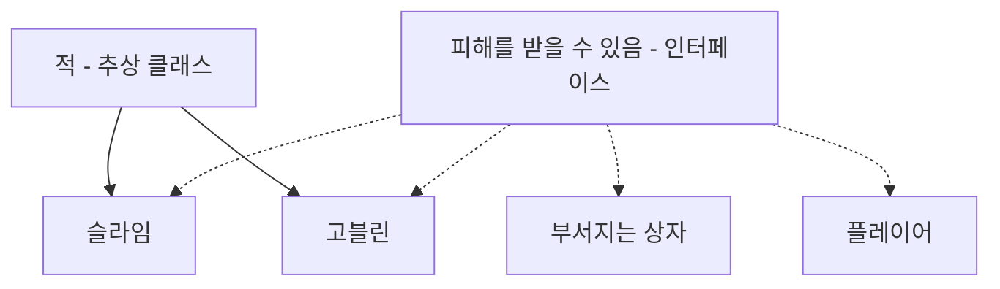

# 추상 클래스 vs 인터페이스 (Abstract Class vs Interface)

## 핵심 개념

- 둘 다 **직접 인스턴스를 만들 수 없고**, 구체 클래스가 내용을 채워야 하는 "설계도" 역할을 함
- 차이는 **무엇을 공유하는가**임
  - **추상 클래스**: "같은 **계열**이다" (is-a). 상태와 공통 구현을 함께 물려줌
  - **인터페이스**: "이 **능력**이 있다" (can-do). 약속만 정하고 구현은 각자 함

- 슬라임과 고블린은 **적 계열**이라 체력, 이동 같은 공통 코드를 추상 클래스에서 물려받음
- 상자와 플레이어는 적이 아니지만 **피해를 받는 능력**은 같으므로 인터페이스로 묶음

## 문법 차이

| 구분 | 추상 클래스 | 인터페이스 |
| --- | --- | --- |
| 상속·구현 개수 | **하나만** 상속 가능 | **여러 개** 구현 가능 |
| 필드 (상태) | 가질 수 있음 | 가질 수 없음 |
| 생성자 | 가질 수 있음 | 가질 수 없음 |
| 구현이 있는 메서드 | 자유롭게 가능 | C# 8부터 기본 구현 가능 (제약 있음) |
| 접근 제한자 | `protected`, `private` 등 자유 | 구현 멤버는 `public` |
| 구조체 | 상속 불가 | 구현 가능 |
| 반드시 구현할 멤버 | `abstract`로 표시한 것만 | 기본 구현이 없는 것 전부 |

## 설계 관점의 차이

| 구분 | 추상 클래스 | 인터페이스 |
| --- | --- | --- |
| 관계 | 같은 계열 (부모와 자식) | 서로 다른 계열에 같은 능력 |
| 공유하는 것 | 데이터 + 공통 동작 + 약속 | 약속만 |
| 결합도 | 높음. 부모가 바뀌면 자식이 영향받음 | 낮음 |
| 확장 | 공통 메서드를 추가해도 자식이 안 깨짐 | 멤버를 추가하면 구현한 쪽이 전부 깨짐 (기본 구현으로 완화) |
| 대표 문제 | 계층이 깊어지면 수정이 어려움 | 같은 구현이 여러 곳에 중복될 수 있음 |

## 고르는 기준

| 상황 | 선택 |
| --- | --- |
| 공통 데이터와 동작을 여러 자식이 공유함 | 추상 클래스 |
| 서로 관계없는 타입에 같은 기능을 붙이고 싶음 | 인터페이스 |
| 한 타입에 여러 역할을 붙여야 함 | 인터페이스 |
| 구조체도 포함해야 함 | 인터페이스 |
| 쓰는 쪽이 구체 타입을 몰라도 되게 하고 싶음 | 인터페이스 |
| 처리 순서는 고정하고 일부 단계만 바꾸고 싶음 | 추상 클래스 (템플릿 메서드) |

**함께 쓰는 경우가 많음**

- 인터페이스로 약속을 정하고, 공통 구현이 필요한 계열은 그 인터페이스를 구현한 **추상 클래스**를 하나 둠
- 쓰는 쪽은 인터페이스만 알고, 구현하는 쪽은 추상 클래스를 상속해 중복을 줄임
- 약속(인터페이스)과 코드 재사용(추상 클래스)을 분리하는 방식임

## 게임 개발 관점에서

**MonoBehaviour가 상속 한 자리를 차지함**

- 유니티 컴포넌트는 MonoBehaviour를 상속해야 하므로, 추상 클래스를 쓰려면 그 추상 클래스가 MonoBehaviour를 상속해야 함
- 상속은 한 번뿐이라 계열은 추상 클래스로, **추가 능력은 인터페이스로** 붙이는 구조가 자연스러움

**컴포넌트 조회**

- 둘 다 GetComponent로 찾을 수 있음
- 공격 판정처럼 대상의 계열과 상관없이 처리해야 할 때는 인터페이스로 찾는 것이 확장에 강함. [[GetComponent]] 참고

**인스펙터 노출 차이**

| 필드 타입 | 인스펙터 |
| --- | --- |
| MonoBehaviour를 상속한 추상 클래스 | 그 계열의 컴포넌트를 끌어다 놓을 수 있음 |
| 인터페이스 | 기본적으로 나타나지 않음 |
| 일반 클래스의 추상·인터페이스 필드 | 참조 직렬화 어트리뷰트를 쓰면 저장 가능 |

- [[Serialization]] 참고

**ScriptableObject와 조합**

- 추상 ScriptableObject를 만들고 상속해 에셋으로 만들면, 전략이나 아이템 효과를 인스펙터에서 교체할 수 있음. [[Strategy Pattern]], [[Scriptable Object]] 참고

## 의문점 / 더 알아볼 것

- 인터페이스 기본 구현이 생긴 뒤 추상 클래스와의 경계가 어떻게 바뀌었는가
- 템플릿 메서드 패턴의 구조
- 상속보다 조합(Composition over Inheritance)의 구체적인 사례
- 관련 노트 — [[Abstract Class]], [[Interface]], [[Inheritance]], [[Polymorphism]], [[Interface Segregation Principle]]