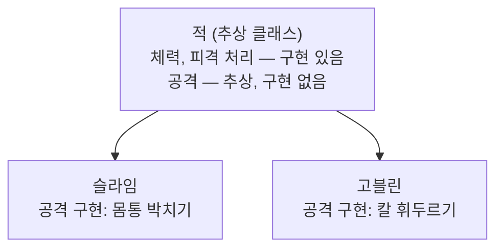

# 추상 클래스 (Abstract Class)

## 핵심 개념

- **추상 클래스**: **직접 객체로 만들 수 없고, 상속받아서만 쓰는** 미완성 클래스
- 공통 구현은 직접 가지고, 자식마다 달라야 할 부분은 **구현 없이 이름만** 정해 둠
- 자식은 비어 있는 부분을 반드시 채워야 함
- "적"처럼 개념으로만 존재하고 실제로는 "슬라임", "고블린" 같은 구체적인 형태로만 존재하는 것을 표현함

## 가질 수 있는 것

| 구성 요소               | 가능 여부                       |
| ----------------------- | ------------------------------- |
| 추상 멤버 (구현 없음)   | 가능. 자식이 반드시 구현        |
| 일반 메서드 (구현 있음) | 가능                            |
| `virtual` 메서드        | 가능. 자식이 선택적으로 재정의  |
| 필드 (상태)             | 가능                            |
| 생성자                  | 가능. 자식이 만들어질 때 호출됨 |
| 정적 멤버               | 가능                            |

## 규칙

| 규칙                     | 내용                                                                     |
| ------------------------ | ------------------------------------------------------------------------ |
| 생성 불가                | `new`로 직접 만들 수 없음                                                |
| 추상 멤버의 위치         | 추상 멤버는 추상 클래스 안에만 둘 수 있음                                |
| 자식의 의무              | 모든 추상 멤버를 `override`로 구현하거나, 자식도 추상 클래스가 되어야 함 |
| 추상 멤버는 private 불가 | 자식이 볼 수 없으면 구현할 수 없음                                       |
| `sealed`와 함께 불가     | 상속 전용인데 상속을 막으면 모순임                                       |

- 추상 멤버는 자동으로 재정의 가능한 멤버로 취급됨. `virtual`을 따로 붙이지 않음. [[Virtual]], [[Override]] 참고
- 생성자는 자식만 부를 수 있으므로 `protected`로 두는 것이 의도가 분명함

## virtual과 abstract

| 구분          | `virtual`                    | `abstract`                   |
| ------------- | ---------------------------- | ---------------------------- |
| 부모의 구현   | 있음 (기본 동작)             | 없음                         |
| 자식의 재정의 | **선택**                     | **필수**                     |
| 쓰는 경우     | 대부분 같지만 일부만 다를 때 | 자식마다 반드시 달라야 할 때 |

## 추상 클래스와 인터페이스

| 구분        | 추상 클래스           | 인터페이스                       |
| ----------- | --------------------- | -------------------------------- |
| 상속 개수   | **하나만**            | **여러 개** 구현 가능            |
| 필드 (상태) | 가질 수 있음          | 가질 수 없음                     |
| 생성자      | 가질 수 있음          | 없음                             |
| 구현 제공   | 자유롭게              | 제한적 (기본 구현만)             |
| 접근 제한자 | 자유롭게              | 기본적으로 공개                  |
| 관계의 의미 | "**무엇이다**" (is-a) | "**무엇을 할 수 있다**" (can-do) |

**고르는 기준**

- **같은 계열**이고 **상태와 구현을 공유**해야 한다면 추상 클래스
- **서로 다른 계열**에 **같은 능력**을 붙이려면 인터페이스
- 둘을 함께 쓰는 경우도 많음. 능력은 인터페이스로 정의하고, 그 인터페이스의 기본 구현을 추상 클래스로 제공하는 식임
- [[Interface]], [[Interface Segregation Principle]] 참고

## 템플릿 메서드 패턴

- 추상 클래스의 대표적인 쓰임새
- 부모가 **전체 흐름(순서)을 정하고**, 흐름 안의 **일부 단계만** 추상 메서드로 비워 둠
- 자식은 그 단계만 채우면 되고, 순서는 부모가 보장함
- 예: "공격 준비 → 공격 실행 → 후딜레이" 흐름은 부모가 정하고, "공격 실행"만 적마다 다르게 구현함

## 주의할 점

**상속은 하나뿐이라 신중히**

- C#은 클래스를 하나만 상속할 수 있으므로, 추상 클래스를 부모로 쓰면 그 자리를 차지함
- 계층이 깊어지면 수정이 어려워지고, 공통 부모에 모든 자식에게 맞지 않는 기능이 쌓이기 쉬움. [[Liskov Substitution Principle]] 참고

**생성자에서 추상 메서드를 부르면 안 됨**

- 부모 생성자가 실행될 때 자식의 필드는 아직 초기화되지 않았음
- 그 상태에서 자식이 구현한 추상 메서드가 불리면 초기화 안 된 값을 쓰게 됨

## 게임 개발 관점에서

**추상 MonoBehaviour는 직접 붙일 수 없음**

- 추상 클래스로 만든 컴포넌트는 오브젝트에 직접 추가할 수 없음. 컴포넌트 추가 목록에도 나타나지 않음
- 이를 이용해 "공통 부모는 직접 쓰지 말고 자식만 쓰라"는 의도를 강제할 수 있음

**유니티 메시지 메서드와 함께**

- 추상 부모에서 `Awake` 같은 메서드를 `protected virtual`로 두고 자식이 `override` 후 `base`를 부르게 하면 부모 초기화가 빠지지 않음. [[Virtual]] 참고

**ScriptableObject와 조합**

- 아이템 효과나 스킬 동작을 추상 ScriptableObject로 정의하고, 효과별로 상속해 에셋으로 만드는 방식이 흔함. [[Scriptable Object]] 참고

**인스펙터에서 여러 자식을 섞어 담기**

- 추상 클래스 타입 필드에 여러 자식 타입을 섞어 저장하려면, 기본 직렬화로는 안 되고 참조 직렬화 어트리뷰트가 필요함. [[Serialization]] 참고

**조합과의 균형**

- 공통 동작을 전부 추상 부모에 몰기보다, 기능별로 컴포넌트를 나누는 방식이 유니티 구조에 더 잘 맞는 경우가 많음. [[Component Pattern]] 참고

## 의문점 / 더 알아볼 것

- 인터페이스의 기본 구현이 생긴 뒤 추상 클래스의 쓰임이 어떻게 달라졌는가
- 정적 추상 멤버 — 인터페이스에서만 가능한 이유
- 템플릿 메서드 패턴과 전략 패턴의 차이
- 추상 클래스와 `sealed`, 정적 클래스의 관계 — [[Static Class]]
- 관련 노트 — [[Inheritance]], [[Polymorphism]]
