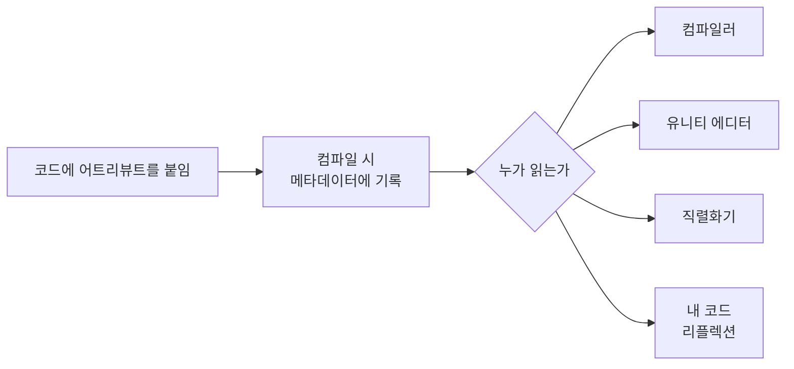

# 어트리뷰트 (Attribute)

## 핵심 개념

- **어트리뷰트**: 클래스, 메서드, 필드, 매개변수 같은 코드 요소에 붙이는 **메타데이터 표시**
- 대괄호 `[ ]`로 대상 바로 위나 앞에 붙임
- Microsoft 한국어 문서에서는 **"특성"**으로 번역함. 프로퍼티(Property)를 "속성"으로 번역하므로 헷갈리지 않게 주의할 것. 프로퍼티는 [[Property]] 참고
- 어트리뷰트 자체는 **아무 동작도 하지 않음**. 누군가 그 표시를 **읽어서** 행동을 바꿀 때만 의미가 생김

## 누가 읽는가

| 읽는 쪽 | 예 | 결과 |
| --- | --- | --- |
| 컴파일러 | `Obsolete` | 사용하는 곳에 경고나 에러를 띄움 |
| 컴파일러 | `Conditional` | 특정 조건이 아니면 호출 자체를 빌드에서 뺌 |
| 런타임 | `Flags` | 열거형을 문자열로 바꿀 때 조합으로 표시함. [[Flags Enum]] |
| 직렬화기 | `Serializable` | 이 타입을 직렬화해도 된다고 표시함. [[Serialization]] |
| 유니티 에디터 | `SerializeField`, `Header`, `Range` | 인스펙터 표시와 저장 방식을 바꿈 |
| 내 코드 | 직접 만든 어트리뷰트 | 리플렉션으로 찾아 원하는 처리를 함 |

- 같은 표시라도 **읽는 쪽이 없으면 그냥 주석과 같음**

## 유니티에서 자주 쓰는 어트리뷰트

**인스펙터**

| 어트리뷰트 | 효과 |
| --- | --- |
| `SerializeField` | private 필드를 직렬화하고 인스펙터에 표시 |
| `HideInInspector` | 직렬화는 하되 인스펙터에서 숨김 |
| `Header`, `Space` | 인스펙터에 제목과 여백을 넣어 구역을 나눔 |
| `Tooltip` | 마우스를 올리면 설명을 보여줌 |
| `Range` | 숫자를 슬라이더로 표시하고 범위를 제한함 |
| `TextArea` | 문자열을 여러 줄 입력칸으로 표시함 |

**컴포넌트와 에셋**

| 어트리뷰트 | 효과 |
| --- | --- |
| `RequireComponent` | 이 컴포넌트를 붙이면 필요한 컴포넌트도 자동으로 붙음 |
| `DisallowMultipleComponent` | 같은 오브젝트에 중복으로 붙이지 못하게 함 |
| `CreateAssetMenu` | ScriptableObject를 만드는 메뉴를 추가함. [[Scriptable Object]] |
| `ContextMenu` | 인스펙터의 컴포넌트 메뉴에서 메서드를 실행할 수 있게 함 |

**실행 시점**

| 어트리뷰트 | 효과 |
| --- | --- |
| `ExecuteAlways` | 플레이 모드가 아닐 때도 스크립트가 동작함 |
| 런타임 초기화 어트리뷰트 | 씬 로드 전후 같은 시점에 정적 메서드를 자동 호출함 |

## 직접 만들기

| 요소 | 내용 |
| --- | --- |
| 정의 | `Attribute`를 상속한 클래스로 만듦 |
| 이름 | 관례상 `Attribute`로 끝남. 붙일 때는 그 부분을 생략할 수 있음 |
| 사용 범위 지정 | 어디에 붙일 수 있는지(클래스, 메서드 등), 여러 번 붙일 수 있는지, 상속되는지를 정할 수 있음 |
| 인자 | 생성자 인자와 공개 필드·프로퍼티로 값을 받음 |

**인자는 상수만 받을 수 있음**

- 어트리뷰트의 값은 컴파일할 때 메타데이터에 **그대로 새겨짐**
- 그래서 숫자, 문자열, 열거형, 타입 정보, 그런 것들의 배열처럼 **컴파일 시점에 정해지는 값**만 넣을 수 있음
- 변수나 `new`로 만든 객체는 넣을 수 없음

## 읽는 방법

- 직접 만든 어트리뷰트는 [[Reflection]]으로 읽음
- 타입이나 메서드의 정보를 얻어, 특정 어트리뷰트가 붙어 있는지 확인하고 값을 꺼냄
- 리플렉션은 비싸므로 **시작할 때 한 번 훑어 결과를 저장**하고, 이후에는 저장한 결과만 씀

## 게임 개발 관점에서

**인스펙터를 기획자 친화적으로**

- 구역 제목, 툴팁, 슬라이더 범위만 잘 붙여도 기획자가 코드를 몰라도 값을 안전하게 조정할 수 있음
- `Range`는 표시만 제한하는 게 아니라 잘못된 값 입력 자체를 막아 실수를 줄여줌

**의존 관계를 코드로 강제**

- 리지드바디가 꼭 필요한 컴포넌트에 `RequireComponent`를 붙이면, 빠뜨려서 생기는 null 오류를 원천 차단함

**인스펙터 확장**

- 직접 만든 어트리뷰트와 에디터 쪽 그리기 클래스를 짝지으면, 특정 필드를 원하는 모양으로 그리는 커스텀 인스펙터를 만들 수 있음

**자동 등록 구조**

- 치트 명령, 이벤트 핸들러 등에 어트리뷰트를 붙여 두고 시작 시 리플렉션으로 모아 등록하면, 새 기능을 추가할 때 등록 코드를 따로 고치지 않아도 됨

**주의**

- 어트리뷰트가 많아질수록 동작이 코드 흐름 밖에 숨어, "이게 왜 동작하지"를 추적하기 어려워짐
- IL2CPP 빌드에서는 리플렉션으로만 쓰이는 코드가 제거될 수 있음. [[Reflection]] 참고

## 의문점 / 더 알아볼 것

- 어트리뷰트 사용 범위 지정의 세부 옵션
- 유니티 `PropertyAttribute`와 `PropertyDrawer`로 커스텀 인스펙터 만들기
- `Conditional` 어트리뷰트로 디버그 로그를 빌드에서 제거하는 방법
- 소스 제너레이터가 어트리뷰트를 읽어 코드를 생성하는 방식
- 어트리뷰트 인자로 쓸 수 있는 타입의 정확한 목록