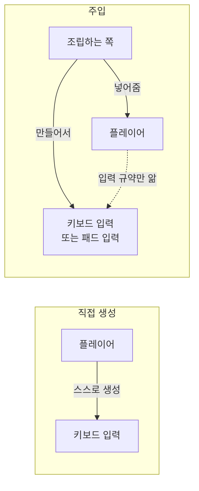

# 의존성 주입 (Dependency Injection)

## 핵심 개념

- **의존성(Dependency)**: 어떤 객체가 일을 하려면 필요한 다른 객체. 플레이어가 입력 처리기를 쓴다면, 입력 처리기는 플레이어의 의존성임
- **의존성 주입(DI)**: 필요한 객체를 **스스로 만들지 않고, 밖에서 넣어 받는** 방식
- 비유하면 요리사가 재료를 직접 기르지 않고 납품받아 쓰는 것임. 요리사는 요리에만 집중하고, 재료를 바꾸고 싶으면 납품처만 바꾸면 됨

- 왼쪽은 플레이어가 키보드 입력을 직접 만들어서, 패드로 바꾸려면 플레이어 코드를 고쳐야 함
- 오른쪽은 플레이어가 "입력을 줄 수 있는 무언가"만 받음. 무엇을 넣을지는 조립하는 쪽이 정함

## 왜 쓰는가

| 효과 | 내용 |
| --- | --- |
| 결합도 감소 | 쓰는 쪽이 구체적인 클래스를 몰라도 됨 |
| 교체 용이 | 키보드를 패드로, 실제 서버를 가짜 서버로 바꾸기 쉬움 |
| 테스트 용이 | 테스트할 때 가짜 객체를 넣어 원하는 상황을 만들 수 있음 |
| 책임 분리 | "무엇을 쓸지 고르고 만드는 일"과 "그것을 쓰는 일"이 나뉨 |

## 주입 방식

| 방식 | 내용 | 특징 |
| --- | --- | --- |
| 생성자 주입 | 객체를 만들 때 생성자 매개변수로 받음 | 의존성이 빠질 수 없음. 가장 권장됨 |
| 메서드 주입 | 초기화 메서드나 필요한 메서드의 매개변수로 받음 | 생성 후 넣어야 할 때 씀 |
| 필드·프로퍼티 주입 | 공개된 필드나 프로퍼티에 대입함 | 넣는 것을 잊을 수 있음 |

## 의존성 역전 원칙과의 차이

- 이름이 비슷해서 자주 혼동됨

| 구분 | 의존성 역전 원칙 (DIP) | 의존성 주입 (DI) |
| --- | --- | --- |
| 성격 | **원칙** | **기법** |
| 내용 | 구체적인 것이 아니라 추상(인터페이스)에 의존하라 | 필요한 것을 밖에서 넣어 받아라 |
| 관계 | "무엇에 의존할까" | "어떻게 받을까" |

- 둘은 따로도 성립함. 구체 클래스를 주입받으면 DI이지만 DIP는 아님
- 함께 쓸 때 효과가 가장 큼 — **추상(인터페이스)을 주입받으면** 구현을 자유롭게 갈아 끼울 수 있음
- [[SOLID]], [[Interface]] 참고

## 조립하는 곳 (Composition Root)

- 주입을 하면 "누가 만들어서 넣어주는가"라는 질문이 남음
- 프로그램 시작 지점처럼 **한곳에서 전부 조립**하는 것이 원칙임. 이곳을 컴포지션 루트라고 부름
- 조립 코드가 여기저기 흩어지면 결국 의존성을 추적하기 어려워짐

## 반대되는 방식

**직접 생성**

- 필요한 객체를 내부에서 `new`로 만듦. 가장 단순하지만 교체할 수 없음

**전역 접근 (싱글톤, 서비스 로케이터)**

- 필요할 때 전역에서 꺼내 씀
- 편하지만 **의존성이 코드 안쪽에 숨음**. 클래스 선언만 봐서는 무엇에 의존하는지 알 수 없음
- 테스트할 때 전역 상태를 갈아 끼우기 어려움

## 게임 개발 관점에서

**MonoBehaviour는 생성자 주입을 쓸 수 없음**

- MonoBehaviour는 `new`로 만들지 않고 유니티가 생성함. 생성자 매개변수를 넘길 방법이 없음
- 그래서 유니티에서는 다른 방식을 씀

| 방식 | 설명 |
| --- | --- |
| 인스펙터 할당 | `[SerializeField]` 필드에 에디터에서 끌어다 놓음. **사실상 필드 주입을 에디터가 해주는 것**임 |
| 초기화 메서드 | 생성 직후 `Init` 같은 메서드로 넘김. 런타임에 만드는 오브젝트에 씀 |
| DI 컨테이너 | VContainer, Zenject 같은 라이브러리가 자동으로 찾아 넣어줌 |

- 일반 C# 클래스(MonoBehaviour가 아닌 것)는 생성자 주입을 그대로 쓸 수 있음

**인스펙터 할당만으로도 충분한 경우가 많음**

- 작은 프로젝트에서는 인스펙터 할당이 가장 단순하고 눈에 잘 보이는 주입 방식임
- DI 컨테이너는 의존 관계가 복잡해지고 교체·테스트 요구가 커질 때 고려함

**과용 주의**

- 모든 것을 주입받게 만들면 조립 코드가 비대해짐
- DI 컨테이너는 자동으로 연결해 주는 만큼 **흐름이 코드에 드러나지 않음**. 어디서 무엇이 들어오는지 추적하기 어려워짐
- 컨테이너는 [[Reflection]]을 쓰는 경우가 많아 초기화 비용과 IL2CPP 코드 스트리핑 문제도 신경 써야 함

**싱글톤 남발의 대안으로 쓰임**

- 게임 매니저, 사운드 매니저 같은 것을 전부 싱글톤으로 만들면 어디서나 접근되어 의존 관계가 엉킴
- 필요한 쪽에 주입하는 구조로 바꾸면 무엇이 무엇에 의존하는지가 드러남

## 의문점 / 더 알아볼 것

- 제어의 역전(IoC) — DI가 속한 더 큰 개념
- VContainer와 Zenject의 차이, 유니티에서의 성능
- 수명 관리 — 싱글톤 수명, 씬 수명, 일회성 수명을 컨테이너가 다루는 방식
- 서비스 로케이터가 안티 패턴으로 불리는 이유와 반론
- 관련 노트 — [[Open-Closed Principle]], [[Interface Segregation Principle]]