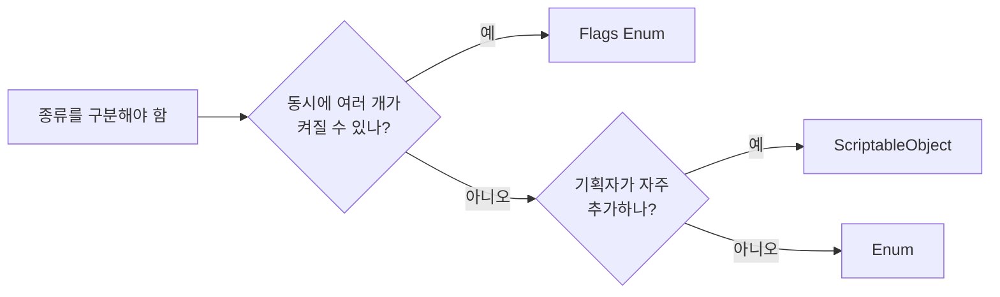

# 열거형 (Enum)

## 핵심 개념

- **열거형**: 관련된 상수들에 **이름을 붙여 하나의 타입으로 묶은 것**
- 실체는 정수임. 이름은 사람을 위한 것이고, 내부적으로는 숫자로 저장되고 비교됨
- `int` 상수 여러 개를 쓰는 것과 달리 **타입이 생김**. 엉뚱한 값을 넘기면 컴파일러가 막아줌

```csharp
public enum PlayerState
{
    Idle,      // 0
    Move,      // 1
    Jump,      // 2
    Dead       // 3
}
```

| 방식                | 타입 안전               | 자동완성 | 오타                | 비교 비용   |
| ------------------- | ----------------------- | -------- | ------------------- | ----------- |
| `const int` 여러 개 | 없음. 아무 int나 들어감 | 됨       | 컴파일 에러         | 정수 비교   |
| 문자열              | 없음                    | 안 됨    | **런타임에야 발견** | 문자열 비교 |
| 열거형              | 있음                    | 됨       | 컴파일 에러         | 정수 비교   |

## 값 지정 규칙

- 아무것도 안 쓰면 **0부터 1씩 증가**함
- 값을 직접 지정할 수 있고, 지정한 다음 멤버는 거기서부터 이어서 증가함

```csharp
public enum Grade
{
    Common = 1,   // 1
    Rare,         // 2
    Epic = 10,    // 10
    Legendary     // 11
}
```

- 서로 다른 멤버가 같은 값을 가질 수도 있음. 별칭처럼 쓰이지만 혼란의 원인이 되므로 피할 것

## 기반 타입

- 기본은 `int`(4바이트)임. 다른 정수 타입으로 바꿀 수 있음

```csharp
public enum Direction : byte { Up, Down, Left, Right }
```

- 값이 적으면 `byte`로 줄여 메모리를 아낄 수 있음. 대량으로 저장하거나 네트워크로 보낼 때 의미가 있음
- 플래그로 쓰면서 32개를 넘겨야 하면 `long`으로 늘림. [[Flags Enum]] 참고

## 정수와의 변환

```csharp
int n = (int)PlayerState.Jump;         // 2
PlayerState s = (PlayerState)2;        // Jump
PlayerState weird = (PlayerState)99;   // 컴파일 에러 없음
```

**정의되지 않은 값도 들어감**

- 캐스팅은 검사를 하지 않음. `(PlayerState)99`도 정상적으로 만들어짐
- 세이브 데이터나 서버에서 받은 숫자를 그대로 캐스팅하면 존재하지 않는 상태가 생길 수 있음
- 외부 입력을 변환할 때는 `Enum.IsDefined`로 검증할 것. 단, 플래그 조합 값은 정의되지 않은 것으로 판정되므로 플래그에는 맞지 않음

**기본값은 항상 0임**

- 필드를 초기화하지 않거나 `default`를 쓰면 0이 됨
- 0에 해당하는 멤버가 없으면 **어떤 이름에도 해당하지 않는 값**이 기본값이 됨
- 그래서 `None = 0`이나 `Unknown = 0`처럼 "아직 정해지지 않음"을 0에 두는 것이 안전함
- 위의 `Grade`처럼 1부터 시작하면 초기화 안 된 필드가 정체불명 값이 됨

## switch와의 조합

- 열거형의 주 사용처가 분기임. 상태별로 다른 동작을 고를 때 씀
- `switch` 식(C# 8)은 모든 멤버를 다루지 않으면 컴파일러가 경고를 줌
- 멤버를 새로 추가했을 때 처리를 빠뜨린 곳을 찾아주므로, 경고를 무시하지 말 것
- `default` 분기를 습관적으로 넣으면 이 경고가 사라져 누락을 못 잡게 됨. 정말 "그 외 전부"를 뜻할 때만 쓸 것

## 문자열 변환 비용

- `ToString()`, `Enum.Parse()`는 메타데이터를 조회하고 문자열을 새로 만듦
- 매 프레임 호출하면 할당이 쌓임. [[GC]] 참고
- 로그나 UI 표시처럼 사람에게 보여줄 때만 쓰고, 로직에서 비교할 때는 열거형끼리 비교할 것
- UI에 자주 표시한다면 이름을 미리 배열이나 딕셔너리로 캐싱해 두는 방법이 있음

## 게임 개발 관점에서

**유니티는 숫자로 직렬화함**

- 인스펙터에서 고른 값은 **이름이 아니라 숫자**로 씬·프리팹·에셋에 저장됨
- 멤버를 중간에 끼워 넣거나 순서를 바꾸면, 이미 설정해 둔 값이 전부 한 칸씩 밀림

| 상황                               | 수정 전             | 수정 후                    |
| ---------------------------------- | ------------------- | -------------------------- |
| 정의                               | `Sword, Bow, Staff` | `Sword, Spear, Bow, Staff` |
| 인스펙터에서 Bow를 골라둔 오브젝트 | 저장값 1 = Bow      | 저장값 1 = **Spear**       |

- 에러가 나지 않아서 한참 뒤에 발견됨. 프리팹 수십 개의 설정이 조용히 바뀌어 있는 식임
- 대응 — **값을 명시적으로 지정**하고, 새 멤버는 맨 뒤에 새 번호로 추가할 것. 삭제한 번호는 재사용하지 말 것

**언제 열거형을 쓰고 언제 피하나**



- 상태(대기·이동·공격), 방향, 게임 모드처럼 **코드와 함께 바뀌는 고정된 목록**에 적합함
- 아이템 종류, 적 종류처럼 **콘텐츠가 계속 늘어나는 목록**은 열거형에 맞지 않음. 하나 추가할 때마다 코드를 고치고 다시 빌드해야 함
- 그런 경우는 [[Scriptable Object]] 에셋으로 만들어 데이터로 늘리는 쪽이 나음

**상태 머신의 출발점**

- 열거형 + `switch`가 가장 단순한 상태 머신임
- 상태가 늘고 상태마다 진입·종료 처리가 생기면 `switch`가 비대해짐. 그때가 상태 패턴으로 넘어갈 시점임

## 의문점 / 더 알아볼 것

- 열거형을 `Dictionary` 키로 쓸 때 박싱이 생기던 이유와 런타임별 차이
- 열거형에 메서드를 붙이는 방법 — 확장 메서드
- `Enum.GetValues`로 전체 멤버를 순회할 때의 비용
- 직렬화된 열거형 값을 안전하게 바꾸는 방법 — 마이그레이션 처리
- `enum class` 같은 개념이 있는 다른 언어(C++, Java)와의 차이 — Java 열거형은 객체임
- 상태 패턴으로 넘어가는 기준과 리팩토링 방식
