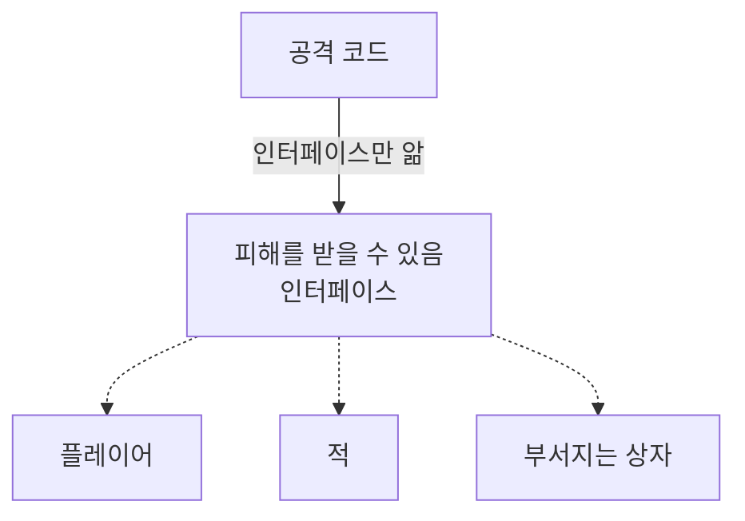

# 인터페이스 (Interface)

## 핵심 개념

- **인터페이스**: "이 기능들을 제공하겠다"는 **약속(계약)만 정의**한 타입
- 무엇을 할 수 있는지(메서드 이름, 매개변수, 반환 타입)만 정하고, **어떻게 하는지는 구현하는 클래스가 정함**
- 클래스가 인터페이스를 구현하면, 그 약속을 모두 지켜야 컴파일됨
- 관례상 이름 앞에 `I`를 붙임

- 공격 코드는 상대가 플레이어인지, 적인지, 상자인지 몰라도 됨. "피해를 받을 수 있는가"만 알면 됨

## 가질 수 있는 것

| 멤버 | 가능 여부 |
| --- | --- |
| 메서드 | 가능 |
| 프로퍼티 | 가능 (값 저장 없이 접근자만 약속함) |
| 이벤트, 인덱서 | 가능 |
| 필드 (상태) | **불가** |
| 생성자 | **불가** |
| 기본 구현 | C# 8부터 가능 |
| 정적 추상 멤버 | C# 11부터 가능 |

- 인터페이스는 **상태를 가질 수 없음**. 약속만 정하고 데이터는 구현하는 쪽이 가짐

## 구현 규칙

| 규칙 | 내용 |
| --- | --- |
| 모두 구현 | 인터페이스의 모든 멤버를 구현해야 함 (기본 구현이 있는 것 제외) |
| 공개 | 구현한 멤버는 `public`이어야 함 |
| 여러 개 가능 | 한 클래스가 **인터페이스를 여러 개** 구현할 수 있음 |
| 상속과 함께 | 클래스 하나를 상속하면서 인터페이스 여러 개를 구현할 수 있음 |
| 구조체도 가능 | 구조체도 인터페이스를 구현할 수 있음 |

**명시적 구현**

- 인터페이스 이름을 붙여 구현하면, 그 멤버는 **인터페이스 타입으로 다룰 때만** 보임
- 두 인터페이스에 같은 이름의 멤버가 있어 충돌할 때, 또는 클래스의 공개 목록을 깔끔하게 두고 싶을 때 씀

## 인터페이스는 타입임

- 인터페이스를 변수, 매개변수, 반환 타입, 컬렉션 요소 타입으로 쓸 수 있음
- 인터페이스 타입 변수에는 그 인터페이스를 구현한 **어떤 객체든** 담을 수 있음
- 이것이 [[Polymorphism]]을 상속 없이 실현하는 방법임
- 제네릭 제약에 쓰면 "이 약속을 지키는 타입만 받겠다"를 컴파일러가 보장해줌. [[Generic]] 참고

## 왜 쓰는가

| 효과 | 내용 |
| --- | --- |
| 결합도 감소 | 쓰는 쪽은 구체 클래스가 아니라 약속만 앎 |
| 교체 용이 | 같은 약속을 지키는 다른 구현으로 바꿔 끼울 수 있음 |
| 다중 능력 | 상속은 하나뿐이지만 인터페이스는 여러 개를 붙일 수 있음 |
| 테스트 | 가짜 구현을 만들어 넣기 쉬움 |

- 설계 원칙과의 관계
  - 작게 나눠 역할별로 정의 — [[Interface Segregation Principle]]
  - 구체 대신 인터페이스에 의존 — [[SOLID]]의 의존성 역전
  - 확장 지점으로 활용 — [[Open-Closed Principle]]

## 추상 클래스와의 차이

- 같은 계열이고 상태와 구현을 공유한다면 추상 클래스, 서로 다른 계열에 같은 능력을 붙인다면 인터페이스
- 자세한 비교는 [[Abstract Class]] 참고

## 주의할 점

**구조체를 인터페이스로 다루면 박싱됨**

- 구조체를 인터페이스 타입 변수에 담는 순간 박싱되어 힙에 복사본이 생김
- 제네릭 제약으로 다루면 박싱을 피할 수 있음. [[Struct]], [[Boxing & Unboxing]] 참고

**인터페이스를 나중에 바꾸면 구현이 전부 깨짐**

- 멤버를 하나 추가하면 그 인터페이스를 구현한 모든 클래스가 컴파일 에러가 남
- 기본 구현을 넣으면 완화되지만, 처음부터 역할을 작게 정의해 두는 것이 더 근본적인 대책임

## 게임 개발 관점에서

**컴포넌트를 인터페이스로 찾기**

- 유니티의 컴포넌트 조회는 **인터페이스 타입으로도 동작함**
- 맞은 대상에서 "피해를 받을 수 있음" 인터페이스를 찾으면, 대상의 종류와 상관없이 같은 코드로 데미지를 줄 수 있음
- 태그로 종류를 일일이 구분하는 것보다 확장에 강함. [[Layer & Tag]], [[GetComponent]] 참고

**인스펙터에 그대로 노출되지 않음**

- 인터페이스 타입 필드는 기본 직렬화 대상이 아니라 인스펙터에 나타나지 않음
- 컴포넌트를 연결하고 싶다면 구체 타입이나 MonoBehaviour 타입 필드로 받고 코드에서 인터페이스로 꺼내 쓰거나, 일반 클래스라면 참조 직렬화 어트리뷰트를 씀. [[Serialization]] 참고

**유니티 자체가 인터페이스를 활용함**

- UI 이벤트 시스템은 클릭, 드래그 같은 이벤트를 각각 인터페이스로 제공함. 필요한 인터페이스만 구현하면 해당 이벤트를 받을 수 있음

## 의문점 / 더 알아볼 것

- 인터페이스 기본 구현의 동작과 한계
- 정적 추상 멤버 — 제네릭 수학 연산에 쓰이는 방식
- 명시적 구현이 필요한 구체적인 상황
- 인터페이스 호출의 내부 동작과 성능
- 관련 노트 — [[Inheritance]], [[Virtual]], [[Dependency Injection]]