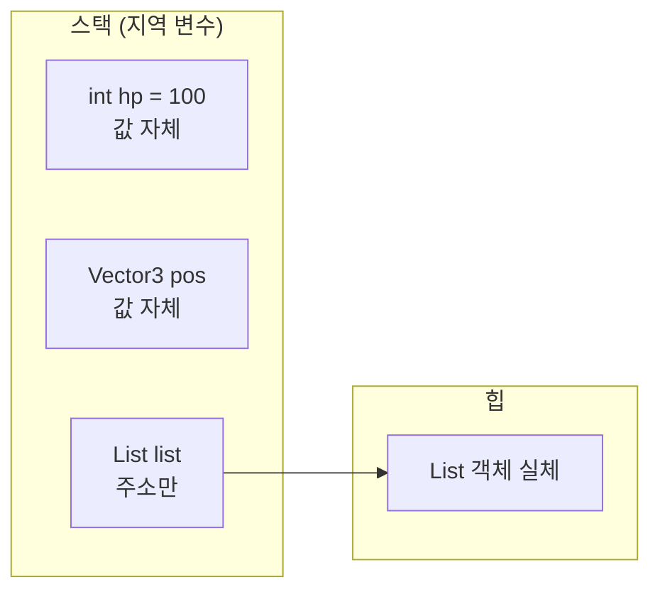

# 지역 변수와 스택 (Local Variable)

## 핵심 개념

- **지역 변수**: 메서드나 블록 `{ }` 안에서 선언되어 **그 안에서만 쓰이고, 실행이 끝나면 사라지는** 변수
- 지역 변수는 개념적으로 **스택**에 저장됨
- 메서드가 끝나면 스택에서 한꺼번에 사라지므로 [[GC]]가 관여하지 않음. 해제 비용이 사실상 0임
- OS 관점의 스택 영역은 [[Stack Segment]] 참고

## 스택 프레임

- 메서드를 호출할 때마다 스택에 **프레임**이 하나 쌓임
- 프레임에는 매개변수, 지역 변수, 돌아갈 위치(복귀 주소)가 들어감
- 메서드가 끝나면 그 프레임이 통째로 제거됨. [[SP]](스택 포인터)를 되돌리기만 하면 끝남

```
호출 순서: Update → Move → CalcVelocity

  ┌──────────────────────┐  ← 스택 꼭대기 (SP)
  │ CalcVelocity 프레임   │    지역 변수: speed, dir
  ├──────────────────────┤
  │ Move 프레임           │    지역 변수: pos, delta
  ├──────────────────────┤
  │ Update 프레임         │    지역 변수: input
  └──────────────────────┘

CalcVelocity가 끝나면 맨 위 프레임만 사라짐
```

- 나중에 호출된 메서드가 먼저 끝나므로 **후입선출(LIFO)** 구조가 딱 맞음

## 값 타입과 참조 타입의 차이

- "지역 변수는 전부 스택에 있다"는 반만 맞음



| 지역 변수의 타입 | 스택에 있는 것 | 힙에 생기는 것 |
| --- | --- | --- |
| 값 타입 (`int`, `float`, `struct`) | 값 전체 | 없음 |
| 참조 타입 (`class`, 배열, `string`) | **참조(주소)만** | 객체 실체 |

- 참조 타입 지역 변수는 메서드가 끝나면 **주소만 사라지고 객체는 힙에 남음**. 그 객체는 나중에 GC가 회수함
- 자세한 차이는 [[Value & Reference]], [[Struct & Class]] 참고

## 스택을 벗어나는 지역 변수

- 다음 경우에는 컴파일러가 지역 변수를 **힙에 있는 숨은 클래스의 필드로 옮김**
- 메서드가 끝난 뒤에도 값이 살아 있어야 하기 때문임

| 상황 | 이유 | 관련 노트 |
| --- | --- | --- |
| 람다가 지역 변수를 캡처함 | 람다가 나중에 실행될 수 있음 | [[Closure]] |
| `yield return`이 있는 메서드 | 멈췄다 재개될 때 값이 남아 있어야 함 | [[Yield return & IEnumerator]] |
| `async` 메서드 | `await` 뒤에 이어서 실행해야 함 | [[Sync & Async]] |

- 이런 경우 지역 변수처럼 보여도 실제로는 **힙 할당**이 일어남

## 스코프와 수명

| 구분 | 의미 |
| --- | --- |
| 스코프 | 그 **이름을 쓸 수 있는** 코드 범위. 컴파일할 때 정해짐 |
| 수명 | 그 값이 **메모리에 존재하는** 기간. 실행할 때 정해짐 |

- 보통은 같지만, 위의 캡처 같은 경우 스코프가 끝나도 수명은 계속됨

## 초기화 규칙

- **지역 변수는 자동으로 초기화되지 않음**. 값을 대입하기 전에 읽으면 컴파일 에러가 남
- 반면 클래스의 **필드**는 기본값(0, `null`, `false`)으로 자동 초기화됨
- 지역 변수는 쓰기 직전에 선언과 동시에 값을 넣는 습관이 안전함

## 스택의 크기 제한

- 스레드마다 스택 크기는 정해져 있고 크지 않음 (보통 1MB 내외)
- 재귀 호출이 너무 깊어지면 프레임이 계속 쌓여 **`StackOverflowException`**이 남
- 이 예외는 `try-catch`로 잡을 수 없고 프로세스가 그대로 종료됨

## 게임 개발 관점에서

**Update 안의 지역 변수**

- `Vector3`, `int` 같은 값 타입 지역 변수는 매 프레임 만들어도 할당이 없음. 부담 없이 써도 됨
- 반면 매 프레임 `new List<>()`처럼 참조 타입을 지역 변수로 만들면 매번 힙에 객체가 생김
- 매 프레임 쓰는 컬렉션은 **필드로 한 번 만들어 두고 비워서 재사용**하는 것이 좋음

**람다와 코루틴 안에서는 할당이 숨어 있음**

- 지역 변수를 캡처하는 람다, 코루틴, `async` 메서드는 지역 변수가 힙으로 옮겨짐
- 겉보기엔 지역 변수라 가볍게 느껴지지만, 프로파일러의 GC Alloc에 잡히는 지점임

**깊은 재귀는 피할 것**

- 타일 맵 영역 채우기(Flood Fill), 길찾기 같은 탐색을 재귀로 짜면 맵이 커질 때 스택 오버플로가 날 수 있음
- 큐나 스택 자료구조를 직접 써서 반복문으로 바꾸면 크기 제한에서 벗어남

## 의문점 / 더 알아볼 것

- `stackalloc`과 `Span<T>` — 배열을 스택에 만들어 힙 할당을 피하는 방법
- `ref` 지역 변수와 `ref` 반환 — 복사 없이 참조로 다루기
- JIT가 지역 변수를 스택 대신 레지스터에 두는 최적화
- 꼬리 재귀 최적화가 C#에서 보장되지 않는 이유
- 지역 함수(Local Function)와 람다의 할당 차이
