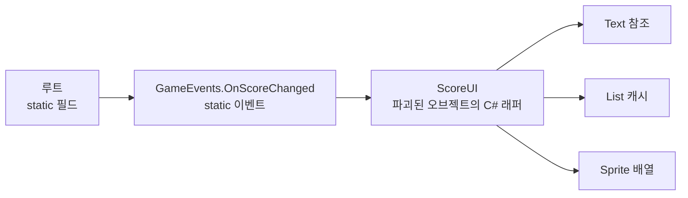

# 메모리 누수 (Memory Leak)

## 핵심 개념

- **C#에서의 메모리 누수**: 더 이상 쓰지 않는 객체가 **참조가 남아 있어서** 회수되지 않는 것
- C++의 누수(`delete`를 빼먹음)와는 원인이 다름. C#은 해제를 잊어서가 아니라 **놓아주는 걸 잊어서** 샘
- [[GC]]는 "루트에서 도달 가능하면 절대 지우지 않음". 쓸모없어도 참조 사슬이 이어져 있으면 살아남음
- 그래서 정확한 정의는 **"도달 가능하지만 필요 없는 객체"**임

## 두 종류의 누수

| 구분 | 원인 | 예시 |
| --- | --- | --- |
| 관리 메모리 누수 | 참조가 남아 GC가 못 지움 | 이벤트 구독 미해제, static 컬렉션 |
| 비관리 자원 누수 | GC가 아예 모르는 메모리를 해제 안 함 | `NativeArray`, `ComputeBuffer`, 런타임 생성 `Material` |

- 관리 누수는 **참조를 끊어야** 해결됨
- 비관리 누수는 **직접 해제해야** 해결됨. [[IDisposable]] 참고

## 참조 하나가 큰 덩어리를 붙잡음

누수가 무서운 이유는 객체 하나가 아니라 **그 객체가 참조하는 모든 것**이 함께 남기 때문임.



- 씬을 떠나 `ScoreUI`가 파괴돼도 static 이벤트가 구독자로 붙잡고 있음
- `ScoreUI`가 들고 있던 리스트, 스프라이트 참조까지 전부 회수되지 않음
- 씬을 왕복할 때마다 이 덩어리가 하나씩 쌓임

## 대표 원인

**1. 이벤트 구독 미해제**

- 가장 흔한 원인임. 발행자가 오래 살수록(매니저, static) 피해가 큼
- 람다로 구독하면 해제 자체가 불가능함. [[Closure]], [[Event & Pub-Sub Pattern]] 참고

```csharp
// 나쁨 — 해제 불가
GameEvents.OnScoreChanged += s => text.text = s.ToString();

// 좋음 — 쌍으로
void OnEnable()  => GameEvents.OnScoreChanged += UpdateScore;
void OnDisable() => GameEvents.OnScoreChanged -= UpdateScore;
```

**2. static 컬렉션에 계속 추가**

- 캐시, 레지스트리, "모든 적 목록" 같은 static 리스트에 넣기만 하고 빼지 않음
- static은 프로그램이 끝날 때까지 루트이므로 들어간 것은 영원히 남음

```csharp
public static readonly List<Enemy> All = new();

void OnEnable()  => All.Add(this);
void OnDisable() => All.Remove(this);   // 빠뜨리면 누수
```

**3. 콜백이 `this`를 붙잡음**

- 코루틴, 트윈, 비동기 작업, 타이머에 넘긴 람다가 `this`를 캡처함
- 오브젝트가 파괴돼도 콜백을 쥔 쪽이 살아 있으면 함께 남음
- 콜백이 나중에 실행되면서 `MissingReferenceException`까지 남

**4. 런타임에 복제된 Material**

- 유니티의 고전적 함정임

```csharp
renderer.material.color = Color.red;   // 이 순간 머티리얼이 복제됨
```

- `renderer.material`에 접근하면 **원본을 복제한 새 머티리얼**이 만들어짐
- 이 복제본은 오브젝트를 파괴해도 자동으로 사라지지 않음. 직접 `Destroy`해야 함
- 색만 잠깐 바꾸는 코드가 생성·파괴를 반복하는 오브젝트에 붙어 있으면 머티리얼이 계속 쌓임
- 공유해도 되면 `sharedMaterial`, 개별 값만 바꾸려면 `MaterialPropertyBlock`을 쓸 것

**5. 파괴됐지만 C# 객체가 남는 경우**

- `Destroy`는 네이티브(C++) 쪽 객체를 지움. C# 래퍼 객체는 참조가 있으면 남음
- 이 껍데기는 `== null`이 `true`를 반환하지만 실제로는 메모리에 있음 (유니티가 `==`를 오버로딩해서 그렇게 보일 뿐임)
- 껍데기가 들고 있던 다른 관리 객체들도 함께 남음

**6. 비관리 자원 해제 누락**

- `NativeArray`, `ComputeBuffer`, `RenderTexture`, 파일 스트림
- GC가 존재를 모르므로 시간이 지나도 절대 회수되지 않음

## 증상

- 메모리 사용량이 계단식으로 증가하고 내려오지 않음
- **씬을 왕복할 때마다** 메모리가 늘어남. 가장 확실한 신호임
- 같은 콜백이 2번, 3번 호출됨 (구독이 누적됨)
- 파괴된 오브젝트 관련 `MissingReferenceException`
- 장시간 플레이하면 모바일에서 강제 종료됨

## 찾는 법

**Memory Profiler 패키지로 스냅샷 비교**

```
1. 메인 메뉴에서 스냅샷 A
2. 게임 씬 진입 → 다시 메인 메뉴로 복귀
3. 스냅샷 B
4. A와 B 비교 — 메뉴로 돌아왔는데 늘어난 것이 누수 후보
```

- 파괴됐는데 C# 껍데기만 남은 객체(Leaked Managed Shell)를 따로 표시해줌
- 객체를 선택하면 **누가 이것을 참조하고 있는지** 역추적할 수 있음. 원인 찾기의 핵심 기능임

**Profiler의 Memory 모듈**

- 실시간으로 총량 추이를 볼 때 씀. 원인 추적보다 "새는지 아닌지" 판단용임

## 게임 개발 관점에서

**수명의 주인을 명확히 할 것**

- "이 구독은 누가 해제하는가", "이 리스트에서 누가 빼는가"가 코드에 드러나야 함
- 추가하는 곳과 제거하는 곳을 같은 클래스의 대칭 메서드(`OnEnable`/`OnDisable`)에 두는 것이 가장 안전함

**static을 줄일 것**

- static 이벤트와 static 컬렉션이 누수의 주요 진원지임
- 편해서 쓰기 쉽지만, 수명이 프로그램 전체라 실수 하나가 영구 누수가 됨

**구독을 묶어서 관리**

- `CompositeDisposable` 같은 구조로 모아두고 `OnDestroy`에서 한 번에 해제함
- 해제를 개별로 기억하는 대신 구조로 강제하는 방법임

**씬 전환을 테스트 루틴에 넣을 것**

- 메뉴 → 게임 → 메뉴를 10번 반복하고 메모리를 확인하는 것만으로 대부분의 누수가 드러남
- `DontDestroyOnLoad` 오브젝트가 이전 씬의 오브젝트를 참조하고 있는지 특히 확인할 것

**`WeakReference`는 만능이 아님**

- 약한 참조는 GC를 막지 않으므로 누수는 막지만, 객체가 언제 사라질지 알 수 없음
- 캐시처럼 "있으면 쓰고 없으면 다시 만드는" 용도에만 적합함

## 의문점 / 더 알아볼 것

- 유니티 `==` 연산자 오버로딩과 fake null — `is null`과 `== null`의 결과가 다른 이유
- `Resources.UnloadUnusedAssets`가 정리하는 범위와 비용
- `MaterialPropertyBlock`의 동작 원리와 SRP Batcher와의 관계
- Memory Profiler의 참조 경로(Retention Path) 읽는 법
- 이벤트 대신 약한 이벤트 패턴(Weak Event Pattern)을 쓰는 경우
- 에셋 번들·Addressables 로드 후 해제 누락으로 생기는 누수
- 메모리 누수와 메모리 단편화의 구분 — 둘 다 "메모리가 계속 늘어난다"로 보임