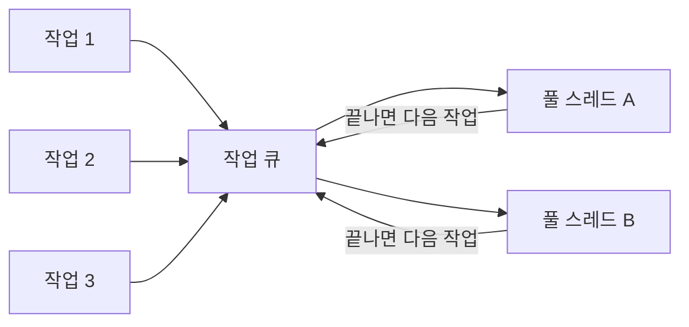

# OS 스레드와 스레드 풀 (OS Thread vs Thread Pool)

## 핵심 개념

- **OS 스레드를 직접 생성**: 작업이 생길 때마다 스레드를 새로 만들고, 끝나면 파괴함
- **스레드 풀**: 스레드를 **미리 만들어 두고 재사용**함. 작업은 큐에 넣고, 놀고 있는 스레드가 꺼내 실행함
- 스레드 생성·파괴가 비싸서 생긴 방식임. [[ObjectPooling]]과 같은 발상임 — 비싼 것은 만들고 버리지 말고 돌려 씀

## 왜 스레드 생성이 비싼가

- OS가 스레드마다 스택 메모리를 예약하고, 관리 정보([[TCB]])를 만들고, 스케줄러에 등록해야 함
- 파괴할 때도 이 과정을 거꾸로 거침
- 몇 밀리초짜리 작업에 스레드를 새로 만들면 **작업보다 준비 비용이 더 큼**

## 비교

| 구분 | OS 스레드 직접 생성 | 스레드 풀 |
| --- | --- | --- |
| 생성 비용 | 작업마다 발생 | 처음 한 번 (재사용) |
| 스레드 수 | 만드는 만큼 늘어남 | 런타임이 적정 수로 조절 |
| 수명 | 작업과 함께 끝남 | 프로그램과 함께 유지 |
| 세부 제어 | 이름, 우선순위, 포그라운드 여부 | 거의 불가 |
| 종류 | 기본 포그라운드 | **항상 백그라운드** |
| 적합한 작업 | 오래 도는 전용 작업 | 짧고 많은 작업 |

## .NET 스레드 풀의 동작

- 최소 개수까지는 요청이 오면 바로 스레드를 늘림
- 그 이상은 **천천히** 늘림. 일정 시간 동안 큐가 안 비면 하나씩 추가하는 식임
- 스레드를 너무 많이 만들면 컨텍스트 스위칭 비용이 오히려 성능을 떨어뜨리기 때문임
- 작업이 줄면 남는 스레드는 시간이 지나 정리됨

## 스레드 풀 고갈 (Starvation)

- 풀 스레드가 전부 **오래 붙잡혀 있는** 작업에 걸리면, 큐에 쌓인 다른 작업이 실행되지 못함
- 풀이 스레드를 천천히 늘리기 때문에 그동안 짧은 작업들까지 줄줄이 지연됨
- 주된 원인
  - 풀 스레드 안에서 동기로 오래 기다림 (`.Result`, `.Wait()`, 동기 입출력)
  - 끝나지 않는 무한 루프 작업을 풀에 넣음
- 대응 — 기다림은 `await`로 바꾸고, 오래 도는 작업은 전용 스레드로 뺌

## 어떤 쪽을 쓰나

- **기본은 스레드 풀**. `Task.Run`이 스레드 풀을 씀
- 프로그램 내내 도는 작업, 우선순위를 직접 정해야 하는 작업만 전용 스레드로 만듦
- 둘 사이의 선택은 [[Thread vs Task]]와 같은 기준임

## 게임 개발 관점에서

**유니티에도 여러 종류의 스레드가 있음**

| 스레드 | 역할 |
| --- | --- |
| 메인 스레드 | 스크립트, 유니티 API |
| 렌더 스레드 | GPU에 렌더링 명령 전달 |
| Job System 워커 | 코어 수에 맞춰 유니티가 관리하는 풀 |
| .NET 스레드 풀 | `Task.Run`이 사용 |

- Job System도 일종의 스레드 풀임. 유니티가 CPU 코어 수에 맞춰 워커를 만들어 두고 작업을 나눠 줌
- 직접 스레드를 많이 만들면 이 워커들과 CPU 코어를 두고 경쟁하게 되어 오히려 느려질 수 있음

**스레드 풀에 무거운 작업을 넣을 때**

- 길찾기 같은 계산을 `Task.Run`으로 보내는 것은 괜찮음. 짧게 끝나고 돌아오는 작업이기 때문임
- 서버 연결을 유지하는 수신 루프처럼 끝나지 않는 작업은 풀에 넣지 말 것

## 의문점 / 더 알아볼 것

- 스레드 풀의 스레드 수 조절 알고리즘 (Hill Climbing)
- `ThreadPool.SetMinThreads` — 최소 스레드 수를 늘려 고갈을 완화하는 방법과 부작용
- 워크 스틸링(Work Stealing) — 스레드마다 작업 큐를 두고 놀면 남의 일을 가져오는 방식
- Job System 워커 스레드 수를 확인하고 조절하는 방법
- 관련 노트 — [[Thread Class]], [[Thread]], [[Process vs Thread]]
