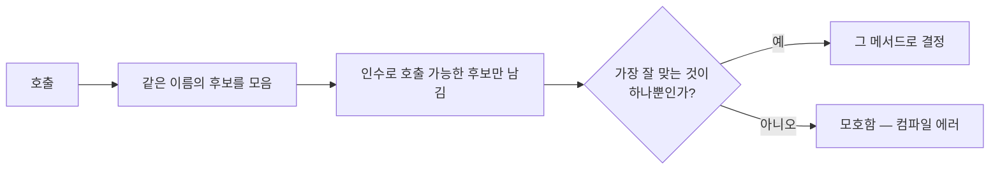

# 오버로딩 (Overloading)

## 핵심 개념

- **오버로딩**: 같은 이름의 메서드를 **매개변수 구성만 다르게** 여러 개 정의하는 것
- "같은 일을 하지만 받는 입력이 다른" 경우 이름을 하나로 통일할 수 있음
- 출력할 대상이 정수든 문자열이든 같은 이름으로 부르는 것이 대표적인 예임

## 무엇으로 구분하는가 — 시그니처

| 요소 | 구분 기준에 포함? |
| --- | --- |
| 메서드 이름 | 포함 (같아야 오버로딩) |
| 매개변수 개수 | 포함 |
| 매개변수 타입 | 포함 |
| 매개변수 순서 | 포함 |
| `ref`·`out`·`in` 여부 | 포함. 단 `ref`와 `out`만 다른 것은 구분 안 됨 |
| **반환 타입** | **포함 안 됨** |
| 매개변수 이름 | 포함 안 됨 |

- 반환 타입만 다른 메서드는 만들 수 없음. 호출하는 쪽에서 반환값을 안 쓸 수도 있어, 컴파일러가 어느 것을 부를지 알 수 없기 때문임
- [[Parameter & Return]] 참고

## 어느 것이 호출되는가 — 오버로드 해석

- **정확히 일치**하는 후보가 **변환이 필요한** 후보보다 우선함
- 변환이 필요하다면 더 "가까운" 변환이 우선함
- 둘 이상이 똑같이 잘 맞으면 컴파일러가 고르지 못하고 에러를 냄

**컴파일 시점에 결정됨**

- 어느 오버로드를 부를지는 **변수에 선언된 타입**을 보고 컴파일할 때 정해짐
- 실제로 들어 있는 객체의 타입은 보지 않음
- `object` 타입 변수에 문자열을 담아 넘기면, 문자열용 오버로드가 아니라 `object`용 오버로드가 호출됨

## 오버로딩과 오버라이딩

- 이름이 비슷해 면접에서 자주 비교를 묻는 개념임

| 구분 | 오버로딩 | 오버라이딩 |
| --- | --- | --- |
| 의미 | 같은 이름, **다른 매개변수** | 부모의 메서드를 자식이 **같은 시그니처로 재정의** |
| 관계 | 같은 클래스 안 (또는 상속 관계에서도 가능) | 부모와 자식 사이 |
| 결정 시점 | **컴파일 시점** (정적 바인딩) | **실행 시점** (동적 바인딩) |
| 결정 기준 | 변수의 선언 타입 | 실제 객체의 타입 |
| 필요한 키워드 | 없음 | `virtual`, `override` |
| 관련 개념 | — | [[Polymorphism]] |

## 자주 걸리는 함정

**암시적 변환으로 엉뚱한 오버로드가 선택됨**

- 정수는 실수로 자동 변환되므로, 정수를 넘길 자리에 실수를 받는 오버로드가 있으면 그쪽이 선택될 수 있음
- 컴파일 에러 없이 의도와 다른 메서드가 불림

**null을 넘기면 모호해질 수 있음**

- `null`은 어느 참조 타입으로든 변환될 수 있음
- 관련 없는 두 참조 타입을 받는 오버로드가 있으면 어느 쪽인지 정할 수 없어 에러가 남

**선택적 매개변수와 섞이면 헷갈림**

- 기본값이 있는 매개변수를 가진 오버로드와, 그 매개변수가 아예 없는 오버로드가 함께 있으면 어느 쪽이 불릴지 읽는 사람이 판단하기 어려움
- 둘 중 하나의 방식으로 통일하는 것이 좋음

## 게임 개발 관점에서

**레이캐스트의 고전적인 실수**

- 레이캐스트는 오버로드가 아주 많음. 거리, 레이어 마스크, 결과 정보 등의 조합이 다양함
- 레이와 **레이어 마스크만** 넘기려고 했는데, 그런 오버로드는 없고 **레이와 최대 거리**를 받는 오버로드가 있으면
- 레이어 마스크(정수)가 최대 거리(실수)로 자동 변환되어 **그쪽이 호출됨**
- 컴파일 에러도 없이 레이어 필터가 무시되고 이상한 거리로 검사하게 됨
- 레이어 마스크를 넘길 때는 거리도 함께 명시하거나, 이름을 붙인 인수로 넘기면 안전함. [[LayerMask]], [[Cast & Overlap]] 참고

**유니티 API에서 자주 보는 오버로딩**

- 오브젝트 생성 함수는 위치·회전·부모 지정 여부에 따라 여러 오버로드가 있음
- 자동완성에서 오버로드 목록을 넘겨 보며 원하는 조합을 고르는 습관을 들이면 실수가 줄어듦

**같은 이름에는 같은 의미만**

- 오버로드끼리는 **본질적으로 같은 일**을 해야 함
- 이름만 같고 하는 일이 다르면 호출부를 읽는 사람이 오해함. 그런 경우는 이름을 다르게 짓는 것이 맞음

## 의문점 / 더 알아볼 것

- 생성자 오버로딩과 생성자끼리 호출하기 (`this(...)`)
- 연산자 오버로딩 — 벡터끼리 `+`로 더할 수 있는 이유
- 제네릭 메서드와 오버로딩 중 무엇을 쓸지
- 확장 메서드와 인스턴스 메서드가 겹칠 때의 우선순위 — [[Extension Method]]
- 오버로드 해석의 세부 규칙 ("더 나은 변환"의 정의)