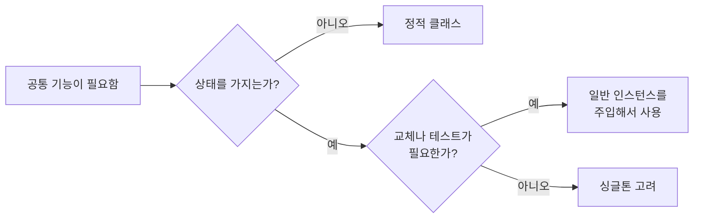

# 정적 클래스 (Static Class)

## 핵심 개념

- **정적 클래스**: **인스턴스를 만들 수 없고**, 정적(static) 멤버만 가질 수 있는 클래스
- 클래스 선언에 `static`을 붙이면 컴파일러가 규칙을 강제함
- "객체를 만들어 쓰는 설계도"가 아니라 **관련된 기능을 묶어 두는 그릇**에 가까움
- `static` 키워드 전반은 [[Static]] 참고

## 규칙

| 규칙 | 내용 |
| --- | --- |
| 인스턴스 생성 불가 | `new`로 만들 수 없음 |
| 정적 멤버만 | 필드, 메서드, 프로퍼티 전부 `static`이어야 함 |
| 상속 불가 | 다른 클래스가 상속할 수 없고, 정적 클래스도 다른 클래스를 상속할 수 없음 |
| 인터페이스 구현 불가 | 인스턴스가 없으니 인터페이스 규약을 따를 대상이 없음 |
| 생성자 | 정적 생성자만 가질 수 있음 |

- 내부적으로는 **추상(abstract)이면서 봉인(sealed)된** 클래스로 컴파일됨. 그래서 만들 수도, 상속할 수도 없음
- 일반 클래스에 정적 멤버만 넣는 것과의 차이는 **컴파일러가 실수를 막아준다**는 점임. 실수로 인스턴스 멤버를 추가하거나 `new`하는 것을 원천 차단함

## 정적 생성자

- 정적 필드를 초기화하는 특별한 생성자
- 직접 호출할 수 없고, 그 클래스가 **처음 쓰이기 직전에 런타임이 한 번** 실행함
- 정확한 실행 시점은 보장되지 않음. "처음 쓰기 전 어느 시점"만 보장됨

**예외가 나면 그 타입은 못 씀**

- 정적 생성자에서 예외가 나면, 그 뒤로 그 클래스를 쓸 때마다 **타입 초기화 예외**가 남
- 원래 원인이 안쪽 예외로 감싸여 있어 원인을 찾기 어려움
- 정적 생성자에서는 실패할 수 있는 작업(파일 읽기 등)을 피하는 것이 좋음

## 쓰임새

| 용도 | 예 |
| --- | --- |
| 상태 없는 도우미 기능 | 수학 계산, 문자열 처리, 변환 함수 |
| 확장 메서드 | 확장 메서드는 정적 클래스 안에만 둘 수 있음. [[Extension Method]] |
| 상수 모음 | 태그 이름, 레이어 이름, 애니메이션 파라미터 이름 |
| 공통 설정값 | 바뀌지 않는 게임 전역 상수 |

- 핵심 조건은 **상태가 없거나, 있어도 읽기 전용**이라는 것임

## 정적 클래스와 싱글톤

| 구분 | 정적 클래스 | 싱글톤 |
| --- | --- | --- |
| 인스턴스 | 없음 | 하나 있음 |
| 인터페이스 구현 | 불가 | 가능 |
| 상속 | 불가 | 가능 |
| 매개변수로 넘기기 | 불가 | 가능 |
| 생성 시점 | 런타임이 정함 | 직접 제어 가능 |
| 교체·테스트 | 어려움 | 인터페이스를 쓰면 가능 |
| 유니티 기능 | 코루틴, 인스펙터 불가 | MonoBehaviour라면 가능 |

- 상태가 없으면 인스턴스 자체가 필요 없으므로 정적 클래스가 가장 단순함
- 상태가 생기는 순간 정적 클래스도 **전역 상태 문제**를 그대로 가짐. [[Singleton Pattern]] 참고
- 주입 방식은 [[Dependency Injection]] 참고

## 주의할 점

**정적 필드는 프로그램 내내 살아 있음**

- 정적 필드는 GC의 루트라서, 거기 담긴 객체는 절대 회수되지 않음
- 정적 리스트에 계속 추가만 하거나, 정적 이벤트에 구독만 하면 그대로 누수가 됨. [[Memory leak]] 참고

**씬과 무관하게 유지됨**

- 씬을 바꿔도 정적 필드 값은 그대로 남음
- 씬을 다시 시작했는데 점수가 초기화되지 않는 버그가 여기서 나옴

**에디터에서 플레이 사이에 남는 경우**

- 플레이 진입을 빠르게 하려고 도메인 리로드를 끄면 정적 필드가 다음 플레이까지 남음
- 이 경우 플레이 시작 시점에 정적 값을 직접 초기화하는 처리가 필요함

**여러 스레드에서 접근할 때**

- 정적 필드는 모든 스레드가 공유하므로, 동시에 쓰면 경쟁 상태가 생김. [[Thread Class]] 참고

## 게임 개발 관점에서

**유니티 API도 정적 멤버로 많이 제공됨**

- 수학 함수, 시간, 물리 질의, 디버그 출력 등은 인스턴스 없이 바로 부르는 정적 멤버임
- 이런 것들이 정적인 이유는 "어디서나 같은 기능, 개별 상태 없음"이기 때문임

**MonoBehaviour 기능이 필요하면 맞지 않음**

- 정적 클래스는 컴포넌트가 아니므로 코루틴, `Update`, 인스펙터 노출을 쓸 수 없음
- 이런 기능이 필요하면 오브젝트에 붙는 컴포넌트로 만들어야 함

**문자열 상수 모음으로 오타 방지**

- 태그, 애니메이션 파라미터, 입력 액션 이름을 문자열로 곳곳에 쓰면 오타가 런타임에야 발견됨
- 정적 클래스에 상수로 모아 두면 자동완성이 되고 오타가 컴파일 에러로 바뀜

## 의문점 / 더 알아볼 것

- 정적 생성자의 실행 시점과 `beforefieldinit`
- `static readonly`와 `const`의 차이 — [[Const & Readonly]]
- 유니티에서 도메인 리로드 없이 정적 값을 초기화하는 방법
- 정적 클래스를 테스트하기 어려운 이유와 우회 방법
- `using static` — 정적 클래스 이름 없이 멤버를 바로 쓰는 문법