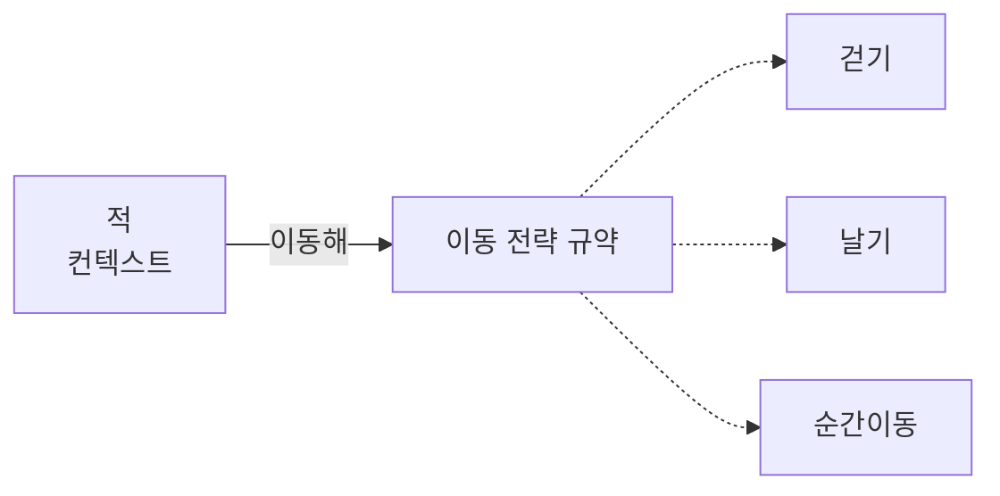

# 전략 패턴 (Strategy Pattern)

## 핵심 개념

- **전략 패턴**: 같은 목적을 이루는 **여러 방법(알고리즘)을 각각 객체로 분리**하고, 상황에 따라 **갈아 끼워 쓰는** 디자인 패턴
- 쓰는 쪽은 "어떤 방법인지" 모르고, "이 일을 해줘"만 요청함
- 방법이 바뀌어도 쓰는 쪽 코드는 그대로임

| 역할 | 하는 일 | 예 |
| --- | --- | --- |
| 전략 규약 (Strategy) | 모든 방법이 지킬 공통 약속 | 이동 방식 |
| 구체 전략 | 실제 방법 하나 | 걷기, 날기, 순간이동 |
| 컨텍스트 (Context) | 전략 하나를 들고 있다가 일을 맡김 | 적 캐릭터 |

- 적은 "이동해"라고만 요청하고, 실제 이동 방식은 들고 있는 전략이 결정함
- 전략을 바꿔 끼우면 같은 적이 다르게 움직임

## 왜 쓰는가

- 방법이 여러 가지일 때 흔히 `switch`나 `if`로 분기함
- 방법이 늘 때마다 분기를 추가해야 하고, 분기가 여러 곳에 흩어지면 전부 찾아 고쳐야 함. [[Switch when]] 참고
- 전략 패턴은 **방법 하나 = 클래스 하나**로 분리해서, 새 방법은 클래스를 추가하는 것으로 끝남
- [[Open-Closed Principle]]의 대표적인 구현 방식임

| 구분 | 분기로 처리 | 전략 패턴 |
| --- | --- | --- |
| 새 방법 추가 | 기존 분기를 수정 | 새 클래스 추가 |
| 방법 하나의 코드 위치 | 분기 안에 섞여 있음 | 한 클래스에 모임 |
| 실행 중 교체 | 분기 조건을 바꿔야 함 | 전략 객체만 바꿔 끼움 |
| 코드량 | 적음 | 클래스가 늘어남 |

## 상속 대신 조합

- 적마다 이동 방식이 다를 때, "걷는 적", "나는 적"처럼 **상속으로 나누면** 이동과 공격 방식을 조합할 때마다 클래스가 폭발함
- 전략 패턴은 이동 방식, 공격 방식을 각각 **부품처럼 끼우므로** 조합이 자유로움
- [[Component Pattern]]과 같은 발상임. 상속보다 조합(Composition over Inheritance)

## 상태 패턴과 무엇이 다른가

- 구조는 거의 같음. 둘 다 "객체를 갈아 끼워 동작을 바꾼다"
- 차이는 **누가, 왜 바꾸는가**임

| 구분 | 전략 패턴 | 상태 패턴 |
| --- | --- | --- |
| 교체하는 주체 | 주로 **바깥**(설정, 사용자 선택) | 주로 **상태 스스로** 다음 상태로 전이 |
| 바뀌는 이유 | 같은 일을 **다른 방법**으로 하려고 | 객체의 **상황이 바뀌어서** |
| 서로를 아는가 | 전략끼리 서로 모름 | 상태가 다음 상태를 아는 경우가 많음 |
| 예 | 정렬 방법, 이동 방식 선택 | 대기 → 이동 → 점프 |

- [[State Pattern]] 참고

## 델리게이트로 가볍게

- 전략이 **메서드 하나뿐**이라면 클래스 대신 델리게이트 하나로 표현할 수 있음
- 정렬할 때 비교 방법을 람다로 넘기는 것이 대표적인 예임. 이미 전략 패턴을 쓰고 있는 셈임
- 전략에 상태나 여러 메서드가 필요해지면 클래스로 바꿈. [[Delegate]], [[Built-in Delegate]] 참고

## 주의할 점

**방법이 하나뿐이면 과함**

- 앞으로 늘어날 근거 없이 미리 전략으로 나누면 클래스만 늘어남
- 실제로 두세 번째 방법이 생길 때 분리하는 것이 자연스러움

**전략이 컨텍스트를 너무 많이 알면**

- 전략이 컨텍스트의 내부 데이터를 마음대로 건드리면, 결국 서로 강하게 묶임
- 전략에 필요한 값만 넘기거나, 전략이 쓸 수 있는 범위를 좁혀 둠

**누가 전략을 고르는가**

- 전략을 고르는 코드가 결국 분기가 될 수 있음. 그 분기가 **한곳에만** 있으면 괜찮음

## 게임 개발 관점에서

**쓰이는 곳**

| 대상 | 전략의 예 |
| --- | --- |
| 적 이동 | 직진, 지그재그, 추적, 순찰 |
| 공격 방식 | 근접, 원거리, 범위 |
| 데미지 계산 | 일반, 치명타, 속성 상성 |
| 난이도 | 쉬움·보통·어려움마다 다른 AI 판단 |
| 아이템 효과 | 회복, 버프, 소환 |

**ScriptableObject로 전략을 에셋화**

- 전략을 추상 ScriptableObject로 만들고, 전략별로 상속해 에셋으로 만들면 **인스펙터에서 끌어다 놓는 것만으로** 전략을 교체할 수 있음
- 기획자가 코드 없이 적의 이동 방식이나 아이템 효과를 조합할 수 있게 됨. [[Scriptable Object]], [[Abstract Class]] 참고

**실행 중 교체**

- 보스가 체력이 절반 이하로 떨어지면 공격 전략을 바꾸는 식으로, 상황에 따라 전략을 갈아 끼울 수 있음
- 이처럼 상황에 따라 바뀌는 경우는 상태 패턴과 경계가 흐려지는데, 이름보다 "어떤 문제를 풀려고 분리했는가"가 중요함

## 의문점 / 더 알아볼 것

- 템플릿 메서드 패턴과의 차이 — 상속으로 단계를 바꾸는가, 조합으로 전체를 바꾸는가
- 전략 선택을 팩토리로 분리하는 방식
- 정렬·비교에서 쓰이는 .NET의 비교자 인터페이스
- 관련 노트 — [[Interface]], [[Command Pattern]]