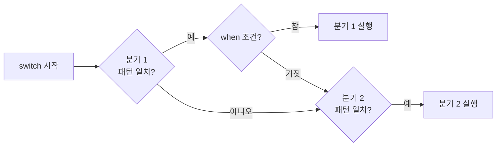

# switch의 when 절 (Switch When)

## 핵심 개념

- **`when`**: `switch`의 각 분기에 **추가 조건**을 덧붙이는 키워드
- 패턴이 일치하더라도 `when` 조건이 거짓이면 그 분기는 건너뛰고 **다음 분기를 검사함**
- "값이 이것이고, 동시에 이 조건도 만족할 때"를 한 줄로 표현할 수 있음

```csharp
switch (state)
{
    case PlayerState.Move when isGrounded:
        // 땅에서 이동 중
        break;
    case PlayerState.Move:
        // 공중에서 이동 중
        break;
}
```

## 쓰는 형태

| 형태 | 예시 | 의미 |
| --- | --- | --- |
| 값 + 조건 | `case Move when isGrounded:` | 상태가 Move이고 땅에 있을 때 |
| 타입 + 조건 | `case Enemy e when e.Hp <= 0:` | Enemy 타입이고 체력이 0 이하일 때 |
| 변수 + 조건 | `case var n when n > 100:` | 어떤 값이든 100보다 클 때 |
| switch 식 | `Move when isGrounded => ...` | switch 식에서도 같은 방식 |

- 타입 패턴과 함께 쓰면 **형변환과 조건 검사를 한 번에** 할 수 있음

## 평가 순서



- **위에서부터 차례로** 검사하고 처음 맞는 분기 하나만 실행함
- 그래서 **더 구체적인 조건을 위에** 둬야 함
- 위 예시에서 조건 없는 `case Move:`를 먼저 쓰면 `when isGrounded` 분기는 영원히 실행되지 않음. 컴파일러가 경고를 주는 경우도 있음

## 주의할 점

**when 분기는 완전성 판단에 포함되지 않음**

- 컴파일러는 `when`의 조건이 언제 참일지 알 수 없어서, `when`이 붙은 분기는 "항상 처리됨"으로 보지 않음
- 그래서 모든 경우를 다룬 것 같아도 switch 식에서 "처리되지 않은 값이 있다"는 경고가 날 수 있음
- 조건 없는 분기를 마지막에 하나 두면 해결됨

**조건이 복잡하면 if가 나음**

- `when` 안에 여러 조건이 길게 이어지면 switch의 가독성 장점이 사라짐
- `when` 안에서 값을 바꾸는 코드(부수 효과)는 넣지 말 것. 검사만 하는 자리임

**관계 패턴이 when을 대체하는 경우**

- C# 9부터 `case < 0:`, `case >= 10 and < 20:` 같은 **관계 패턴**을 쓸 수 있음
- 단순 범위 비교라면 `when`보다 짧고 의도가 분명함. 유니티 버전에 따라 지원 여부를 확인할 것

## 게임 개발 관점에서

**상태와 조건의 조합**

- [[Enum]] + `switch`로 만든 상태 머신에서, 같은 상태라도 상황에 따라 다르게 처리할 때 씀
- 같은 공격 상태라도 콤보 단계나 무기 종류에 따라 분기하는 식

**충돌 대상 분기**

- 부딪힌 대상을 타입 패턴으로 받고, 그 대상의 상태까지 함께 확인할 때 깔끔해짐
- "적인데 이미 죽은 적이면 무시" 같은 처리를 한 분기로 표현함

**분기가 계속 늘어나는 switch는 신호임**

- 새로운 종류가 추가될 때마다 `case`를 늘려야 하는 switch는 설계를 다시 볼 시점이라는 신호임
- [[SOLID]]의 개방-폐쇄 원칙이 다루는 문제임

## 의문점 / 더 알아볼 것

- 속성 패턴 — `case { Hp: <= 0 }`처럼 객체의 필드로 매칭하는 방식
- 튜플 패턴 — `switch (state, isGrounded)`로 두 값을 함께 분기하기
- switch가 내부적으로 점프 테이블로 최적화되는 조건과 when이 그 최적화에 미치는 영향
- 유니티 버전별 지원 C# 언어 버전