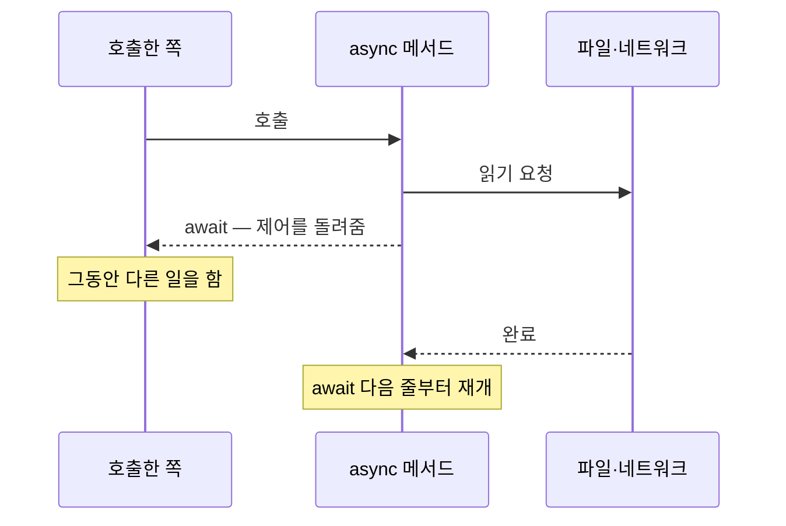

# 동기와 비동기 (Sync & Async)

## 핵심 개념

- **동기(Synchronous)**: 작업을 시작하면 **끝날 때까지 기다린 뒤** 다음 줄로 넘어감
- **비동기(Asynchronous)**: 작업을 시작해 두고, **끝나기를 기다리는 동안 다른 일을 함**. 끝나면 이어서 처리함
- 비유하면 식당 카운터임
  - 동기 — 주문을 받고 요리가 나올 때까지 카운터에 서서 기다림. 뒤 손님은 계속 줄을 섬
  - 비동기 — 주문을 주방에 넘기고 다음 손님을 받음. 요리가 나오면 그때 가져다줌

## 비동기는 멀티스레드가 아님

**가장 많이 헷갈리는 지점임.**

| 개념 | 묻는 것 |
| --- | --- |
| 비동기 | **기다리는 방식** — 기다리는 동안 붙잡혀 있는가, 다른 일을 하는가 |
| 멀티스레드 | **일하는 손의 수** — 동시에 몇 개의 작업이 실제로 실행되는가 |

- 파일 읽기, 네트워크 요청 같은 작업은 대부분 시간이 **기다림**임. 디스크나 서버가 일하는 동안 CPU는 할 게 없음
- 이런 작업을 비동기로 기다리면 **스레드를 추가로 쓰지 않고도** 기다리는 동안 다른 일을 할 수 있음
- 위의 식당 비유에서도 카운터 직원은 한 명뿐임. 손이 늘어난 게 아니라 기다리는 방식이 바뀐 것임

## 작업의 성격에 따라 다름

| 작업 종류 | 특징 | 비동기의 효과 |
| --- | --- | --- |
| I/O 작업 | 파일, 네트워크, DB. 대부분 기다림 | **큼**. 기다리는 동안 다른 일을 함 |
| CPU 작업 | 계산, 길찾기, 대량 데이터 처리. 계속 일함 | **없음**. 비동기로 감싸도 같은 스레드에서 계산하면 그대로 멈춤 |

- CPU 작업을 메인 스레드에서 떼어내려면 비동기만으로는 안 되고 **다른 스레드로 보내야** 함 (`Task.Run` 등)
- "비동기로 바꿨는데 왜 여전히 끊기지?"의 원인이 대부분 이것임

## async / await

- `async`는 "이 메서드 안에서 `await`를 쓰겠다"는 표시임
- `await`를 만나면 **그 자리에서 메서드를 일단 빠져나가** 호출한 쪽에 제어를 돌려줌
- 기다리던 작업이 끝나면 `await` 다음 줄부터 이어서 실행함

- 컴파일러가 메서드를 **상태 머신 클래스로 변환**해서 "어디까지 실행했는지"를 기억함. [[Yield Return & IEnumerator]]의 이터레이터와 같은 원리임
- 반환 타입은 `Task`(값 없음), `Task<T>`(값 있음)를 씀. 자세한 내용은 [[Task]] 참고

## 자주 걸리는 함정

**1. `async void`**

- 기다릴 수 없고, 안에서 난 예외를 바깥에서 잡을 수 없음. 프로그램이 그대로 죽을 수 있음
- 이벤트 핸들러처럼 시그니처가 `void`로 정해진 경우에만 쓰고, 그 외에는 `Task`를 반환할 것

**2. `.Result`, `.Wait()`로 기다리기**

- 비동기 작업을 **동기적으로 붙잡고** 기다리는 것임. 비동기의 의미가 사라짐
- 유니티 메인 스레드에서 쓰면 이어서 실행되어야 할 부분이 메인 스레드를 기다리고, 메인 스레드는 그 작업을 기다리는 **교착 상태**가 될 수 있음. 에디터가 멈춤

**3. 기다리지 않고 던져두기**

- `await` 없이 호출만 하면 작업 안에서 난 예외가 **아무 데도 보고되지 않고 사라짐**
- 버그가 났는데 로그에 아무것도 안 남는 상황이 생김

**4. 다른 스레드에서 유니티 API 호출**

- 유니티 API(`transform`, `GameObject` 등)는 **메인 스레드에서만** 쓸 수 있음
- `Task.Run`으로 보낸 작업 안에서 건드리면 예외가 남
- 계산은 백그라운드에서, 결과 반영은 메인 스레드로 돌아와서 해야 함

## 게임 개발 관점에서

**유니티는 await 이후 메인 스레드로 돌아옴**

- 유니티 메인 스레드에서 `await`하면, 작업이 끝난 뒤 이어지는 코드도 **메인 스레드에서** 실행됨
- 그래서 일반적인 `await` 후에는 유니티 API를 써도 안전함
- 단, `Task.Run` **안쪽**은 다른 스레드이므로 예외임

**오브젝트 수명과 맞물리지 않음**

- 코루틴은 오브젝트가 파괴되면 함께 멈추지만, `Task`는 **오브젝트와 무관하게 계속 실행됨**
- 기다리는 사이 오브젝트가 파괴되면, 재개된 코드가 파괴된 오브젝트를 건드려 `MissingReferenceException`이 남
- 에디터에서는 **플레이 모드를 멈춰도 Task가 계속 돌아가는** 경우까지 있음
- 대응 — 취소 토큰(`CancellationToken`)을 넘겨서 오브젝트 파괴 시 함께 취소함. 최근 버전은 MonoBehaviour가 파괴 시점에 맞춘 토큰을 제공함

**코루틴과의 비교**

| 구분 | 코루틴 | async / await |
| --- | --- | --- |
| 반환값 | 받을 수 없음 | `Task<T>`로 받음 |
| 예외 처리 | `try-catch`로 감쌀 수 없는 구간이 있음 | `try-catch`로 그대로 잡힘 |
| 오브젝트 수명 연동 | 자동 | 직접 취소해야 함 |
| 다른 스레드 활용 | 불가 | `Task.Run`으로 가능 |
| 할당 | 시작 시 상태 머신 | 호출마다 상태 머신 + Task |

- [[Coroutine]]은 실은 메인 스레드 하나에서 프레임을 나눠 실행하는 방식이라, 비동기처럼 보이지만 별도 스레드를 쓰지 않음
- 반환값이 필요하거나 실패를 제대로 다뤄야 하는 로딩·네트워크 작업은 async가 유리함

**할당 비용과 대안**

- `async` 메서드는 호출할 때마다 상태 머신과 `Task` 객체가 할당됨. 자주 부르면 [[GC]] 부담이 됨
- 유니티 전용 대안으로 **UniTask**(라이브러리), **Awaitable**(최근 유니티 내장)이 있음. 할당이 적고 프레임 대기, 메인 스레드 복귀 같은 유니티 맞춤 기능을 제공함

**실제로 쓰이는 곳**

- 에셋 로딩 (Addressables), 씬 비동기 로드
- 서버 통신, 로그인, 리더보드
- 세이브 파일 읽기·쓰기
- 길찾기처럼 무거운 계산을 백그라운드로 보내기

## 의문점 / 더 알아볼 것

- `SynchronizationContext` — await 이후 어느 스레드로 돌아올지를 정하는 장치
- `ConfigureAwait(false)`의 의미와 유니티에서 쓰면 안 되는 이유
- `ValueTask` — 할당을 줄이는 Task 대안
- `Task.WhenAll`, `Task.WhenAny` — 여러 비동기 작업을 동시에 기다리기
- Awaitable과 UniTask의 차이, 지원 버전
- Job System과 Task의 차이 — 유니티가 별도 병렬 처리 시스템을 둔 이유
- 동시성(Concurrency)과 병렬성(Parallelism)의 구분