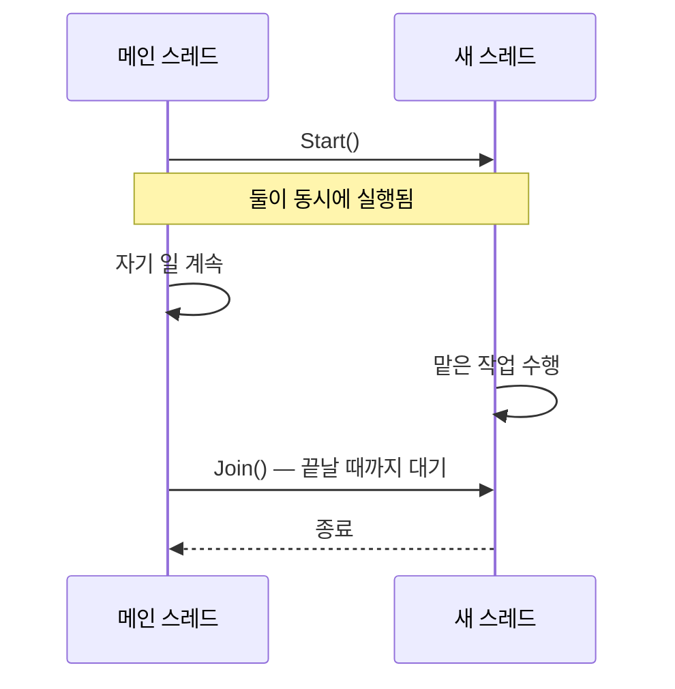

# C# 스레드 (Thread Class)

## 핵심 개념

- **`System.Threading.Thread`**: C#에서 **OS 스레드를 직접 하나 만들어** 작업을 맡기는 클래스
- 스레드 자체의 개념(프로세스 안의 실행 흐름, 스택 공유 범위 등)은 [[Thread]] 참고. 여기서는 C#에서 다루는 방법을 정리함
- 만든 스레드는 메인 스레드와 **동시에** 실행됨. 어느 쪽이 먼저 끝날지는 OS 스케줄러가 정함

## 기본 사용 흐름

| 단계 | 하는 일 |
| --- | --- |
| 생성 | 실행할 메서드를 넘겨 `Thread` 객체를 만듦. 아직 실행되지 않음 |
| `Start()` | OS 스레드가 만들어지고 실행이 시작됨 |
| `Join()` | 호출한 쪽이 그 스레드가 끝날 때까지 **멈춰서 기다림** |
| `Sleep()` | 현재 스레드를 지정한 시간만큼 재움 |

- `Join()`은 호출한 스레드를 막음. 메인 스레드에서 부르면 그동안 게임이 멈춤

## 포그라운드와 백그라운드

| 구분 | 프로세스 종료 시 |
| --- | --- |
| 포그라운드 (기본값) | **이 스레드가 끝날 때까지 프로세스가 종료되지 않음** |
| 백그라운드 (`IsBackground = true`) | 프로세스가 끝나면 함께 강제 종료됨 |

- 직접 만든 스레드는 기본이 포그라운드임
- 무한 반복하는 포그라운드 스레드를 만들어 두면 프로그램을 닫아도 프로세스가 남음

## 공유 자원 문제

- 여러 스레드가 같은 변수를 동시에 읽고 쓰면 결과가 실행할 때마다 달라짐 (경쟁 상태, Race Condition)
- `count++`처럼 한 줄짜리 코드도 "읽기 → 더하기 → 쓰기" 세 단계라 중간에 끼어들 수 있음
- `lock`으로 한 번에 한 스레드만 들어가게 막거나, `Interlocked` 같은 원자적 연산을 씀
- 잠금을 잘못 걸면 두 스레드가 서로를 영원히 기다리는 **데드락**이 생김

## 직접 만드는 비용

- 스레드 하나마다 OS가 별도의 스택 메모리를 예약하고 관리 정보를 만듦
- 생성과 파괴가 무겁고, 스레드가 많을수록 컨텍스트 스위칭 비용도 늘어남
- 짧은 작업마다 스레드를 새로 만드는 것은 나쁨. 그래서 [[OS Thread vs Thread Pool]]의 스레드 풀이 있음

## 주의할 점

**예외가 호출한 쪽으로 전달되지 않음**

- 스레드 안에서 처리하지 않은 예외는 `Start()`를 부른 쪽에서 잡을 수 없음
- 스레드 메서드 안에서 직접 `try-catch`로 감싸야 함

**강제 종료는 쓰지 말 것**

- 실행 중인 스레드를 밖에서 강제로 끊는 기능은 자원을 망가뜨릴 위험이 커서 최신 .NET에서는 지원하지 않음
- 플래그나 취소 토큰으로 "이제 멈춰라"를 전달하고, 스레드가 스스로 빠져나오게 해야 함

## 게임 개발 관점에서

**유니티 API는 메인 스레드에서만**

- 직접 만든 스레드 안에서 `transform`, `GameObject` 같은 유니티 API를 건드리면 예외가 남
- 계산은 스레드에서 하고, 결과는 메인 스레드로 넘겨서 반영해야 함

**에디터에서 플레이를 멈춰도 계속 돎**

- 직접 만든 스레드는 플레이 모드와 무관하게 실행됨
- 포그라운드 스레드가 남아 있으면 에디터 종료가 늦어지거나 멈추기도 함
- `OnDestroy`나 `OnApplicationQuit`에서 반드시 종료 신호를 보낼 것

**실무에서는 직접 만드는 경우가 드묾**

- 일반적인 비동기 작업은 [[Task]], 대량 병렬 계산은 유니티 Job System을 씀
- 직접 `Thread`를 쓰는 것은 소켓 수신처럼 **오래 도는 전용 작업**이 필요할 때 정도임
- 둘의 차이는 [[Thread vs Task]] 참고

## 의문점 / 더 알아볼 것

- `lock`과 `Monitor`의 관계, 잠금 범위를 좁게 잡는 요령
- `volatile` 키워드와 메모리 가시성 문제
- `Interlocked` — 잠금 없이 안전하게 값을 바꾸는 방법
- `ThreadLocal<T>` — 스레드마다 따로 갖는 변수
- 데드락이 생기는 네 가지 조건
