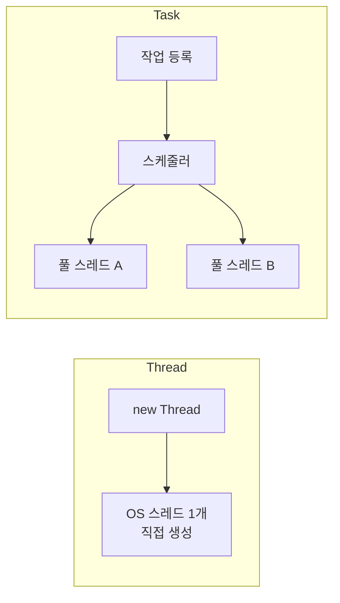

# 스레드와 태스크 (Thread vs Task)

## 핵심 개념

- **Thread**: **일꾼을 직접 한 명 고용**하는 것. OS 스레드 하나를 만들어 작업을 맡김
- **Task**: **해야 할 일을 등록**하는 것. 누가, 언제 실행할지는 스케줄러가 정함 (기본은 스레드 풀)
- Task는 스레드가 아니라 **작업 단위**임. 이 구분이 핵심임

## Task는 스레드 없이 진행될 수도 있음

- 파일 읽기, 네트워크 요청 같은 비동기 작업은 **기다리는 동안 어떤 스레드도 차지하지 않음**
- 작업이 끝났다는 신호가 오면 그때 이어서 실행할 스레드를 배정함
- 그래서 "Task 하나 = 스레드 하나"가 아님. 수천 개의 Task가 소수의 스레드로 돌아갈 수 있음
- 자세한 원리는 [[Sync & Async]] 참고

## 비교

| 구분 | Thread | Task |
| --- | --- | --- |
| 추상화 수준 | 낮음. OS 스레드를 직접 다룸 | 높음. 작업만 정의함 |
| 생성 비용 | 큼. 매번 새 스레드 생성 | 작음. 풀 스레드를 재사용 |
| 결과값 | 받을 방법이 없음. 공유 변수로 우회 | `Task<T>`로 받음 |
| 예외 | 호출한 쪽으로 전달 안 됨 | `await`하면 그대로 잡힘 |
| 취소 | 표준 방식 없음 | `CancellationToken` |
| 조합 | 직접 구현 | `WhenAll`, `WhenAny`, `ContinueWith` |
| `async`/`await` | 지원 안 함 | 지원함 |
| 세부 제어 | 이름, 우선순위, 포그라운드 여부 지정 가능 | 제한적 |

## 언제 무엇을 쓰나

**Task를 기본으로 씀**

- 대부분의 비동기·병렬 작업은 Task가 더 짧고 안전함
- 결과값, 예외, 취소를 표준 방식으로 처리할 수 있음

**Thread를 직접 쓰는 경우**

- 프로그램 내내 돌아가는 **전용 작업** — 소켓 수신 루프, 로그 기록 스레드
- 스레드의 우선순위나 이름, 포그라운드 여부를 정확히 제어해야 할 때
- 오래 붙잡혀 있을 작업을 스레드 풀에 넣으면 풀이 고갈되므로 따로 빼는 것임. [[OS Thread vs Thread Pool]] 참고

## 게임 개발 관점에서

**둘 다 유니티 API를 못 건드림**

- `Thread` 안이든 `Task.Run` 안이든 메인 스레드가 아니면 유니티 API를 쓸 수 없음
- 단, 메인 스레드에서 `await`한 뒤 이어지는 코드는 메인 스레드로 돌아오므로 괜찮음

**유니티에서의 선택지**

| 목적 | 도구 |
| --- | --- |
| 로딩, 통신 같은 비동기 작업 | Task, 또는 UniTask·Awaitable |
| 대량의 같은 계산을 병렬로 | Job System |
| 오래 도는 전용 백그라운드 작업 | Thread |
| 여러 프레임에 나눠 실행 (메인 스레드) | [[Coroutine]] |

- Job System은 유니티가 코어 수에 맞춰 관리하는 워커 스레드를 써서, 직접 스레드를 만드는 것보다 안전하고 효율적임

## 의문점 / 더 알아볼 것

- `TaskScheduler`와 `SynchronizationContext` — Task가 어느 스레드에서 실행될지 정하는 장치
- `TaskCreationOptions.LongRunning` — Task로 만들되 전용 스레드를 쓰게 하는 옵션
- `Parallel.For` — 반복문을 여러 스레드에 나누는 방법
- Job System의 워커 스레드와 .NET 스레드 풀의 관계
- 관련 노트 — [[Task]], [[Thread Class]], [[Thread]]
