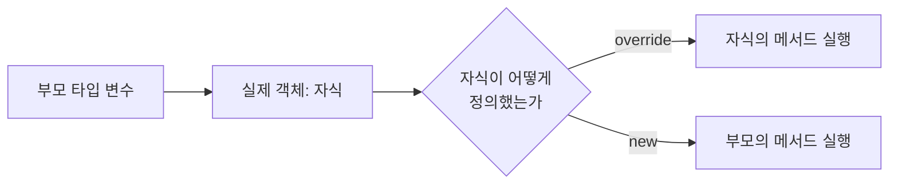

# virtual 키워드 (Virtual)

## 핵심 개념

- **`virtual`**: "이 멤버는 **자식 클래스가 재정의(`override`)해도 된다**"고 허락하는 키워드
- 부모 타입 변수로 호출해도, **실제 객체의 타입**에 맞는 재정의된 버전이 실행됨
- [[Polymorphism]]을 가능하게 하는 핵심 장치임
- C#은 기본이 **재정의 불가**임. 재정의를 허락하려면 부모가 명시적으로 `virtual`을 붙여야 함 (Java는 기본이 재정의 가능이라 반대임)

## 붙일 수 있는 대상

| 대상 | 가능 여부 |
| --- | --- |
| 메서드 | 가능 |
| 프로퍼티 | 가능 |
| 이벤트, 인덱서 | 가능 |
| 필드 | **불가** |
| 정적 멤버 | **불가** |
| private 멤버 | **불가** — 자식이 볼 수 없으니 재정의할 수 없음 |

## override와 new — 결과가 다름

| 구분 | `override` | `new` (숨기기) |
| --- | --- | --- |
| 부모 쪽 필요 조건 | 부모가 `virtual`·`abstract`·`override`여야 함 | 아무 메서드나 가능 |
| 부모 타입 변수로 호출 | **자식 버전** 실행 | **부모 버전** 실행 |
| 자식 타입 변수로 호출 | 자식 버전 실행 | 자식 버전 실행 |
| 의미 | 부모의 동작을 **대체**함 | 이름만 같은 **별개의 메서드**를 만듦 |

- 부모 타입으로 다룰 때 동작이 갈리는 것이 핵심 차이임
- `new`로 숨긴 메서드는 다형성이 동작하지 않아, 의도하지 않았다면 버그의 원인이 됨. [[New]] 참고
- 부모에 `virtual`이 없는데 같은 이름을 자식에 만들면 컴파일러가 "숨기는 것이 맞으면 `new`를 붙이라"고 경고함

## 관련 키워드

| 키워드 | 의미 |
| --- | --- |
| `virtual` | 재정의를 **허락**함. 부모가 기본 구현을 가짐 |
| `abstract` | 재정의를 **강제**함. 부모에 구현이 없음 |
| `override` | 부모의 것을 재정의함 |
| `sealed override` | 재정의하되, 더 아래 자식은 다시 재정의하지 못하게 막음 |
| `base` | 재정의한 메서드 안에서 부모의 원래 구현을 호출함 |

- `virtual`과 `abstract`의 차이는 "기본 구현이 있는가"임
- 재정의할 때 부모 동작에 **덧붙이고** 싶다면 `base`로 부모 구현을 먼저 부르고 이어서 처리함

## 동작 원리

- 컴파일러는 어느 메서드를 부를지 **컴파일 시점에 확정하지 못함**. 실제 객체가 무엇일지 모르기 때문임
- 객체마다 "이 타입의 재정의된 메서드 목록"(가상 메서드 테이블)을 참조해 **실행 시점에** 찾아감 (동적 바인딩)
- 오버로딩이 컴파일 시점에 정해지는 것과 대비됨. [[Overloading]] 참고

**성능**

- 테이블을 거쳐 한 번 더 찾아가는 비용이 있음
- 더 큰 비용은 **인라이닝이 막힌다**는 점임. 컴파일러가 어느 메서드인지 모르니 호출 자리에 코드를 펼쳐 넣을 수 없음
- 대부분의 코드에서는 무시해도 될 수준이지만, 매 프레임 수만 번 도는 코드라면 고려 대상임
- `sealed`로 더 이상 재정의가 없음을 알려주면 최적화 여지가 생김

## 주의할 점

**생성자에서 virtual 메서드를 부르면 안 됨**

- 부모 생성자에서 `virtual` 메서드를 부르면, **자식의 재정의 버전이 실행됨**
- 그런데 그 시점에는 자식 생성자가 아직 실행되지 않아 자식의 필드가 초기화되지 않은 상태임
- 초기화 안 된 값을 쓰는 버그가 생김

**재정의는 부모의 약속을 지켜야 함**

- 자식이 재정의하면서 부모가 보장하던 동작을 깨면 다형성이 무너짐. [[Liskov Substitution Principle]] 참고

## 게임 개발 관점에서

**유니티 메시지 메서드는 virtual이 아님**

- `Awake`, `Start`, `Update` 같은 메서드는 상속 규칙으로 호출되는 것이 아니라, 유니티가 **이름으로 찾아서** 부름
- 그래서 부모와 자식 모두에 `Awake`가 있으면 **자식 것만 호출되고 부모 것은 실행되지 않는** 일이 생김
- 부모의 `Awake`가 private이면 컴파일러 경고도 없이 조용히 무시되어 찾기 어려움

**해결 — 부모를 protected virtual로**

- 부모 클래스의 메시지 메서드를 `protected virtual`로 선언함
- 자식은 `override`로 재정의하고, 안에서 `base`로 부모 구현을 먼저 호출함
- 이렇게 하면 부모의 초기화가 빠지지 않음

**상속 계층에서의 쓰임**

- 적 공통 부모가 기본 행동을 `virtual`로 제공하고, 특수한 적만 재정의하는 식으로 씀
- 다만 계층이 깊어지면 어디서 무엇이 재정의됐는지 추적하기 어려워짐. 컴포넌트 조합과 함께 고려할 것. [[Component Pattern]] 참고

## 의문점 / 더 알아볼 것

- 가상 메서드 테이블의 구조와 인터페이스 호출과의 차이
- JIT의 가상 호출 최적화(Devirtualization) 조건
- `abstract` 클래스와 인터페이스 중 무엇을 고를지
- 재정의할 때 접근 제한자를 바꿀 수 없는 이유
- 관련 노트 — [[Inheritance]], [[Polymorphism]]