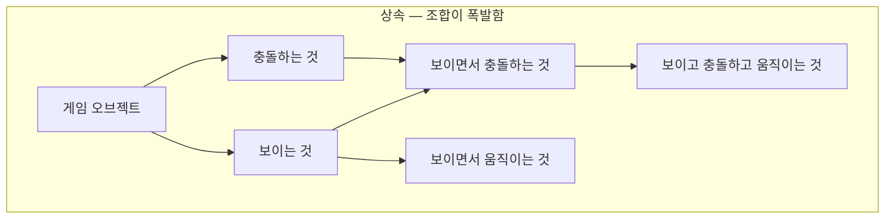
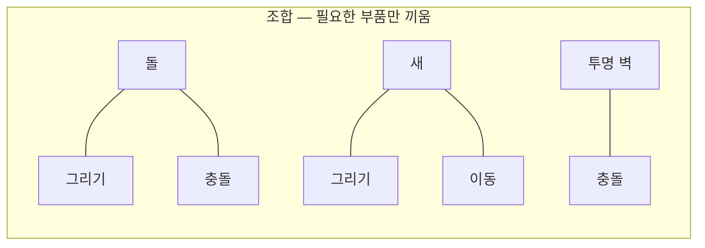

# 컴포넌트 패턴 (Component Pattern)

## 핵심 개념

- **컴포넌트 패턴**: 하나의 객체가 맡은 여러 기능을 **각각 독립된 부품(컴포넌트)으로 분리**하고, 객체는 그 부품들을 **담는 그릇**이 되는 패턴
- 이동, 충돌, 그리기, 소리처럼 서로 다른 영역의 기능을 한 클래스에 몰아넣지 않음
- 필요한 부품을 골라 끼워서 객체를 만듦. 레고 블록을 조립하는 것과 비슷함
- "상속보다 조합(Composition over Inheritance)"을 구체화한 패턴임

## 상속으로 만들 때의 문제

- 기능이 늘어날수록 "A이면서 B인 것" 같은 조합마다 클래스가 필요해짐
- 여러 부모의 기능을 동시에 물려받아야 하는 경우가 생기지만, C#은 클래스 다중 상속을 허용하지 않음
- 계층 위쪽에 기능을 올리면 그 기능이 필요 없는 자식까지 떠안게 됨. [[Liskov Substitution Principle]] 위반으로 이어짐

## 컴포넌트로 만들면

- 객체(엔티티)는 스스로 기능을 거의 가지지 않고, **어떤 부품을 끼웠는가**로 정체가 정해짐
- 새로운 종류의 객체가 필요하면 클래스를 새로 만드는 대신 **부품 조합을 바꿈**
- 각 부품은 자기 영역만 책임지므로 [[Single Responsibility Principle]]과 자연스럽게 맞아떨어짐

## 장점과 단점

| 장점 | 단점 |
| --- | --- |
| 부품 재사용 — 같은 충돌 부품을 어디에나 붙임 | 부품끼리 협력하려면 서로를 찾아야 함 |
| 조합의 유연성 — 클래스 추가 없이 새 종류를 만듦 | 부품이 많아지면 전체 흐름을 한눈에 보기 어려움 |
| 실행 중 부품을 붙이거나 뗄 수 있음 | 부품 간 실행 순서 문제가 생김 |
| 기획자가 코드 없이 조립할 수 있음 | 너무 잘게 나누면 관리 비용이 커짐 |

## 컴포넌트끼리 소통하는 방법

| 방식 | 내용 | 특징 |
| --- | --- | --- |
| 직접 참조 | 필요한 다른 부품을 찾아 직접 부름 | 빠르고 명확하지만 서로 묶임 |
| 공유 상태 | 그릇(엔티티)이 가진 공통 데이터를 함께 읽고 씀 | 간단하지만 누가 바꿨는지 추적이 어려움 |
| 메시지·이벤트 | "이런 일이 일어났다"를 알리고 관심 있는 부품이 반응함 | 결합이 느슨하지만 흐름이 코드에 드러나지 않음 |

- 정답은 없고, 부품 사이 관계의 긴밀도에 따라 고름
- 항상 함께 쓰이는 부품끼리는 직접 참조, 느슨하게 연결돼도 되는 경우는 이벤트가 어울림

## 유니티는 컴포넌트 패턴 위에 만들어져 있음

| 유니티 요소 | 패턴에서의 역할 |
| --- | --- |
| GameObject | 그릇(엔티티). 자체 기능은 거의 없음 |
| Transform | 모든 GameObject가 반드시 가지는 유일한 부품 |
| MonoBehaviour, Collider, Renderer 등 | 부품(컴포넌트) |
| 컴포넌트 추가·조회 API | 부품을 붙이고 찾는 수단 |

- 직접 만든 스크립트도 전부 컴포넌트임. 유니티 내장 컴포넌트와 같은 방식으로 붙고 동작함
- 어떤 컴포넌트가 다른 컴포넌트를 반드시 필요로 한다면, 그 의존을 어트리뷰트로 명시해 자동으로 함께 붙게 할 수 있음
- 문자열 이름으로 메서드를 찾아 부르는 메시지 방식도 있지만, 느리고 오타를 잡을 수 없어 잘 쓰지 않음

## 게임 개발 관점에서

**부품의 크기를 정하는 기준**

- 너무 크면 상속 문제가 컴포넌트 안으로 옮겨올 뿐임
- 너무 작으면 부품끼리 찾고 연결하는 코드가 본래 로직보다 많아짐
- "따로 재사용하거나 따로 바꿀 일이 있는가"가 나눌지 말지의 기준이 됨

**부품 조회 비용**

- 다른 컴포넌트를 찾는 작업은 공짜가 아님. 매 프레임 찾지 말고 시작할 때 찾아서 보관함. [[GetComponent]] 참고

**ECS와의 차이**

- 유니티 기본 방식은 컴포넌트가 **데이터와 로직을 함께** 가짐 (객체지향 컴포넌트)
- ECS(Entity Component System)는 컴포넌트가 **데이터만** 가지고, 로직은 시스템이 모아서 처리함
- ECS는 같은 종류의 데이터를 메모리에 연속으로 배치해 대량 처리에 매우 빠르지만, 사고방식이 크게 다름

## 의문점 / 더 알아볼 것

- 게임 프로그래밍 패턴(Game Programming Patterns)의 컴포넌트 장
- 컴포넌트 간 실행 순서를 제어하는 방법
- 인터페이스로 컴포넌트를 찾는 방식 — 구체 타입 대신 역할로 찾기. [[Interface Segregation Principle]]
- 유니티 DOTS(ECS)의 구조와 도입 기준
- 데코레이터 패턴, 전략 패턴과의 관계