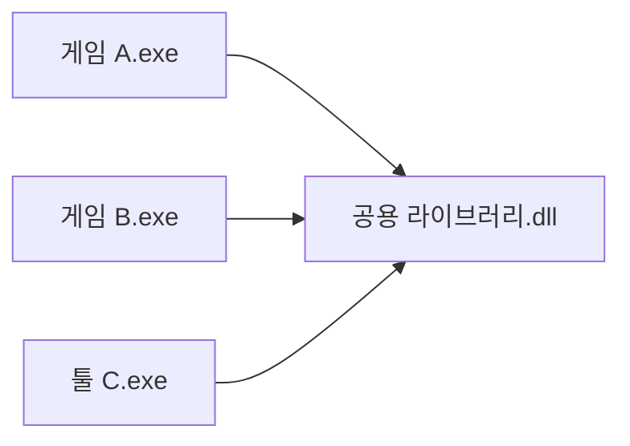

# DLL (Dynamic Link Library)

## 핵심 개념

- **DLL (동적 링크 라이브러리)**: 여러 프로그램이 **함께 쓸 수 있는 코드와 데이터를 담은 파일**
- 프로그램을 만들 때 코드를 실행 파일 안에 넣지 않고, **실행할 때 연결해서** 씀. 그래서 "동적" 링크임
- 윈도우의 `.dll`이 대표적이고, 리눅스는 `.so`, macOS는 `.dylib`가 같은 역할을 함

## 정적 링크와 동적 링크

| 구분 | 정적 링크 | 동적 링크 (DLL) |
| --- | --- | --- |
| 연결 시점 | 빌드할 때 실행 파일에 **복사해 넣음** | **실행할 때** 불러와 연결함 |
| 실행 파일 크기 | 커짐 | 작음 |
| 여러 프로그램이 공유 | 각자 복사본을 가짐 | **하나를 함께 씀** |
| 라이브러리 수정 시 | 프로그램을 다시 빌드해야 함 | DLL만 교체하면 됨 |
| 배포 | 실행 파일 하나로 끝남 | DLL도 함께 있어야 실행됨 |

- 같은 DLL을 여러 프로세스가 쓰면, 운영체제가 코드 부분을 **메모리에 한 번만 올려 공유**할 수 있어 메모리가 절약됨

## 불러오는 방식

| 방식 | 내용 | 특징 |
| --- | --- | --- |
| 암시적 로드 | 프로그램 시작 시 운영체제가 필요한 DLL을 자동으로 불러옴 | 간단함. DLL이 없으면 **시작 자체가 실패** |
| 명시적 로드 | 실행 중 필요한 시점에 코드로 직접 불러옴 | 선택적 기능, 플러그인에 적합. 없어도 대처할 수 있음 |

## DLL 지옥

- 여러 프로그램이 같은 이름의 DLL을 공유하다 보니, 한 프로그램이 **다른 버전으로 덮어쓰면** 다른 프로그램이 깨지는 문제가 있었음
- 이를 "DLL 지옥(DLL Hell)"이라 부름
- 지금은 프로그램 폴더에 필요한 DLL을 함께 두거나, 여러 버전을 나란히 설치하는 방식으로 대부분 피함

## .NET의 DLL은 성격이 다름

- C# 프로젝트를 빌드해서 나오는 `.dll`은 확장자만 같을 뿐, 내용이 일반 DLL과 다름

| 구분 | 네이티브 DLL | .NET 어셈블리 DLL |
| --- | --- | --- |
| 내용 | CPU가 바로 실행하는 기계어 | **중간 언어(IL) + 메타데이터** |
| 실행 | 바로 실행됨 | 런타임이 실행 시점에 기계어로 변환함 |
| 타입 정보 | 거의 없음 | 클래스·메서드 정보가 전부 들어 있음 |

- .NET에서는 이 단위를 **어셈블리**라고 부름. 배포와 버전 관리의 단위임
- 메타데이터가 들어 있어서 [[Reflection]]으로 타입 정보를 읽을 수 있음
- 같은 이유로 **디컴파일하면 원래 코드에 가까운 형태로 쉽게 복원됨**

**C#에서 네이티브 DLL 부르기**

- C#에서 C/C++로 만든 네이티브 DLL의 함수를 호출하는 기능이 있음 (P/Invoke)
- 데이터를 두 세계 사이에서 변환(마샬링)하는 비용이 있어, 자주 부르면 느려질 수 있음
- 플랫폼마다 네이티브 DLL을 따로 준비해야 함

## 게임 개발 관점에서

**유니티 스크립트도 DLL로 컴파일됨**

- 유니티에서 작성한 C# 스크립트는 컴파일되어 어셈블리 DLL로 만들어짐
- 기본적으로 모든 스크립트가 **하나의 큰 어셈블리**에 들어감

**어셈블리 정의 파일로 나누기**

- 어셈블리 정의 파일(asmdef)을 폴더에 두면, 그 폴더의 스크립트가 **별도 어셈블리**로 분리됨
- 효과
  - 코드를 고쳤을 때 **해당 어셈블리만 다시 컴파일**해서 컴파일 시간이 줄어듦
  - 어셈블리 간 참조 방향을 정해야 해서, **의존 방향이 강제됨**. 엉뚱한 곳끼리 서로 참조하는 것을 막음
- 프로젝트가 커지면 컴파일 대기 시간 때문에 거의 필수가 됨

**플러그인으로 DLL 쓰기**

- 외부 라이브러리를 DLL로 받아 프로젝트에 넣어 쓸 수 있음
- 네이티브 DLL은 플랫폼마다 다르므로, 어느 플랫폼에서 쓸지 임포트 설정에서 지정해야 함

**빌드 방식에 따라 결과물이 다름**

| 빌드 방식 | 결과물 | 특징 |
| --- | --- | --- |
| Mono | 게임 폴더에 스크립트 어셈블리 DLL이 **그대로** 들어감 | 디컴파일하기 쉬움 |
| IL2CPP | 스크립트를 C++로 변환해 **네이티브 코드**로 빌드함 | 분석이 상대적으로 어려움. 성능도 유리한 편 |

- Mono 빌드의 DLL은 쉽게 열어볼 수 있어, 많은 유니티 게임의 모드(MOD)가 이 DLL을 분석하거나 교체하는 방식으로 만들어짐
- 반대로 말하면 **클라이언트 코드는 언제든 읽힐 수 있다**고 가정해야 함. 중요한 판정이나 데이터는 서버가 가져야 함

## 의문점 / 더 알아볼 것

- 실행 파일 포맷(PE)의 구조와 DLL의 내보내기(export) 테이블
- .NET 어셈블리 로드 방식과 버전 충돌 해결
- 어셈블리 정의 파일의 참조 규칙과 에디터 전용 어셈블리
- 네이티브 플러그인을 직접 만들어 유니티에서 부르는 방법
- 코드 난독화 — DLL 디컴파일을 어렵게 만드는 방법과 한계
- 관련 노트 — [[File Format]], [[Process memory]]