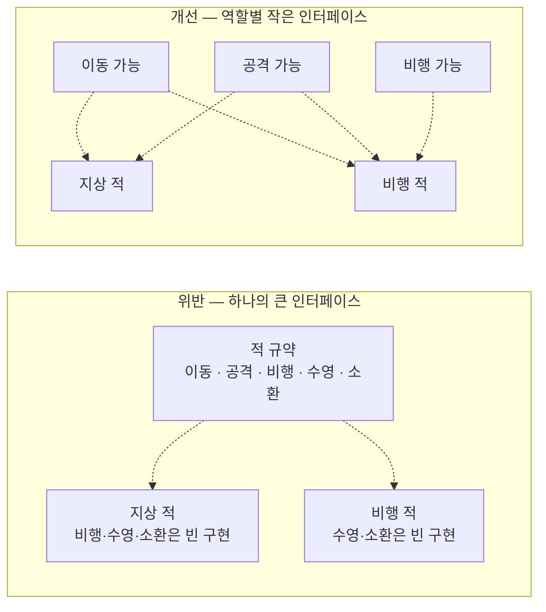

# 인터페이스 분리 원칙 (Interface Segregation Principle)

## 핵심 개념

- **인터페이스 분리 원칙(ISP)**: 클라이언트(쓰는 쪽)는 **자신이 쓰지 않는 메서드에 의존하도록 강요받으면 안 됨**
- [[SOLID]]의 I에 해당함
- 큰 인터페이스 하나보다, **역할별로 나눈 작은 인터페이스 여러 개**가 나음
- 기준은 구현하는 쪽이 아니라 **쓰는 쪽의 관점**임. "이 인터페이스를 받는 코드가 실제로 무엇을 호출하는가"로 나눔

## 뚱뚱한 인터페이스의 문제

- 큰 인터페이스를 구현하는 쪽은 **필요 없는 메서드까지 억지로 채워야** 함. 빈 구현이나 "지원하지 않음" 예외가 생김
- 그 빈 구현은 [[Liskov Substitution Principle]]을 깨뜨리는 원인이 됨
- 쓰는 쪽도 손해를 봄. 이동만 필요한 코드가 비행·수영까지 포함된 인터페이스에 묶여, 관계없는 메서드가 바뀌어도 영향을 받음

## 역할 인터페이스

- 인터페이스를 **"무엇인가"가 아니라 "무엇을 할 수 있는가"**로 정의함
- C#은 한 클래스가 [[Interface]]를 여러 개 구현할 수 있으므로, 필요한 역할만 골라 붙이면 됨
- 이름도 역할을 드러내게 지음. "피해를 받을 수 있음", "상호작용할 수 있음", "저장할 수 있음" 같은 식

| 큰 인터페이스 | 역할별로 나눈 인터페이스 |
| --- | --- |
| 적이 할 수 있는 모든 것 | 이동 가능, 공격 가능, 피해 가능 |
| 저장 관리자의 모든 기능 | 읽기 가능, 쓰기 가능 |
| UI 요소의 모든 이벤트 | 클릭 처리, 드래그 처리, 마우스 올림 처리 |

## 위반 신호

- 인터페이스를 구현하면서 메서드 일부를 **빈 채로 두거나 예외를 던짐**
- 인터페이스에 메서드가 하나 추가되면, 그 메서드를 쓰지도 않는 **구현 클래스 전부를 고쳐야** 함
- 인터페이스를 받는 코드가 그중 한두 개 메서드만 호출함

## 너무 잘게 나누면

- 메서드마다 인터페이스를 만들면 인터페이스가 폭발적으로 늘어 오히려 찾기 어려워짐
- **항상 함께 쓰이는 메서드들**은 한 인터페이스에 둠
- [[Single Responsibility Principle]]이 클래스를 변경 이유로 나눈다면, 이 원칙은 인터페이스를 **사용 목적**으로 나눔

## 게임 개발 관점에서

**유니티 자체가 이 원칙을 따르는 예가 있음**

- UI 이벤트 시스템은 클릭, 드래그, 마우스 올림 같은 이벤트를 **각각 별도의 인터페이스**로 제공함
- 클릭만 받고 싶은 컴포넌트는 클릭 인터페이스 하나만 구현하면 됨. 쓰지 않는 드래그 처리를 채울 필요가 없음

**역할로 판별하기**

- 공격이 맞았을 때 "피해를 받을 수 있는가"라는 역할 인터페이스를 가졌는지만 확인하면 됨
- 플레이어든 적이든 부서지는 상자든, 그 역할만 구현하면 같은 공격 코드로 처리됨
- 태그로 종류를 하나하나 구분하는 것보다 확장에 강함. [[Layer & Tag]] 참고

**조합 구조와 잘 맞음**

- 기능을 컴포넌트로 나눠 붙이는 유니티 구조에서는, 각 컴포넌트가 필요한 역할 인터페이스만 구현하는 방식이 자연스러움

## 의문점 / 더 알아볼 것

- 인터페이스의 기본 구현(Default Interface Method) — 메서드를 추가해도 기존 구현이 깨지지 않게 하는 방법과 그 한계
- 유니티 이벤트 시스템이 인터페이스를 찾아 호출하는 방식
- 인터페이스와 추상 클래스 중 무엇을 확장 지점으로 둘지
- 관련 노트 — [[Open-Closed Principle]], [[Liskov Substitution Principle]]