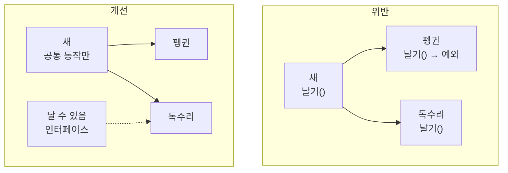

# 리스코프 치환 원칙 (Liskov Substitution Principle)

## 핵심 개념

- **리스코프 치환 원칙(LSP)**: 자식 타입은 **부모 타입이 쓰이던 자리에 넣어도 프로그램이 올바르게 동작해야** 함
- [[SOLID]]의 L에 해당함. 바바라 리스코프가 제시한 원칙이라 이름이 붙음
- 핵심은 "상속 문법상 가능한가"가 아니라 **"부모가 한 약속을 자식이 지키는가"**임
- 컴파일이 되는 것과 올바르게 동작하는 것은 다름. 이 원칙은 후자를 다룸

## 상속은 약속을 물려받는 것

- 부모 타입을 쓰는 코드는 부모의 동작을 믿고 짜여 있음
- 자식이 그 믿음을 깨면, 부모 타입으로 다루던 코드가 **자식이 들어오는 순간 조용히 틀린 결과를 냄**
- [[Polymorphism]]은 "부모 타입으로 다루면 자식이 알아서 맞게 동작한다"는 전제 위에 서 있음. 이 원칙이 깨지면 다형성 자체가 무너짐

## 지켜야 할 약속

| 규칙 | 의미 | 위반 예 |
| --- | --- | --- |
| 사전조건을 강화하지 않음 | 부모가 받아주던 입력을 자식이 거부하면 안 됨 | 부모는 음수 데미지를 허용하는데 자식은 예외를 던짐 |
| 사후조건을 약화하지 않음 | 부모가 보장하던 결과를 자식도 보장해야 함 | 부모는 호출 후 체력이 줄어 있음을 보장하는데 자식은 그대로 둠 |
| 불변식을 유지함 | 부모가 항상 참이라고 한 조건이 자식에서도 참이어야 함 | 체력은 0 이상이어야 하는데 자식이 음수를 허용함 |
| 새로운 예외를 던지지 않음 | 부모에 없던 실패 방식을 추가하면 안 됨 | 자식이 "지원하지 않음" 예외를 던짐 |

## 고전적인 예

**직사각형과 정사각형**

- 수학적으로 정사각형은 직사각형임. 그래서 정사각형이 직사각형을 상속하는 것이 자연스러워 보임
- 그런데 직사각형은 "가로를 바꿔도 세로는 그대로"라는 약속이 있음
- 정사각형은 가로를 바꾸면 세로도 함께 바뀌어야 함. 이 약속을 지킬 수 없음
- 직사각형을 받아 "가로 5, 세로 4로 바꾸면 넓이는 20"이라고 믿는 코드에 정사각형을 넣으면 16이나 25가 나옴
- **현실 세계의 분류(is-a)가 코드에서의 행동 약속과 일치하지 않는 경우**를 보여주는 예임

**새와 펭귄**

- 새가 `날기`를 가지고, 펭귄이 새를 상속함
- 펭귄은 날 수 없으니 `날기`를 비워 두거나 예외를 던짐
- "새라면 날 수 있다"고 믿고 짠 코드가 펭귄에서 깨짐

- 모두가 공유하지 않는 능력을 부모에 두지 않고, 가진 쪽에만 [[Interface]]로 붙이는 것이 해결 방향임
- [[SOLID]]의 인터페이스 분리 원칙과 함께 쓰이는 이유가 이것임

## 위반 신호

- 자식 클래스가 부모 메서드를 **빈 채로 두거나 "지원하지 않음" 예외**를 던짐
- 부모 타입으로 받았는데 호출하는 쪽에서 **`is`로 실제 타입을 검사해 분기**함
- 부모 기준으로 작성한 테스트가 특정 자식에서만 실패함
- 자식이 `override`로 부모의 의도와 **반대되는 동작**을 함

**타입 검사 분기가 가장 흔한 신호임**

- "보스면 넉백 처리를 건너뛰고, 아니면…"처럼 실제 타입을 확인하는 코드가 생겼다면 약속이 깨진 것임
- 이런 분기는 새 자식이 생길 때마다 늘어나므로 [[Open-Closed Principle]]까지 함께 무너짐

## 해결 방향

| 방법 | 내용 |
| --- | --- |
| 계층 다시 나누기 | 모두가 지킬 수 있는 동작만 부모에 남김 |
| 능력은 인터페이스로 | 일부만 가진 기능은 상속이 아니라 인터페이스로 붙임 |
| 상속 대신 조합 | 기능을 부품으로 만들어 필요한 것만 조립함 |
| 약속을 넓게 정의 | "넉백된다" 대신 "넉백을 시도한다"처럼 자식 모두가 지킬 수 있는 수준으로 부모의 약속을 정함 |

## 게임 개발 관점에서

**적 계층에서 자주 깨짐**

- 모든 적이 같은 부모를 상속하다 보면, 특수한 적이 부모의 기능 일부를 무력화하는 경우가 생김
- 보스가 넉백을 무시하려고 넉백 메서드를 비워 두면, 넉백 후 위치나 이펙트를 계산하던 쪽은 넉백됐다고 착각함
- 이런 예외가 쌓일수록 부모 클래스는 "대부분의 적에게만 맞는 약속"이 되어 버림

**유니티는 조합 쪽으로 기울어 있음**

- 유니티는 기능을 컴포넌트로 붙이는 구조라, 깊은 상속 계층보다 조합이 자연스러움
- 넉백 가능한 적에만 넉백 컴포넌트를 붙이면 "넉백 안 되는 적"이라는 예외 자체가 사라짐

**면접 단골 질문**

- 직사각형과 정사각형 예시를 설명하라는 질문이 자주 나옴
- "수학적 분류와 코드의 행동 약속이 다르다"는 요점을 짚고, 해결 방향까지 말할 수 있으면 충분함

## 의문점 / 더 알아볼 것

- 계약에 의한 설계(Design by Contract) — 사전조건, 사후조건, 불변식을 코드로 명시하는 방식
- 공변성과 반공변성 — 반환 타입과 매개변수 타입을 자식에서 바꿀 수 있는 범위
- 상속보다 조합(Composition over Inheritance)
- `sealed`로 상속 자체를 막는 판단 기준
- 관련 노트 — [[Inheritance]], [[Single Responsibility Principle]], [[Open-Closed Principle]]