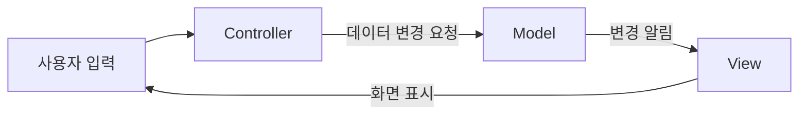

# MVC 패턴 (Model-View-Controller)

## 핵심 개념

- **MVC 패턴**: 프로그램을 **데이터(Model)**, **화면(View)**, **입력 처리(Controller)** 세 역할로 나누는 구조
- 목적은 **데이터와 화면을 분리**하는 것임. 화면을 바꿔도 데이터 로직은 그대로, 데이터 로직을 바꿔도 화면은 그대로 둘 수 있게 함

| 역할 | 하는 일 | 게임 UI 예 |
| --- | --- | --- |
| Model | 데이터와 규칙을 가짐. 화면을 모름 | 인벤토리 목록, 골드, 아이템 추가·제거 규칙 |
| View | 데이터를 **보여주기만** 함 | 인벤토리 칸 UI, 골드 텍스트 |
| Controller | 입력을 받아 Model에 요청함 | 아이템 클릭, 버리기 버튼 처리 |

- Model은 바뀌었다는 사실을 **알리기만** 하고, 누가 보여주는지는 모름. 이 알림이 [[Observer Pattern]]임

## 왜 나누는가

| 효과 | 내용 |
| --- | --- |
| 화면 교체 | 같은 인벤토리 데이터를 PC용 UI와 모바일용 UI로 각각 보여줄 수 있음 |
| 테스트 | 화면 없이 Model만 따로 검증할 수 있음 |
| 협업 | UI 작업과 데이터 로직 작업을 나눠서 진행할 수 있음 |
| 변경 범위 | 버튼 위치를 바꾸는 일이 아이템 규칙 코드를 건드리지 않음 |

- 역할별로 바뀌는 이유가 다르므로 [[Single Responsibility Principle]]을 구조 단위로 적용한 것으로 볼 수 있음

## 변형들

| 패턴 | 중간 역할 | 특징 |
| --- | --- | --- |
| MVC | Controller | 입력은 Controller, 표시는 View가 Model을 보고 갱신 |
| MVP | Presenter | View는 아무것도 모르고, Presenter가 Model을 읽어 View에 값을 **직접 넣어줌** |
| MVVM | ViewModel | View가 ViewModel에 **자동으로 연결(바인딩)**되어 값이 바뀌면 화면이 저절로 갱신됨 |

- 셋 다 "데이터와 화면을 떼어놓는다"는 목표는 같고, **둘을 어떻게 이어주느냐**가 다름
- 실무에서는 이름을 엄격히 구분하기보다 프로젝트에 맞게 섞어 쓰는 경우가 많음

## 주의할 점

**작은 기능에는 과함**

- 버튼 하나, 텍스트 하나짜리 UI까지 세 클래스로 나누면 파일만 늘고 흐름이 오히려 흩어짐
- 데이터가 여러 화면에 쓰이거나, 화면이 자주 바뀌는 곳부터 적용하는 것이 효과적임

**Controller가 비대해지기 쉬움**

- 이것저것 연결하는 역할이 몰리다 보면 Controller가 모든 것을 아는 거대 클래스가 됨

**View가 Model을 직접 고치면 의미가 사라짐**

- 화면 코드가 데이터를 바로 바꾸기 시작하면 분리한 이유가 없어짐
- View는 보여주고 입력을 전달하는 데까지만 책임짐

## 게임 개발 관점에서

**UI에서 가장 많이 쓰임**

- 인벤토리, 상점, 캐릭터 정보창, 설정 화면처럼 **데이터를 보여주고 조작하는 화면**이 대표적임
- 게임플레이 로직 전체를 MVC로 짜는 경우는 드묾

**유니티에서는 MVP 형태가 흔함**

- 유니티 UI 요소는 MonoBehaviour라 View가 자연스럽게 컴포넌트가 됨
- Model은 일반 C# 클래스로 두고, Presenter가 둘 사이를 이어주는 구성이 다루기 쉬움
- 아무 구분 없이 짜면 한 MonoBehaviour가 데이터 보관, 입력 처리, 화면 갱신을 모두 맡게 되는데, 이것이 분리 전의 전형적인 모습임

**Model 변경 알림**

- Model의 값이 바뀔 때 이벤트를 발행하고, View 쪽이 구독해 화면을 갱신하는 방식이 기본임
- 구독 해제를 빠뜨리면 누수가 생기므로 화면이 꺼질 때 반드시 해제함. [[Memory leak]] 참고

**데이터 저장과의 연결**

- Model이 화면과 분리되어 있으면 그대로 저장·불러오기 대상이 되기 쉬움. [[Serialization]] 참고

## 의문점 / 더 알아볼 것

- MVP와 MVVM을 유니티에서 구현하는 방식과 리액티브 라이브러리(R3)의 역할
- 유니티 UI Toolkit의 데이터 바인딩
- 웹 프레임워크의 MVC와 게임 UI의 MVC가 다른 점
- 관련 노트 — [[Interface]], [[Dependency Injection]]