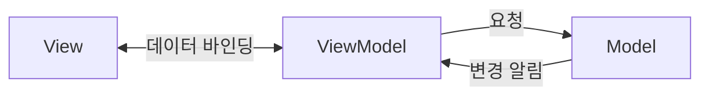

# MVVM 패턴 (Model-View-ViewModel)

## 핵심 개념

- **MVVM 패턴**: 프로그램을 **Model**, **View**, **ViewModel** 세 역할로 나누고, View와 ViewModel을 **데이터 바인딩**으로 자동 연결하는 구조
- 목적은 MVC와 같음. **데이터와 화면을 분리**하는 것
- 차이는 연결 방식임. ViewModel이 화면을 직접 고치지 않고, **값만 바꾸면 화면이 저절로 갱신됨**
- 마이크로소프트의 데스크톱 UI 프레임워크(WPF)에서 시작된 패턴임

| 역할 | 하는 일 | 게임 UI 예 |
| --- | --- | --- |
| Model | 데이터와 규칙을 가짐. 화면을 모름 | 플레이어 체력, 최대 체력, 피해 규칙 |
| ViewModel | Model을 **화면에 보여주기 좋은 형태**로 가공해 들고 있음. View를 모름 | 체력 비율, "120 / 200" 문자열, 위험 상태 여부 |
| View | ViewModel의 값에 **연결(바인딩)**되어 표시만 함 | 체력바, 체력 텍스트, 빨간 테두리 |

- ViewModel은 **View가 누구인지 모름**. 값이 바뀌었다고 알리기만 하고, 그 값을 구독한 View가 알아서 갱신됨
- 이 알림 구조는 [[Observer Pattern]]임

## 데이터 바인딩

- **바인딩**: View의 요소와 ViewModel의 값을 미리 연결해 두는 것
- 연결해 두면 값이 바뀔 때마다 화면을 갱신하는 코드를 **직접 쓰지 않아도 됨**

| 방향 | 흐름 | 예 |
| --- | --- | --- |
| 단방향 | ViewModel → View | 체력 텍스트 표시 |
| 양방향 | ViewModel ↔ View | 설정 화면의 볼륨 슬라이더. 움직이면 값이 바뀌고, 값이 바뀌면 슬라이더도 움직임 |

- 버튼 클릭 같은 입력은 ViewModel이 제공하는 **명령(Command)**에 연결함. [[Command Pattern]] 참고

## MVC, MVP와의 차이

| 구분 | MVC | MVP | MVVM |
| --- | --- | --- | --- |
| 중간 역할 | Controller | Presenter | ViewModel |
| View 갱신 | View가 Model을 보고 갱신 | Presenter가 View에 값을 **직접 넣음** | 바인딩이 **자동으로** 갱신 |
| 중간 역할이 View를 아는가 | 경우에 따라 다름 | 앎 (인터페이스로) | **모름** |
| 화면 갱신 코드 | 직접 작성 | Presenter에 작성 | 바인딩 시스템이 대신함 |

- MVVM은 바인딩 시스템이 있어야 제 효과가 남. 없으면 결국 연결 코드를 손으로 짜야 해서 MVP와 비슷해짐
- [[MVC Pattern]] 참고

## 왜 쓰는가

| 효과 | 내용 |
| --- | --- |
| 갱신 코드 감소 | 값만 바꾸면 화면이 따라옴 |
| 테스트 | ViewModel은 화면 없이 값만으로 검증할 수 있음 |
| 화면 교체 | 같은 ViewModel에 다른 View를 연결할 수 있음 |
| 협업 | UI 디자이너가 View를, 프로그래머가 ViewModel을 나눠 작업하기 쉬움 |

## 주의할 점

**작은 UI에는 과함**

- 텍스트 몇 개짜리 화면에 ViewModel과 바인딩까지 두면 구조만 무거워짐

**바인딩은 디버깅이 어려움**

- 연결이 자동으로 일어나므로, 값이 화면에 안 나올 때 **어디서 끊겼는지 추적하기 어려움**
- 바인딩 경로를 문자열로 지정하는 방식은 오타가 나도 컴파일 에러가 나지 않음 주의

**ViewModel이 비대해지기 쉬움**

- 화면 하나에 필요한 값을 전부 몰아넣다 보면 거대한 클래스가 됨. 화면 단위로 나눠야 함

**알림 누락**

- 값을 바꾸고 변경 알림을 빠뜨리면 화면이 갱신되지 않음. 알림을 자동으로 처리하는 프로퍼티 구조를 쓰는 이유임. [[Property]] 참고

## 게임 개발 관점에서

**유니티의 기본 UI(UGUI)에는 바인딩이 없음**

- 기본 UI 시스템에는 데이터 바인딩 기능이 없어서, 순수 MVVM을 쓰려면 라이브러리가 필요함
- 그래서 유니티에서는 MVP 형태가 더 흔했음

**바인딩을 제공하는 방법들**

| 방법 | 내용 |
| --- | --- |
| UI Toolkit 런타임 바인딩 | 유니티 6부터 UI Toolkit에 런타임 데이터 바인딩이 들어감 |
| 리액티브 라이브러리 (R3 등) | 값이 바뀌면 알림을 보내는 프로퍼티를 제공해 바인딩처럼 쓸 수 있음 |
| 직접 구현 | 값 변경 시 이벤트를 발행하는 프로퍼티를 만들어 View가 구독함 |

**쓰기 좋은 곳**

- 설정 화면, 인벤토리, 상점, 캐릭터 정보창처럼 **값이 많고 자주 바뀌는 UI**
- 체력바, 탄약 표시처럼 HUD 요소가 여러 곳에서 같은 데이터를 보여줄 때

**구독 해제**

- View가 ViewModel의 알림을 구독했다면 화면이 꺼질 때 해제해야 함. [[OnDisable]], [[Memory leak]] 참고

## 의문점 / 더 알아볼 것

- UI Toolkit 런타임 바인딩의 사용법과 UGUI와의 차이
- R3의 리액티브 프로퍼티 구조
- 변경 알림 인터페이스(INotifyPropertyChanged)의 동작 방식
- 게임 UI에서 MVP와 MVVM 중 무엇을 고르는 기준
- 관련 노트 — [[Event & Pub-Sub Pattern]], [[Interface]]