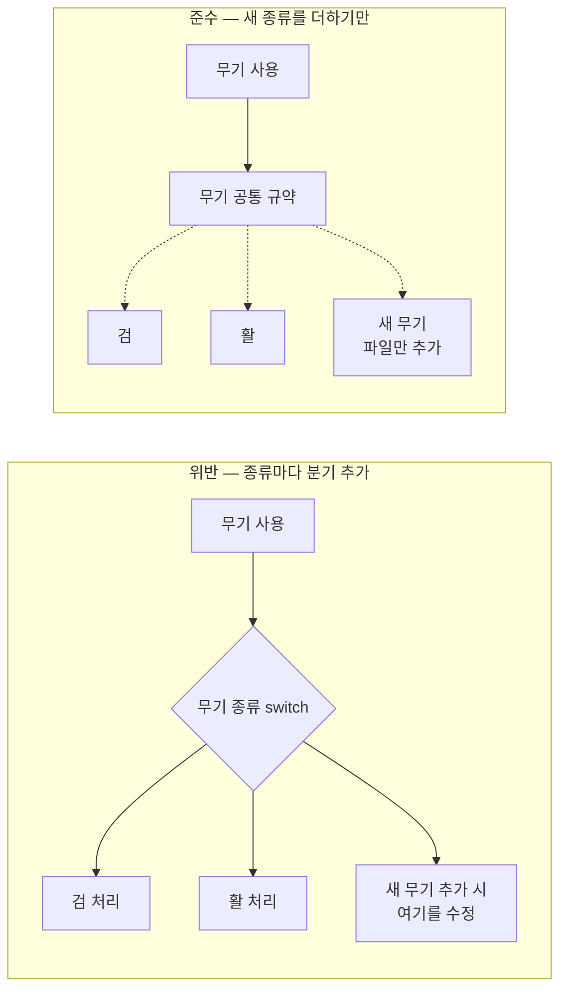

# 개방-폐쇄 원칙 (Open-Closed Principle)

## 핵심 개념

- **개방-폐쇄 원칙(OCP)**: 소프트웨어는 **확장에는 열려 있고, 수정에는 닫혀 있어야** 함
- 새 기능을 추가할 때 **기존 코드를 고치지 않고, 새 코드를 더하는 것**으로 끝나야 한다는 뜻임
- [[SOLID]]의 O에 해당함
- 이미 동작하는 코드를 고칠수록 기존 기능이 깨질 위험이 커지기 때문임. 새 코드를 더하는 쪽은 기존 동작을 건드리지 않음

## 위반하는 구조와 지키는 구조

- 왼쪽은 무기가 늘 때마다 **사용하는 쪽의 분기**를 고쳐야 함. 분기가 여러 곳에 있으면 전부 찾아 고쳐야 함
- 오른쪽은 사용하는 쪽이 "무기라면 이렇게 쓸 수 있다"는 **공통 규약**만 앎. 새 무기는 그 규약을 따르는 코드를 추가하면 끝남

## 확장 지점을 만드는 수단

| 수단 | 방식 | 관련 노트 |
| --- | --- | --- |
| 다형성 | 공통 규약(인터페이스, 추상 클래스)을 두고 구현을 갈아 끼움 | [[Interface]], [[Polymorphism]] |
| 데이터화 | 종류를 코드가 아니라 데이터(에셋)로 늘림 | [[Scriptable Object]] |
| 이벤트 | 발행하는 쪽을 고치지 않고 반응하는 쪽을 추가함 | [[Delegate]] |
| 전략 교체 | 동작을 객체로 만들어 주입함 | |

- 공통점은 **변하는 부분과 변하지 않는 부분을 분리**한다는 것임
- 변하지 않는 쪽(사용하는 코드)은 닫아 두고, 변하는 쪽(종류, 동작)만 열어 둠

## 위반 신호

- 새 종류를 추가할 때마다 기존 `switch`나 `if-else` 연쇄에 분기를 늘려야 함. [[Switch when]] 참고
- 같은 종류 판별 분기가 **여러 파일에 흩어져** 있음. 하나 추가하면 전부 찾아서 고쳐야 함
- [[Enum]]에 멤버를 추가할 때마다 그 열거형을 쓰는 곳을 줄줄이 수정함

## 모든 곳을 열 수는 없음

- 어떤 방향의 변경에 대비할지 정해야 함. **모든 변경에 열린 코드는 존재하지 않음**
- 예상만으로 확장 지점을 만들면, 실제로는 다른 방향으로 바뀌어 쓸모없는 추상화만 남음
- 실용적인 기준
  - **처음 한 번**은 그냥 구현함
  - 같은 종류의 변경이 **두세 번 반복되면** 그 축이 실제로 변하는 축임. 그때 확장 지점을 만듦
- 추상화는 공짜가 아님. 파일과 계층이 늘어 흐름을 따라가기 어려워짐

## 단일 책임 원칙과의 관계

- [[Single Responsibility Principle]]는 "무엇을 함께 둘 것인가", 개방-폐쇄 원칙은 "변경을 어떻게 받아들일 것인가"를 다룸
- 책임이 섞인 클래스는 어떤 변경이 와도 그 클래스를 고쳐야 하므로, 단일 책임이 개방-폐쇄의 전제가 되는 경우가 많음

## 게임 개발 관점에서

**콘텐츠가 계속 늘어나는 영역에서 중요함**

- 무기, 스킬, 아이템, 적, 버프처럼 출시 후에도 계속 추가되는 것들이 대표적임
- 이런 영역에서 추가할 때마다 핵심 로직을 고치면, 콘텐츠 하나 넣을 때마다 기존 콘텐츠가 깨질 위험을 짊어짐

**데이터로 여는 방식이 특히 유용함**

- 종류별 차이가 **수치나 조합**뿐이라면 코드 대신 에셋으로 늘리는 것이 가장 강력한 확장 방식임
- 기획자가 코드 수정 없이 새 콘텐츠를 만들 수 있게 됨
- 동작 자체가 종류마다 다를 때만 코드 수준의 다형성이 필요함

**성능과의 균형**

- 공통 규약을 통한 호출은 직접 호출보다 약간 비쌈
- 매 프레임 수만 번 도는 코드에서는 분기를 그대로 두는 것이 나은 경우도 있음

## 의문점 / 더 알아볼 것

- 전략 패턴, 템플릿 메서드 패턴 — 개방-폐쇄를 구현하는 대표적인 패턴
- 플러그인 구조 — 리플렉션으로 확장 코드를 자동 수집하는 방식
- 추상 클래스와 인터페이스 중 확장 지점으로 무엇을 고를지
- 데이터 주도 설계(Data-Driven Design)가 게임 업계에서 널리 쓰이는 이유
- YAGNI 원칙과 개방-폐쇄 원칙이 충돌하는 지점