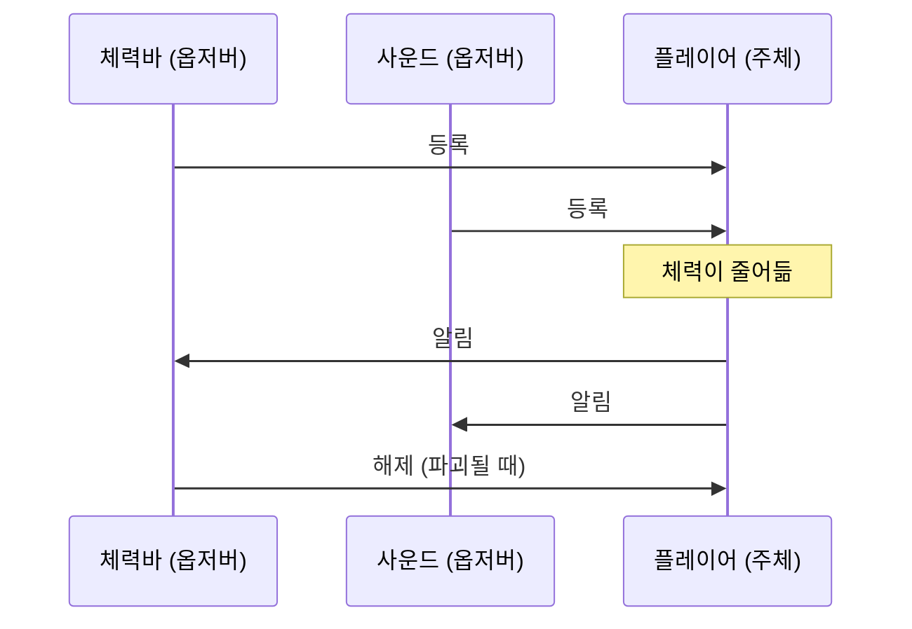

# 옵저버 패턴 (Observer Pattern)

## 핵심 개념

- **옵저버 패턴**: 어떤 객체의 상태가 바뀌면, 그 객체를 **지켜보고 있는 객체들에게 자동으로 알려주는** 디자인 패턴
- 알리는 쪽은 **누가 듣고 있는지 몰라도 됨**. "변화가 있었다"만 알리면 됨
- 일대다 관계를 느슨하게 연결하는 것이 목적임

| 역할 | 이름 | 하는 일 |
| --- | --- | --- |
| 지켜봐지는 쪽 | 주체 (Subject) | 옵저버 목록을 가지고, 변화가 생기면 목록 전체에 알림 |
| 지켜보는 쪽 | 옵저버 (Observer) | 주체에 등록해 두고, 알림이 오면 반응함 |

## 왜 쓰는가

- 옵저버 패턴 없이 플레이어가 체력바, 사운드, 업적을 **직접 호출**하면, 플레이어가 그 모두를 알아야 함
- 반응할 대상이 하나 늘 때마다 플레이어 코드를 고쳐야 함
- 옵저버 패턴을 쓰면 플레이어는 알리기만 하고, 새 반응은 **옵저버를 하나 더 등록**하는 것으로 끝남
- [[Open-Closed Principle]]과 맞닿아 있음

## 알리는 방식

| 방식 | 내용 | 특징 |
| --- | --- | --- |
| 밀어주기 (Push) | 알릴 때 바뀐 값을 함께 보냄 | 옵저버가 바로 씀. 필요 없는 값도 받을 수 있음 |
| 끌어가기 (Pull) | "바뀌었다"만 알리고, 옵저버가 주체에서 직접 값을 읽음 | 옵저버가 필요한 것만 읽음. 대신 주체를 알아야 함 |

## C#에서의 구현

| 방식 | 내용 |
| --- | --- |
| 인터페이스 직접 구현 | 옵저버 규약을 인터페이스로 정의하고, 주체가 그 목록을 관리함. 고전적인 형태 |
| 델리게이트와 이벤트 | **언어가 옵저버 패턴을 내장**한 것. 등록·해제·알림을 문법으로 제공함 |
| 표준 인터페이스 | .NET이 옵저버 패턴용 인터페이스 한 쌍을 제공함. 리액티브 라이브러리의 기반 |

- C#의 `event`는 옵저버 패턴 그 자체임. 이벤트를 쓰고 있다면 이미 이 패턴을 쓰는 것임
- 이벤트의 문법과 세부 동작은 [[Event & Pub-Sub Pattern]], [[Delegate]] 참고

## 옵저버 패턴과 발행/구독 패턴

| 구분 | 옵저버 패턴 | 발행/구독 패턴 |
| --- | --- | --- |
| 연결 | 옵저버가 **주체에 직접** 등록함 | 둘 사이에 **중개자(브로커·채널)**가 있음 |
| 서로를 아는가 | 옵저버는 주체를 앎 | 발행자와 구독자가 서로를 전혀 모름 |
| 결합도 | 느슨함 | 더 느슨함 |

- 유니티에서 ScriptableObject를 이벤트 채널로 쓰는 방식은 발행/구독 쪽에 가까움. [[Scriptable Object]] 참고

## 주의할 점

**해제를 잊으면 누수가 됨**

- 주체가 옵저버 목록을 쥐고 있으므로, 해제하지 않은 옵저버는 **파괴된 뒤에도 회수되지 않음**
- 이 문제를 따로 부르는 이름이 있을 정도로 흔함 (Lapsed Listener Problem)
- 등록과 해제를 짝지어 두는 것이 기본임. [[Memory leak]] 참고

**알림 순서에 기대면 안 됨**

- 여러 옵저버가 어떤 순서로 알림을 받을지에 의존하는 로직은 깨지기 쉬움

**알림 도중 목록이 바뀌는 문제**

- 알림을 받은 옵저버가 그 자리에서 자기 자신을 해제하거나 다른 옵저버를 추가하면, 순회 중인 목록이 바뀌어 예외가 나거나 일부가 빠짐
- 알림 전에 목록을 복사해서 돌거나, 뒤에서부터 순회하는 방식으로 대비함

**연쇄 알림**

- 옵저버가 반응하면서 다른 주체를 바꾸고, 그 주체가 또 알리고… 하는 식으로 연쇄가 생김
- 고리가 생기면 무한 반복에 빠질 수 있고, 흐름을 추적하기 매우 어려워짐

**흐름이 코드에 안 드러남**

- "이 함수를 누가 부르는가"를 코드에서 바로 찾을 수 없음
- 남용하면 디버깅이 어려워지므로, 결합을 끊을 가치가 있는 경계에서만 씀

## 게임 개발 관점에서

**대표적인 쓰임**

- 체력·점수·재화가 바뀌면 UI 갱신
- 적 처치 시 업적, 퀘스트 진행, 사운드, 이펙트가 각자 반응
- 게임 상태 변화(일시정지, 게임 오버)를 여러 시스템에 전달

**유니티에서의 선택지**

| 방식 | 특징 |
| --- | --- |
| C# 이벤트 | 빠름. 코드에서만 연결 |
| UnityEvent | 인스펙터에서 연결 가능. 상대적으로 느림. [[Unity Event]] |
| ScriptableObject 이벤트 채널 | 발행자와 구독자가 에셋만 공유함 |

**등록·해제 시점**

- 오브젝트가 켜질 때 등록하고 꺼질 때 해제하는 쌍이 가장 안전함
- 씬을 넘어 살아남는 주체(매니저, 정적 이벤트)일수록 해제 누락의 피해가 큼

## 의문점 / 더 알아볼 것

- 약한 참조를 이용한 이벤트 — 해제를 잊어도 누수가 나지 않게 하는 방법
- .NET 표준 옵저버 인터페이스와 리액티브 확장(R3, UniRx)
- MVC, MVP 같은 UI 구조에서 옵저버 패턴의 역할
- 알림을 즉시 보내지 않고 모았다가 보내는 방식 — 이벤트 큐