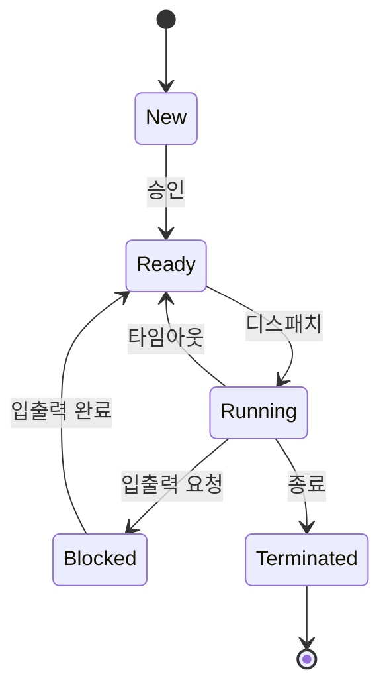

# 프로세스 상태 (Process Status)

## 핵심 개념

- 프로세스는 생성되어 종료될 때까지 **여러 상태를 오가며** 실행됨
- 상태를 바꾸는 주체는 **운영체제의 스케줄러**임. 프로세스가 스스로 정하는 것이 아님
- 현재 상태는 [[PCB]]에 기록되고, OS는 이 정보를 보고 다음에 누구를 실행할지 결정함
- CPU 코어 하나에서 **실행 중(Running)인 프로세스는 한 번에 하나**뿐임. 나머지는 전부 기다리는 중임

## 5가지 상태

| 상태 | 의미 |
| --- | --- |
| 생성 (New) | 프로세스를 만드는 중. PCB와 메모리를 할당받는 단계 |
| 준비 (Ready) | 실행할 준비는 끝났고 **CPU 차례만 기다리는** 상태 |
| 실행 (Running) | CPU를 받아 실제로 명령어를 실행하는 상태 |
| 대기 (Blocked / Waiting) | 입출력 같은 **외부 작업이 끝나기를 기다리는** 상태. CPU를 줘도 할 일이 없음 |
| 종료 (Terminated) | 실행이 끝나 자원을 반납하는 중 |

## 상태 전이

| 전이 | 일어나는 상황 |
| --- | --- |
| 디스패치 (Ready → Running) | 스케줄러가 이 프로세스에 CPU를 배정함 |
| 타임아웃 (Running → Ready) | 할당받은 시간이 끝나 CPU를 빼앗김 |
| 블록 (Running → Blocked) | 파일 읽기, 네트워크 요청처럼 기다려야 하는 작업을 시작함 |
| 웨이크업 (Blocked → Ready) | 기다리던 작업이 끝남 |

**대기에서 바로 실행으로 갈 수 없음**

- 입출력이 끝나도 곧바로 CPU를 받지 못하고 **반드시 준비 상태를 거쳐** 다시 차례를 기다림
- 그 사이 다른 프로세스가 CPU를 쓰고 있을 수 있기 때문임

**준비와 대기의 차이**

- 준비 — CPU만 주면 바로 실행할 수 있음
- 대기 — CPU를 줘도 할 게 없음. 외부 작업 결과가 와야 진행됨
- 둘 다 "실행 중이 아님"이라 헷갈리기 쉬움. 기다리는 대상이 **CPU인지, 외부 작업인지**로 구분함

## 보류 상태 (Suspended)

- 메모리가 부족하면 OS가 일부 프로세스를 통째로 디스크로 내보냄 (스왑 아웃)
- 이때 **보류 준비(Suspended Ready)**, **보류 대기(Suspended Blocked)** 상태가 추가됨
- 다시 메모리로 불러오기 전까지는 준비 상태로도 돌아갈 수 없음

## 게임 개발 관점에서

**동기 입출력은 게임을 대기 상태로 만듦**

- 메인 스레드에서 파일이나 네트워크를 동기로 읽으면, 그 작업이 끝날 때까지 메인 스레드가 대기 상태가 됨
- 그 시간 동안 렌더링도 입력 처리도 멈춰 화면이 굳음
- 로딩·세이브·통신을 비동기로 처리하는 이유가 여기 있음. [[Sync & Async]] 참고

**모바일에서는 OS가 게임 상태를 바꿈**

- 전화가 오거나 홈으로 나가면 OS가 게임을 일시정지시키거나, 메모리가 부족하면 아예 종료시킴
- 유니티의 `OnApplicationPause`, `OnApplicationFocus`가 이 시점을 알려줌
- 백그라운드로 갈 때 진행 상황을 저장하지 않으면 돌아왔을 때 처음부터 다시 시작될 수 있음

**타임아웃이 프레임 시간에 끼어듦**

- 게임도 OS 입장에서는 여러 프로세스 중 하나라 언제든 CPU를 빼앗길 수 있음
- 백그라운드 프로그램이 많으면 게임이 준비 상태에서 기다리는 시간이 늘어 프레임이 불규칙해짐

## 의문점 / 더 알아볼 것

- 스케줄링 알고리즘 — FCFS, 라운드 로빈, 우선순위 스케줄링
- 컨텍스트 스위칭 — 상태가 바뀔 때 PCB에 무엇을 저장하고 복원하는가
- 좀비 프로세스와 고아 프로세스
- [[Thread status]]와 비교 — 스레드도 같은 상태 모델을 따르는가
- 모바일 OS가 백그라운드 앱을 종료시키는 기준
