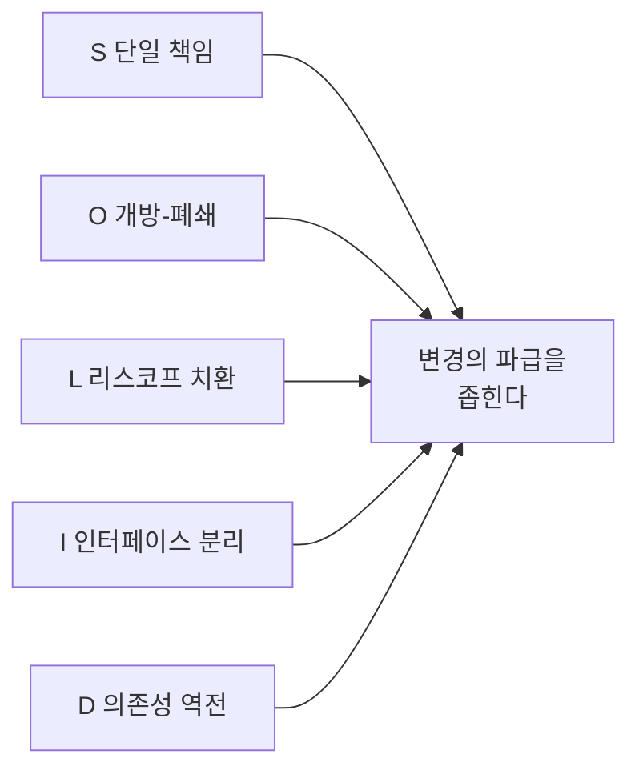

# SOLID 원칙 (SOLID Principles)

## 핵심 개념

- 객체지향 설계에서 **변경에 강한 코드**를 만들기 위한 다섯 가지 원칙
- 다섯 개 모두 같은 목표를 향함 — **하나를 고칠 때 다른 곳까지 줄줄이 고치지 않게 하는 것**
- 규칙이 아니라 **판단 기준**임. 코드가 고치기 어려워졌을 때 "어디가 문제인가"를 짚는 도구로 씀

## 다섯 가지 원칙

### S — 단일 책임 원칙 (Single Responsibility)

- **클래스는 바뀌어야 할 이유가 하나뿐이어야 함**
- "기능이 하나"가 아니라 "변경 사유가 하나"라는 점이 핵심임
- 위반 신호 — 입력, 이동, 체력, UI 갱신, 사운드를 한 클래스가 모두 처리함. 사운드를 고치려고 열었는데 이동 코드까지 건드리게 됨

### O — 개방-폐쇄 원칙 (Open-Closed)

- **확장에는 열려 있고, 수정에는 닫혀 있어야 함**
- 새 기능을 추가할 때 기존 코드를 고치지 않고 새 코드를 더하는 방식으로 해결할 수 있어야 함
- 위반 신호 — 새 무기를 추가할 때마다 기존 `switch`에 `case`를 하나씩 늘려야 함. [[Switch When]] 참고

### L — 리스코프 치환 원칙 (Liskov Substitution)

- **자식 클래스는 부모 클래스 자리에 넣어도 문제없이 동작해야 함**
- 부모를 믿고 쓴 코드가 자식 때문에 깨지면 안 됨
- 위반 신호 — 자식이 부모의 메서드를 "지원하지 않음" 예외로 막아버림. 새(`Bird`)를 상속한 펭귄이 `Fly()`를 막는 고전적 예가 이것임
- [[Inheritance]], [[Polymorphism]]과 직결되는 원칙임

### I — 인터페이스 분리 원칙 (Interface Segregation)

- **쓰지 않는 메서드에 의존하도록 강요하면 안 됨**
- 큰 인터페이스 하나보다 작은 인터페이스 여러 개가 나음
- 위반 신호 — 적 인터페이스에 공격, 비행, 수영이 다 들어 있어서 지상 적도 비행 메서드를 빈 채로 구현해야 함
- [[Interface]] 참고

### D — 의존성 역전 원칙 (Dependency Inversion)

- **구체적인 클래스가 아니라 추상(인터페이스)에 의존해야 함**
- 중요한 규칙을 담은 쪽이 세부 구현에 묶이지 않게 함
- 위반 신호 — 플레이어 코드가 키보드 입력 클래스를 직접 만들어 씀. 패드를 지원하려면 플레이어 코드를 고쳐야 함

## 주의할 점

**과하게 적용하면 오히려 나빠짐**

- 모든 것을 인터페이스로 쪼개고 작은 클래스로 나누면 파일만 늘고 흐름을 따라가기 어려워짐
- 바뀔 가능성이 없는 곳까지 대비하는 것은 과설계임

**처음부터 지키기보다 문제가 생겼을 때 적용하는 기준**

- 같은 이유로 여러 파일을 계속 고치고 있다면 → 단일 책임이나 개방-폐쇄를 의심
- 상속했더니 예외 처리가 늘어난다면 → 리스코프 치환을 의심
- 직접 고치면서 "왜 고치기 어려운가"를 겪어본 뒤에 원칙을 대어보면 훨씬 잘 이해됨

## 게임 개발 관점에서

**유니티 구조 자체가 원칙을 반영함**

- 기능을 컴포넌트로 나눠 붙이는 방식은 단일 책임 원칙과 맞닿아 있음
- [[Input System]]이 기기와 동작을 분리한 것은 의존성 역전의 예임
- 콘텐츠를 코드가 아니라 [[Scriptable Object]] 에셋으로 늘리는 방식은 개방-폐쇄의 예임

**성능과의 트레이드오프**

- 추상화 계층이 늘면 호출 비용과 할당이 따라옴
- 매 프레임 수천 번 도는 코드에서는 원칙보다 성능이 우선인 경우가 있음
- 원칙을 깨더라도 **의도적으로 깼다는 것을 아는 것**이 중요함

**면접에서 자주 나옴**

- 다섯 가지 이름과 정의를 외우는 것보다, 각 원칙의 위반 사례를 하나씩 설명할 수 있는 것이 중요함
- 자기 프로젝트에서 실제로 고치기 어려웠던 경험과 연결해 설명하면 설득력이 큼

## 의문점 / 더 알아볼 것

- 의존성 주입(DI)과 의존성 역전 원칙의 차이 — 원칙과 구현 기법
- 상속보다 조합(Composition over Inheritance)이 리스코프 문제를 피하는 방식
- 디자인 패턴과 SOLID의 관계 — 전략 패턴, 옵저버 패턴이 어느 원칙을 구현하는가
- 데이터 지향 설계(ECS)에서는 SOLID가 어떻게 달라지는가
- YAGNI, KISS 같은 원칙과 SOLID가 충돌하는 지점