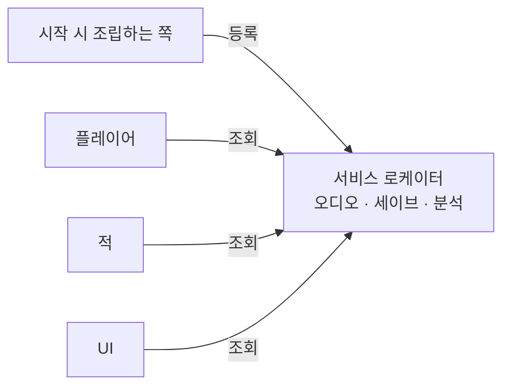

# 서비스 로케이터 (Service Locator)

## 핵심 개념

- **서비스 로케이터**: 여러 곳에서 쓰는 기능(서비스)을 **중앙 등록소에 등록해 두고**, 필요한 쪽이 **찾아서 꺼내 쓰는** 패턴
- 두 가지 동작으로 이루어짐
  - 등록 — 시작할 때 "오디오 서비스는 이 구현을 쓴다"고 등록함
  - 조회 — 쓰는 쪽이 "오디오 서비스를 달라"고 요청해 받음
- 서비스는 보통 **인터페이스 타입으로** 등록하고 조회함. 쓰는 쪽은 구체 구현을 모름

## 싱글톤과 무엇이 다른가

| 구분              | 싱글톤          | 서비스 로케이터             |
| ----------------- | --------------- | --------------------------- |
| 쓰는 쪽이 아는 것 | **구체 클래스** | **인터페이스**              |
| 구현 교체         | 어려움          | 등록만 바꾸면 됨            |
| 전역 접근         | 있음            | 있음 (로케이터 자체가 전역) |
| 테스트            | 어려움          | 가짜 구현을 등록하면 됨     |

- 싱글톤의 가장 큰 문제였던 "구체 클래스에 직접 묶임"을 인터페이스로 풀어낸 형태임
- 하지만 **전역에서 꺼내 쓴다**는 성질은 그대로 남음. [[Singleton Pattern]] 참고

## 의존성 주입과 무엇이 다른가

| 구분                | 의존성 주입          | 서비스 로케이터          |
| ------------------- | -------------------- | ------------------------ |
| 받는 방식           | 밖에서 **넣어줌**    | 안에서 **꺼내 씀**       |
| 의존성이 드러나는가 | 생성자·필드에 드러남 | 메서드 안쪽에 **숨음**   |
| 누락 발견 시점      | 조립할 때            | **그 코드가 실행될 때**  |
| 구조                | 조립하는 쪽이 필요함 | 등록소 하나면 됨. 단순함 |

- [[Dependency Injection]] 참고

## 안티 패턴이라는 비판

**숨은 의존성**

- 클래스 선언만 봐서는 어떤 서비스를 쓰는지 알 수 없음. 메서드 안을 읽어야 알 수 있음

**실행 중에야 발견되는 오류**

- 등록하지 않은 서비스를 요청하면, 컴파일할 때가 아니라 **그 코드가 실행되는 순간** 오류가 남
- 드물게 실행되는 경로라면 한참 뒤에야 발견됨

**여전히 전역**

- 어디서든 꺼낼 수 있으므로 남용하면 싱글톤과 같은 얽힘이 생김

**반론**

- 게임처럼 오디오·세이브·로그 같은 **진짜 전역 서비스**가 있는 환경에서는 실용적인 절충안임
- DI 컨테이너 같은 별도 도구 없이 간단히 구현할 수 있음

## 널 서비스 (Null Service)

- 서비스가 등록되지 않았을 때 `null` 대신 **아무것도 하지 않는 기본 구현**을 돌려주는 방식
- 쓰는 쪽이 매번 `null`을 확인할 필요가 없어짐
- 활용
  - 사운드를 끄고 싶을 때 오디오 서비스를 널 서비스로 바꿔 등록
  - 테스트할 때 필요 없는 서비스를 널 서비스로 채움
  - 아직 준비되지 않은 서비스를 임시로 대체

## 감싸서 기능 덧붙이기

- 원래 서비스를 감싼 **래퍼 구현**을 등록하면, 쓰는 쪽을 고치지 않고 기능을 덧붙일 수 있음
- 예: 오디오 서비스 호출을 전부 로그로 남기는 래퍼를 디버그 빌드에서만 등록

## 게임 개발 관점에서

**적합한 서비스**

- 오디오, 세이브·로드, 로그, 분석(통계 전송), 플랫폼 기능(업적, 결제)
- 게임 전체에서 하나만 필요하고, 여러 시스템이 고르게 쓰는 것

**플랫폼별 구현 교체**

- PC와 모바일, 스토어별로 업적·결제 구현이 다를 때, 시작 시 플랫폼에 맞는 구현을 등록하면 나머지 코드는 그대로 둘 수 있음

**등록 시점과 순서**

- 다른 오브젝트가 조회하기 **전에** 등록이 끝나 있어야 함
- 게임 시작용 씬에서 서비스를 모두 등록하고, 이후 씬으로 넘어가는 구성이 흔함
- 씬마다 바뀌는 서비스라면 씬 전환 시 등록 해제까지 관리해야 함

**쓰는 범위를 좁게**

- 게임 로직의 세부 객체끼리 주고받는 것까지 로케이터로 처리하면 의존 관계가 전부 숨어 버림
- 진짜 전역 서비스에만 쓰고, 나머지는 직접 참조나 주입으로 연결하는 것이 좋음

## 의문점 / 더 알아볼 것

- 게임 프로그래밍 패턴(Game Programming Patterns)의 서비스 로케이터 장
- 널 오브젝트 패턴 — 아무것도 하지 않는 객체로 분기를 없애는 방식
- 데코레이터 패턴 — 감싸서 기능을 덧붙이는 구조
- DI 컨테이너가 내부적으로 서비스 로케이터를 쓰는 방식
- 관련 노트 — [[Interface]], [[Static Class]]
