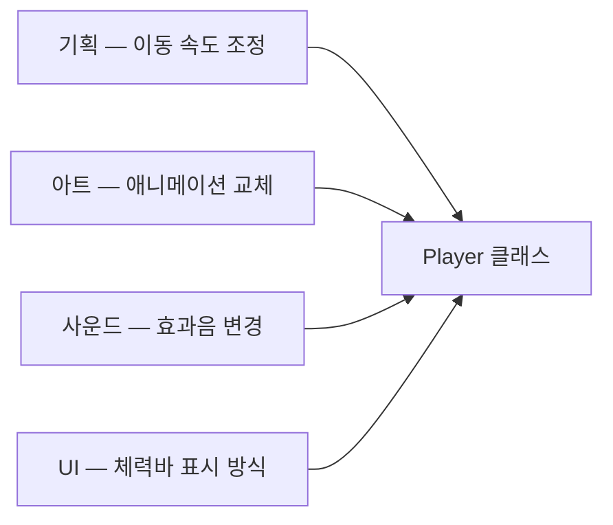

# 단일 책임 원칙 (Single Responsibility Principle)

## 핵심 개념

- **단일 책임 원칙(SRP)**: 클래스는 **바뀌어야 할 이유가 하나뿐**이어야 함
- [[SOLID]]의 S에 해당함
- "기능을 하나만 가져라"가 아님. 메서드가 여러 개여도, 그것들이 **같은 이유로 함께 바뀐다면** 하나의 책임임
- 더 정확한 표현은 "하나의 **액터**(변경을 요구하는 주체)에 대해서만 책임진다"임

## 책임은 "누가 고쳐달라고 하는가"로 판단함

- 클래스를 수정하게 만드는 요구가 어디서 오는지 나열해 보면 책임이 보임
- 서로 다른 사람이나 이유가 같은 클래스를 고치게 만든다면 책임이 섞인 것임

- 위처럼 한 클래스에 변경 요청이 네 방향에서 들어오면, 하나를 고칠 때 나머지 셋이 깨질 위험을 매번 짊어짐
- 변경 이유별로 나누면 각 수정이 자기 클래스 안에서 끝남

## 위반 신호

| 신호 | 의미 |
| --- | --- |
| 클래스가 수백~수천 줄로 커짐 | 여러 책임이 한곳에 쌓임 (God Class) |
| 이름에 `And`, `Manager`, `Handler`가 붙고 뭘 하는지 한 문장으로 설명이 안 됨 | 책임의 경계가 없음 |
| A를 고쳤는데 무관한 B가 깨짐 | 서로 다른 책임이 같은 상태를 공유함 |
| 협업 시 같은 파일에서 충돌이 자주 남 | 여러 사람의 변경이 한 파일로 모임 |
| 일부만 테스트하고 싶은데 전체를 준비해야 함 | 책임이 분리되지 않아 떼어낼 수 없음 |

## 너무 잘게 나누면 반대 문제가 생김

- 책임을 지나치게 쪼개면 **하나의 기능을 바꾸려고 여러 파일을 동시에 고쳐야** 함 (산탄총 수술, Shotgun Surgery)
- 이것도 "변경 이유"를 기준으로 보면 판단할 수 있음
  - 같은 이유로 **항상 함께 바뀌는 것**은 같은 클래스에 둠
  - **따로 바뀌는 것**은 나눔
- 목표는 클래스를 작게 만드는 것이 아니라, **한 번의 변경이 한 곳에서 끝나게** 하는 것임

## 응집도와의 관계

- 단일 책임 원칙을 지키면 **응집도(Cohesion)**가 높아짐. 클래스 안의 요소들이 같은 목적을 향함
- 반대로 클래스 사이의 **결합도(Coupling)**는 낮아짐. 하나를 바꿔도 다른 클래스에 덜 퍼짐
- "응집도는 높게, 결합도는 낮게"를 클래스 단위에서 구체화한 원칙이라고 볼 수 있음

## 게임 개발 관점에서

**유니티 컴포넌트 구조와 맞닿아 있음**

- 유니티는 기능을 컴포넌트로 나눠 하나의 오브젝트에 붙이는 구조임
- 이동, 체력, 공격, 애니메이션 제어를 각각의 컴포넌트로 두면 자연스럽게 책임이 나뉨
- 다만 컴포넌트가 늘수록 서로를 찾고 연결하는 코드도 늘어남. 나눈 만큼 연결 비용이 생김

**처음부터 나누기보다, 고치기 어려워질 때 나누는 기준**

- 처음에는 한 클래스에 몰아서 짜는 것이 빠르고 흐름도 잘 보임
- "이걸 고치려는데 왜 저것까지 신경 써야 하지?"라는 순간이 분리할 시점임
- 이유를 겪은 뒤에 나눈 구조가, 예상만으로 미리 나눈 구조보다 맞을 가능성이 높음

**면접에서 설명할 때**

- 정의보다 "어떤 클래스가 어떤 이유들로 바뀌었고, 어떻게 나눴더니 무엇이 편해졌는지"를 경험으로 말할 수 있는 것이 중요함

## 의문점 / 더 알아볼 것

- 응집도의 종류 — 기능적, 순차적, 우연적 응집도
- 산탄총 수술과 확산적 변경(Divergent Change) — 단일 책임 위반의 두 방향
- 유니티에서 컴포넌트를 나눈 뒤 서로 통신하는 방법 — 직접 참조, 이벤트, 인터페이스
- 리팩토링 기법 — 클래스 추출(Extract Class), 메서드 이동(Move Method)
- 데이터와 동작을 분리하는 설계(ECS)에서 책임을 나누는 방식
