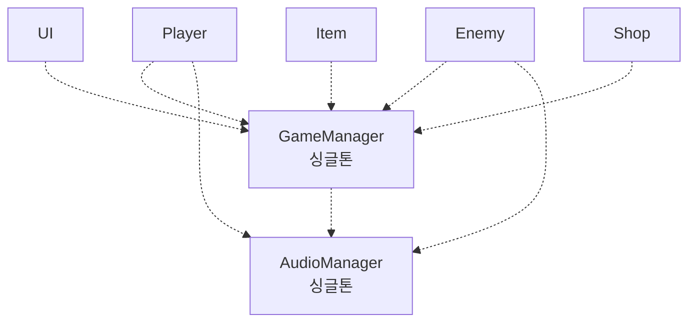

# 싱글톤 패턴의 문제점 (Singleton Pattern)

## 핵심 개념

- **싱글톤 패턴**: 클래스의 인스턴스를 **하나만** 만들고, 그 인스턴스에 **어디서나 접근**할 수 있게 하는 패턴
- 두 가지 성질을 함께 가짐
  - 유일성 — 인스턴스가 하나뿐임
  - 전역 접근 — 어느 코드에서든 바로 꺼내 쓸 수 있음
- 유니티에서 게임 매니저, 사운드 매니저, UI 매니저를 만들 때 가장 먼저 배우는 패턴임
- 편한 만큼 남용되기 쉬워서 **안티 패턴**이라는 비판도 많이 받음. 문제의 대부분은 "유일성"이 아니라 **"전역 접근"**에서 나옴

## 문제 1 — 의존성이 숨음

- 클래스 선언(필드, 생성자)만 봐서는 무엇에 의존하는지 알 수 없음. 메서드 안쪽 어딘가에서 전역으로 꺼내 쓰기 때문임
- 위처럼 의존 관계가 그물처럼 얽혀도 코드에서는 드러나지 않음
- 하나를 고치면 어디까지 영향이 가는지 추적하기 어려움
- 의존성을 밖에서 넣어 받는 [[Dependency Injection]]과 정반대 방향임

## 문제 2 — 전역 상태

- 어느 코드에서든 싱글톤의 값을 바꿀 수 있음
- 값이 이상해졌을 때 **누가 언제 바꿨는지** 찾으려면 프로젝트 전체를 뒤져야 함
- 전역 변수의 문제를 그대로 가지고 있음. 객체 모양을 했을 뿐임

## 문제 3 — 교체와 테스트가 어려움

- 쓰는 쪽이 **구체 클래스에 직접 묶임**. 다른 구현으로 바꾸려면 쓰는 곳을 전부 고쳐야 함
- 테스트할 때 가짜 객체로 갈아 끼울 수 없음
- 싱글톤의 상태가 테스트 사이에 남아 있어, 테스트 순서에 따라 결과가 달라짐
- [[SOLID]]의 의존성 역전 원칙과 충돌함

## 문제 4 — 책임이 계속 불어남

- 어디서나 접근되니 "일단 매니저에 넣자"가 쉬워짐
- 시간이 지나면 게임 매니저가 점수, 저장, 씬 전환, 일시정지, 설정까지 다 맡는 거대 클래스가 됨
- [[Single Responsibility Principle]] 위반의 대표적인 경로임

## 유니티에서 특히 생기는 문제

**초기화 순서**

- 여러 오브젝트의 `Awake` 실행 순서는 보장되지 않음
- 다른 스크립트의 `Awake`에서 싱글톤에 접근했는데, 싱글톤 쪽 `Awake`가 아직 안 돌아서 인스턴스가 비어 있는 경우가 생김
- 실행 순서 설정으로 강제할 수는 있지만, 싱글톤이 늘수록 순서 관리가 복잡해짐. [[Unity Lifecycle]] 참고

**씬을 넘나드는 수명**

- 씬이 바뀌어도 유지하려고 `DontDestroyOnLoad`를 쓰는 경우가 많음
- 씬에 미리 배치해 둔 싱글톤이 있으면, 그 씬에 다시 들어올 때마다 **하나가 더 생김**. 중복 제거 처리가 필요함
- 싱글톤이 이전 씬의 오브젝트를 참조하고 있으면 그 오브젝트가 회수되지 않음. [[Memory leak]] 참고

**종료 시점의 유령 인스턴스**

- 접근할 때 없으면 자동으로 만들어 주는 방식(지연 생성)을 쓰면, 게임 종료나 씬 정리 중에 다른 오브젝트가 접근해서 **이미 파괴된 싱글톤을 새로 만들어 버리는** 경우가 생김
- 플레이를 멈췄는데 씬에 정체불명의 오브젝트가 남는 현상이 이것임

**정적 참조가 플레이 사이에 남는 경우**

- 플레이 진입 속도를 높이려고 도메인 리로드를 끄면, static 필드가 초기화되지 않음
- 이전 플레이의 파괴된 인스턴스를 가리킨 채로 다음 플레이가 시작되는 문제가 생김

## 그래도 쓰는 경우

- **정말로 하나여야 하고**, 상태가 적거나 없고, 수명이 프로그램 전체와 같은 것
  - 로그 출력, 설정 조회처럼 읽기 위주인 것
- 프로토타입처럼 구조보다 속도가 중요한 단계
- 쓰더라도 상태를 최소화하고, 쓰기보다 읽기 위주로 두면 문제가 줄어듦

## 대안

| 대안 | 방식 |
| --- | --- |
| 의존성 주입 | 필요한 쪽에 넣어 줌. 유니티에서는 인스펙터 할당이 가장 간단한 형태 |
| ScriptableObject | 공유 데이터나 이벤트 채널을 에셋으로 두고 필요한 쪽이 참조함. [[Scriptable Object]] |
| 이벤트 | 매니저를 직접 부르는 대신 일어난 일을 알리고, 관심 있는 쪽이 반응함 |
| 정적 클래스 | 상태 없는 순수 기능(수학 계산 등)이라면 인스턴스 자체가 필요 없음 |

- 핵심은 **유일성과 전역 접근을 분리**하는 것임. 인스턴스가 하나인 것은 문제가 아님. 아무나 어디서나 꺼내 쓰는 것이 문제임

## 의문점 / 더 알아볼 것

- 서비스 로케이터 — 싱글톤과 무엇이 다르고 무엇이 같은가
- `Lazy<T>` — 멀티스레드 환경에서 안전한 지연 생성
- 유니티 실행 순서 설정(Script Execution Order)과 그 한계
- Enter Play Mode Options와 도메인 리로드
- 정적 클래스와 싱글톤의 차이 — 인터페이스 구현, 상속, 수명 제어