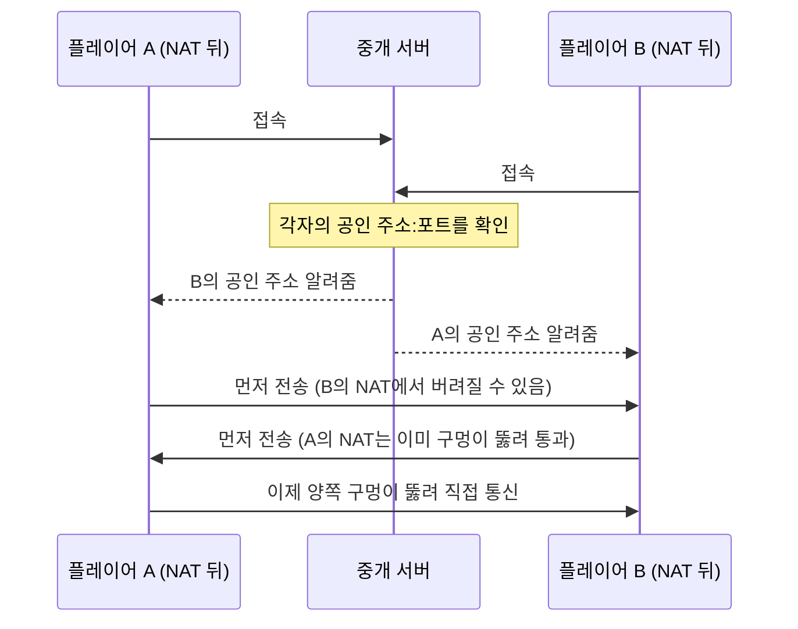

# UDP 홀 펀칭 (UDP Hole Punching)

## 핵심 개념

- **UDP 홀 펀칭**: 각자 공유기(NAT) 뒤에 있는 두 기기가 **서버를 거치지 않고 직접 통신**할 수 있게 만드는 기법
- 양쪽이 **동시에 상대에게 먼저 패킷을 보내서**, 각자의 NAT에 상대의 패킷이 들어올 수 있는 "구멍"을 뚫음
- P2P 멀티플레이 게임에서 서버 비용을 줄이고 지연을 낮추기 위해 씀

## 문제 — NAT는 바깥에서 먼저 오는 패킷을 막음

- 집이나 회사의 기기는 대부분 **사설 IP**를 쓰고, 공유기(NAT)가 하나의 **공인 IP**로 바꿔서 인터넷에 내보냄
- 내부 기기가 바깥으로 패킷을 보내면, NAT는 "내부 주소:포트 ↔ 공인 주소:포트" 짝을 **매핑 테이블**에 기록함
- 바깥에서 들어오는 패킷은 **이 기록이 있을 때만** 내부로 전달됨
- 즉 **내가 먼저 보낸 상대의 응답만** 들어올 수 있음. 바깥에서 먼저 오는 패킷은 버려짐

```
내부 기기 192.168.0.5:5000
        │  나가는 패킷
        ▼
NAT 매핑 기록:  192.168.0.5:5000  ↔  공인 211.x.x.x:40001
        │
        ▼
인터넷 — 211.x.x.x:40001로 오는 응답만 내부로 전달됨
```

- 두 기기가 모두 NAT 뒤에 있으면, **서로 먼저 보내지 않은 상태라 둘 다 막힘**. 이것이 P2P 연결의 근본 문제임

## 절차



1. 두 기기가 모두 **중개 서버**에 접속함. 서버는 각자의 **공인 주소와 포트**를 알게 됨
2. 서버가 서로의 공인 주소를 **교환**해 줌
3. 두 기기가 **거의 동시에** 상대의 공인 주소로 패킷을 보냄
4. 내가 상대에게 보낸 순간, **내 NAT에 상대 주소에 대한 기록**이 생김. 이것이 구멍임
5. 첫 패킷은 상대 NAT에 아직 구멍이 없어 버려질 수 있지만, 양쪽에 구멍이 생기면 이후 패킷은 서로 통과함

- 중개 서버는 **처음 주소를 교환할 때만** 필요하고, 이후 게임 데이터는 직접 오감

## 왜 UDP인가

- UDP는 연결이라는 개념 없이 패킷을 보내기만 하므로, NAT에 기록만 있으면 바로 통과함
- TCP는 연결을 맺는 과정(3단계 핸드셰이크)이 있어, 양쪽이 동시에 연결을 시작해야 하는 등 조건이 까다로워 **성공률이 낮음**
- 게임 실시간 통신은 원래 UDP를 많이 쓰므로 궁합도 좋음

## NAT 종류에 따른 성공 여부

| NAT 종류 | 동작 | 홀 펀칭 |
| --- | --- | --- |
| Full Cone | 한 번 매핑되면 누구의 패킷이든 통과 | 쉬움 |
| Restricted Cone | 내가 보낸 적 있는 **IP**에서 온 패킷만 통과 | 가능 |
| Port Restricted Cone | 내가 보낸 적 있는 **IP와 포트**에서 온 패킷만 통과 | 가능 |
| Symmetric | **목적지마다 다른 공인 포트**를 씀 | **대부분 실패** |

**Symmetric NAT가 문제인 이유**

- 서버에 보낼 때 쓴 공인 포트와, 상대에게 보낼 때 쓰는 공인 포트가 **다름**
- 서버가 상대에게 알려준 포트는 이미 쓸모없는 정보가 됨. 상대는 엉뚱한 포트로 보내게 됨
- 양쪽 중 한쪽만 Symmetric이면 경우에 따라 가능하지만, 양쪽 모두라면 거의 불가능함

## 실패했을 때 — 중계 서버

- 홀 펀칭이 실패하면 **중계(릴레이) 서버를 거쳐** 통신함
- 직접 연결보다 지연이 늘고 서버 비용이 들지만, 연결 자체는 보장됨
- 관련 표준 기술들

| 기술 | 역할 |
| --- | --- |
| STUN | 서버에 물어 **내 공인 주소와 NAT 종류**를 알아냄 |
| TURN | 직접 연결이 안 될 때 데이터를 **중계**함 |
| ICE | 가능한 경로 후보(직접, 홀 펀칭, 중계)를 모아 **가장 좋은 것**을 고름 |

## 연결 유지

- NAT의 매핑 기록은 **일정 시간 패킷이 없으면 지워짐**. 구멍이 다시 막힘
- 게임 중 데이터가 끊기는 구간이 있어도 연결을 유지하려면, 주기적으로 작은 패킷(Keep-alive)을 보내야 함

## 게임 개발 관점에서

**P2P의 장단점**

| 장점 | 단점 |
| --- | --- |
| 전용 서버 비용이 들지 않음 | 상대의 IP가 노출됨 |
| 서버를 거치지 않아 지연이 낮을 수 있음 | 판정을 한쪽이 맡으면 조작(치트)에 취약함 |
| 격투 게임, 소규모 협동 게임에 적합 | 호스트가 나가면 게임이 끊기거나 호스트 이전이 필요함 |

**직접 구현하는 경우는 드묾**

- 게임 엔진의 네트워크 솔루션이나 플랫폼 서비스(스팀 등)가 NAT 통과와 중계 서버를 **대신 처리**해 주는 경우가 많음
- 원리를 알면 "특정 사용자끼리만 연결이 안 된다", "어떤 경우엔 지연이 크다" 같은 문제의 원인을 이해할 수 있음

**연결 실패 원인**

- 통신사가 NAT를 한 번 더 거는 환경(CGNAT)이나 공유기를 두 개 겹쳐 쓴 환경에서는 홀 펀칭이 더 어려워짐
- 그래서 실서비스에서는 **중계 서버를 반드시 대비책으로 둠**

## 의문점 / 더 알아볼 것

- TCP 홀 펀칭과 동시 연결(Simultaneous Open)
- CGNAT와 이중 NAT 환경
- IPv6 환경에서는 NAT가 없는데도 연결이 막히는 이유 — 방화벽
- 같은 공유기 안의 두 기기끼리 연결할 때의 문제 (헤어핀 NAT)
- WebRTC가 ICE로 연결을 맺는 과정
- TCP와 UDP의 차이, 게임에서 UDP 위에 신뢰성을 직접 구현하는 방식