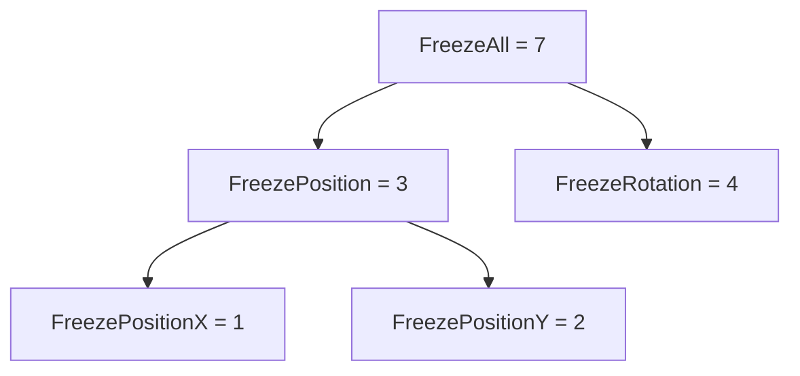

# 플래그 열거형 (Flags Enum)

## 핵심 개념

- **플래그 열거형**: 각 값이 **비트 하나씩**을 차지하도록 정의해서, 여러 값을 **동시에** 담을 수 있게 만든 열거형
- 일반 열거형은 "여러 개 중 하나"지만, 플래그 열거형은 "여러 개 중 몇 개든"임
- `[Flags]` 어트리뷰트를 붙여 의도를 표시함
- [[LayerMask]]와 같은 원리임. LayerMask는 `int`, 플래그 열거형은 **이름이 붙은 타입**이라는 차이만 있음

## RigidbodyConstraints2D의 구조

```
비트 위치         2         1         0
                Rotation  PositionY PositionX

FreezePositionX   0         0         1     = 1
FreezePositionY   0         1         0     = 2
FreezeRotation    1         0         0     = 4
```

- 단일 플래그는 2의 거듭제곱(1, 2, 4, 8 ...)이라 비트가 겹치지 않음
- **조합 값**도 미리 정의돼 있음



- `FreezePosition`은 독립된 값이 아니라 **X와 Y를 합친 것**임. 이 점이 검사할 때 함정이 됨

## 연산 정리

| 목적 | 연산 | 의미 |
| --- | --- | --- |
| 덮어쓰기 | `c = A \| B` | 기존 값 무시하고 A, B만 켬 |
| 추가 | `c \|= A` | 기존 값 유지하고 A를 켬 |
| 제거 | `c &= ~A` | 기존 값 유지하고 A만 끔 |
| 토글 | `c ^= A` | A가 켜져 있으면 끄고, 꺼져 있으면 켬 |
| 하나라도 켜짐? | `(c & A) != 0` | A의 비트 중 **하나라도** 켜져 있음 |
| 전부 켜짐? | `(c & A) == A` | A의 비트가 **모두** 켜져 있음 |
| 전부 끄기 | `c = None` | 0으로 초기화 |

## 흔한 실수

**1. 추가하려다 덮어씀**

- 가장 흔함. `=`와 `|=`를 혼동하는 것임

```
현재 상태: FreezeRotation (회전 고정)

c = FreezePositionX       → 회전 고정이 풀림 (X만 남음)
c |= FreezePositionX      → 회전 고정 유지 + X 고정 추가
```

- 회전을 고정해 둔 캐릭터에 위치 고정을 걸었더니 갑자기 넘어지기 시작했다면 이 경우임

**2. 조합 값을 "하나라도"로 검사함**

- `FreezePosition`은 X|Y(=3)라서 검사 방식에 따라 결과가 달라짐

```
현재 상태: FreezePositionX 만 켜짐 (= 1)

(c & FreezePosition) != 0         → true   X가 켜져 있으니까
(c & FreezePosition) == FreezePosition  → false  Y는 꺼져 있으니까
```

- "위치가 완전히 고정됐나"를 물으려면 `==` 쪽을 써야 함
- 단일 플래그(`FreezePositionX`)를 검사할 때는 두 방식의 결과가 같아서 차이가 안 드러나다가, 조합 값에서 처음 문제가 됨

**3. 괄호 누락**

- C#에서 `&`는 `==`, `!=`보다 우선순위가 낮음
- `c & A != 0`은 `c & (A != 0)`으로 해석되어 컴파일 에러가 남. 항상 `(c & A)`를 괄호로 묶을 것

**4. 제거할 때 `~` 빠뜨림**

- `c &= A`는 "A만 남기고 나머지 전부 끄기"가 됨. 제거는 반드시 `c &= ~A`

## HasFlag

```
c.HasFlag(FreezePosition)    // (c & FreezePosition) == FreezePosition 과 같은 의미
```

- **"전부 켜짐"** 의미임. 이름만 보고 "하나라도"로 오해하기 쉬움
- `HasFlag(None)`은 항상 `true`. 0은 모든 값의 부분집합이기 때문임
- 런타임 환경에 따라 박싱이 생길 수 있음. 매 프레임 도는 코드에서는 비트 연산을 직접 쓰는 것이 안전함

## 직접 정의할 때의 규칙

- 단일 값은 반드시 **2의 거듭제곱**으로. `1 << n` 형태로 쓰면 실수가 줄어듦
- `None = 0`을 둘 것. 아무것도 없는 상태를 표현해야 함
- 자주 쓰는 조합은 미리 이름을 붙여 둠 (`FreezePosition`처럼)
- 값을 1, 2, 3, 4로 연속해서 매기면 3이 1|2와 겹쳐 플래그로 동작하지 않음. 가장 흔한 정의 실수임

**`[Flags]`가 하는 일**

- 비트 연산 자체는 `[Flags]` 없이도 됨. 어트리뷰트는 **연산을 가능하게 하는 게 아님**
- `ToString()`이 `"FreezePositionX, FreezeRotation"`처럼 조합을 이름으로 보여줌. 없으면 숫자 `5`가 나옴
- 최근 유니티 인스펙터는 `[Flags]` 열거형을 다중 선택 드롭다운으로 표시함
- 무엇보다 "이 열거형은 조합해서 쓴다"는 **의도를 코드에 남기는 표시**임

## 게임 개발 관점에서

**상태를 덮어쓰지 말고 더하고 빼는 습관**

- 물리 제약, 상태 이상, 입력 잠금처럼 여러 시스템이 같은 값을 건드리는 경우가 많음
- 한 시스템이 `=`로 덮어쓰면 다른 시스템이 걸어둔 플래그가 조용히 사라짐
- 각자 자기 플래그만 `|=`로 켜고 `&= ~`로 끄면 서로 간섭하지 않음

**응용처**

- 상태 이상 — 기절, 침묵, 속박이 동시에 걸릴 수 있음
- 아이템 속성 — 화염·냉기·독 속성이 겹칠 수 있음
- 입력 잠금 — 이동 잠금, 공격 잠금, 점프 잠금을 따로 켜고 끔
- `bool` 필드 여러 개를 쓰는 것보다 저장·비교·전달이 간단함

**한계**                

- 비트 수만큼만 담을 수 있음. 기본 `int`면 32개
- 같은 플래그를 두 시스템이 동시에 켰다가 한쪽이 끄면, 다른 쪽 의도와 상관없이 꺼짐. 이런 경우는 플래그 대신 카운터(몇 개의 이유로 잠겼는가)가 필요함

## 의문점 / 더 알아볼 것

- 열거형의 기반 타입 지정 (`enum X : byte`, `: long`) — 비트 수 확장과 메모리
- `Enum.HasFlag`가 박싱을 일으켰던 이유와 최신 런타임에서 개선된 방식
- 정의되지 않은 비트가 섞인 값을 검증하는 방법 (`Enum.IsDefined`의 한계)
- 인스펙터의 Flags 드롭다운 표시가 지원되는 유니티 버전
- 여러 시스템이 같은 플래그를 공유할 때의 참조 카운팅 방식 잠금
- `RigidbodyConstraints`(3D)는 비트 배치가 어떻게 다른가