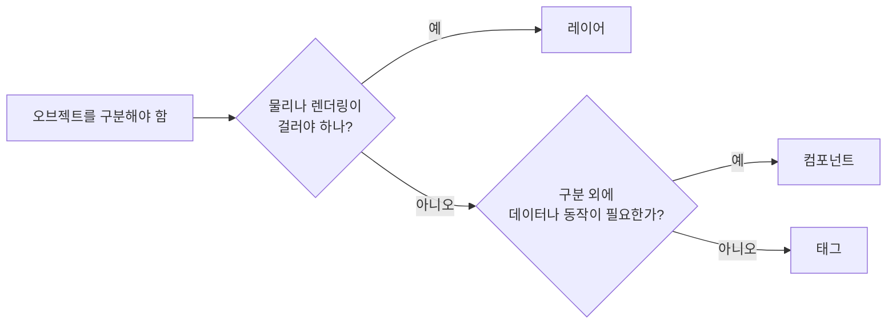

# 레이어와 태그 (Layer & Tag)

## 핵심 개념

- 둘 다 게임 오브젝트에 붙이는 **분류 라벨**이고, 오브젝트당 **하나씩만** 가질 수 있음
- 차이는 **누가 읽느냐**임
- **태그**: "이 오브젝트가 무엇인가". **내 코드가** 읽고 판별함
- **레이어**: "이 오브젝트를 어느 시스템이 어떻게 다룰까". **엔진(물리·렌더링)이** 읽고 걸러냄

| 구분 | 태그 | 레이어 |
| --- | --- | --- |
| 저장 형태 | 문자열 | 정수 (0~31) |
| 개수 | 제한 없음 | 32개 (일부는 유니티 예약) |
| 엔진이 직접 사용 | 거의 없음 | 물리, 레이캐스트, 카메라, 조명 |
| 여러 개 묶어서 다루기 | 불가 | 가능 (비트마스크) |
| 주 용도 | 코드에서 정체 확인 | 시스템 단위의 필터링 |

## 태그

**검사는 `CompareTag`로**

- `gameObject.tag == "Enemy"`처럼 비교하면 `tag` 프로퍼티가 **매번 새 문자열을 만들어** 반환함. [[GC]] 할당이 생김
- `CompareTag("Enemy")`는 할당 없이 비교함
- 또 `CompareTag`는 정의되지 않은 태그 이름을 넘기면 에러를 내서 **오타를 잡아줌**. `==`는 조용히 `false`만 반환함

**문자열이라 오타에 약함**

- `"Enemy"`와 `"enemy"`는 다른 태그임. 컴파일러가 잡아주지 못함
- 태그 이름을 상수로 한곳에 모아두면 오타를 줄일 수 있음

**특별한 의미를 가진 기본 태그**

| 태그 | 의미 |
| --- | --- |
| `MainCamera` | `Camera.main`이 이 태그로 카메라를 찾음 |
| `EditorOnly` | **빌드에서 제외됨**. 에디터 전용 도우미 오브젝트에 씀 |
| `Player`, `Respawn`, `Finish` | 관례적으로 제공될 뿐 엔진이 특별 취급하지 않음 |

- `Camera.main`이 `null`이 나오면 카메라의 태그가 `MainCamera`인지부터 확인할 것

**태그로 찾기는 비쌈**

- `FindWithTag`, `FindGameObjectsWithTag`는 씬 전체를 탐색함
- 매 프레임 호출하지 말고 시작할 때 한 번 찾아 캐싱할 것

## 레이어

**엔진 시스템이 레이어를 읽음**

| 시스템 | 레이어를 쓰는 방식 |
| --- | --- |
| 물리 충돌 | Layer Collision Matrix로 어떤 레이어끼리 충돌할지 결정 |
| 레이캐스트·오버랩 | 마스크로 검사 대상 레이어를 지정 |
| 카메라 | Culling Mask로 그릴 레이어를 지정 |
| 조명 | Culling Mask로 비출 레이어를 지정 |

- 비트마스크 원리와 번호·마스크 혼동 문제는 [[LayerMask]] 참고

**32개 제한이 있음**

- 유니티가 몇 개를 기본으로 씀 (Default, TransparentFX, Ignore Raycast, Water, UI)
- 단순 분류 목적으로 레이어를 만들기 시작하면 금방 부족해짐
- 레이어는 "엔진이 다르게 다뤄야 하는가"를 기준으로만 만들 것

**자식 오브젝트의 레이어는 따로 바뀜**

- 에디터에서 부모의 레이어를 바꾸면 "자식도 바꿀까요?"라고 물어봄
- 코드로 부모의 `layer`를 바꾸면 **자식은 그대로임**. 자식까지 바꾸려면 직접 순회해야 함
- 무기나 이펙트가 자식으로 붙어 있을 때 레이어가 어긋나 충돌이 이상해지는 원인이 됨

## 어떤 것을 써야 하나

- **레이어** — 땅만 레이캐스트로 검사, 총알끼리는 충돌 안 함, 미니맵 카메라에만 아이콘 표시
- **태그** — 부딪힌 상대가 플레이어인지 간단히 확인
- **컴포넌트** — 판별에 더해 데이터나 동작이 필요할 때

**태그 대신 컴포넌트로 판별하는 방식**

- 태그는 오브젝트당 하나라서 "적이면서 동시에 피격 가능하고 불에 탐" 같은 여러 분류를 담을 수 없음
- 대신 특정 컴포넌트나 인터페이스를 가지고 있는지(`TryGetComponent`)로 판별하는 방식이 실무에서 많이 쓰임
- 문자열 오타가 없고, 판별과 동시에 그 컴포넌트를 바로 쓸 수 있음

## 게임 개발 관점에서

**태그로 땅을 판정하려다 막히는 경우**

- 처음에 바닥에 `Ground` 태그를 달고 충돌 콜백에서 태그를 확인하는 방식으로 시작하는 경우가 많음
- 그런데 레이캐스트나 오버랩으로 바닥을 검사하려 하면 **태그로는 필터를 걸 수 없음**. 질의는 레이어 마스크만 받음
- 결국 바닥은 레이어로 분리하게 됨. 처음부터 레이어로 두는 편이 나음

**둘을 함께 쓰는 경우도 많음**

- 레이어로 "적 레이어"를 걸러서 레이캐스트한 뒤, 맞은 대상 중 보스만 태그로 구분하는 식
- 엔진 필터는 레이어로 크게 거르고, 세부 구분은 코드에서 함

## 의문점 / 더 알아볼 것

- 태그·레이어 설정이 저장되는 위치 (`TagManager.asset`)와 협업 시 충돌 문제
- `Camera.main`의 내부 동작과 최신 버전에서의 캐싱 개선
- Sorting Layer와 레이어의 차이 — 2D 렌더 순서용 별도 시스템
- URP/HDRP의 Rendering Layer Mask — 32개 레이어를 렌더링 용도로 쓰지 않아도 되는 방법
- 컴포넌트 기반 판별에서 인터페이스를 쓰는 방식과 `TryGetComponent`의 비용