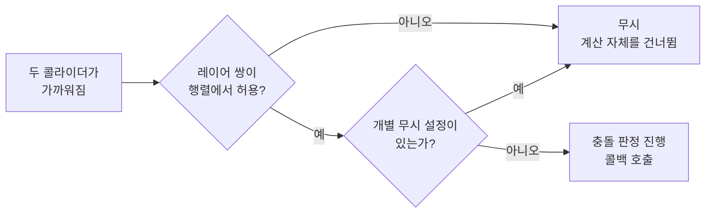

# 레이어 충돌 행렬 (Layer Collision Matrix)

## 핵심 개념

- **레이어 충돌 행렬**: **어떤 레이어끼리 충돌할지**를 레이어 쌍마다 정해 두는 표
- Project Settings의 물리 설정에 있음
- 체크가 꺼진 레이어 쌍은 **서로 통과하고, 충돌 콜백과 트리거 콜백도 일어나지 않음**
- 레이어 자체에 대한 설명은 [[Layer & Tag]], 비트마스크 원리는 [[LayerMask]] 참고

## 구조

```
              Default  Player  Enemy  PBullet  EBullet
Default         ✓       ✓       ✓       ✓        ✓
Player                  ✗       ✓       ✗        ✓
Enemy                           ✓       ✓        ✗
PBullet                                 ✗        ✗
EBullet                                          ✗
```

- 레이어 32개 × 32개의 표임
- **A와 B의 충돌은 B와 A의 충돌과 같으므로** 절반만 표시됨 (삼각형 모양)
- 각 레이어는 개념적으로 "충돌하는 상대 레이어들"을 비트마스크 하나로 가짐. 두 콜라이더의 충돌 여부는 비트 연산 한 번으로 판정됨

## 판정 흐름



- 행렬에서 걸러진 쌍은 **정밀한 충돌 계산까지 가지 않음**. 그래서 성능 최적화 수단이 됨

## 2D와 3D는 따로임

- 3D 물리(Physics)와 2D 물리(Physics 2D)는 **각자의 행렬**을 가짐
- 2D 게임인데 3D 쪽 행렬을 고쳐 놓고 "왜 안 되지"를 겪는 경우가 많음
- 2D 프로젝트라면 반드시 **Physics 2D** 설정의 행렬을 수정할 것

## 행렬이 영향을 주는 것과 주지 않는 것

| 대상 | 행렬의 영향 |
| --- | --- |
| 물리 충돌 (밀어내기) | 받음 |
| 충돌 콜백 (`OnCollisionEnter` 계열) | 받음 |
| 트리거 콜백 (`OnTriggerEnter` 계열) | 받음 |
| 레이캐스트, 오버랩 같은 물리 질의 | **받지 않음**. 넘겨준 레이어 마스크를 따름 |

- 레이캐스트는 행렬과 무관하게 **호출할 때 넘긴 마스크**로 대상을 정함. [[Cast & Overlap]] 참고
- 질의에도 행렬과 같은 기준을 적용하고 싶다면, 특정 레이어가 충돌하는 상대 레이어 마스크를 가져와 질의에 넘기는 방법이 있음

## 코드로 바꾸기

| 범위 | 방법 |
| --- | --- |
| 레이어 쌍 전체 | 두 레이어 간 충돌을 무시하도록 설정하는 API |
| 특정 콜라이더 두 개만 | 두 콜라이더 간 충돌만 무시하도록 설정하는 API |
| 오브젝트 하나의 소속 변경 | 오브젝트의 레이어를 다른 레이어로 바꿈 |

- 레이어 쌍 설정은 **전역**임. 그 레이어의 모든 오브젝트에 영향을 줌
- 특정 오브젝트 하나만 잠깐 통과시키고 싶을 때는 레이어 쌍 설정보다 **오브젝트의 레이어를 바꾸거나 개별 무시 설정**이 맞음
- 최근 버전은 콜라이더나 리지드바디마다 포함·제외할 레이어를 따로 지정하는 기능도 있음

## 주의할 점

**새 레이어는 모든 레이어와 충돌하는 상태로 시작함**

- 레이어를 새로 만들면 행렬에서 모든 칸이 켜진 채로 추가됨
- 레이어를 만든 뒤 행렬을 확인하지 않으면 의도하지 않은 충돌이 그대로 남음

**레이어를 바꿔도 자식은 그대로임**

- 코드로 부모 오브젝트의 레이어를 바꾸면 자식 오브젝트의 레이어는 바뀌지 않음
- 자식에 콜라이더가 있다면 자식들도 함께 바꿔야 함. [[Layer & Tag]] 참고

## 게임 개발 관점에서

**대표적인 설정 예**

| 레이어 쌍 | 설정 | 이유 |
| --- | --- | --- |
| 플레이어 ↔ 플레이어 총알 | 끔 | 자기 총알에 맞지 않게 |
| 적 ↔ 적 총알 | 끔 | 적끼리 맞지 않게 |
| 총알 ↔ 총알 | 끔 | 총알끼리 부딪힐 필요 없음 |
| 이펙트 ↔ 전부 | 끔 | 시각 효과용 콜라이더가 판정에 끼지 않게 |
| 아이템 ↔ 적 | 끔 | 적이 아이템을 줍거나 밀지 않게 |
| 적 ↔ 적 | 상황에 따라 | 겹쳐도 되면 끄고, 서로 밀어내야 하면 켬 |

**코드의 예외 처리를 줄여줌**

- 행렬을 쓰지 않으면 충돌 콜백 안에서 "자기 총알이면 무시" 같은 조건 검사를 계속 해야 함
- 행렬로 미리 걸러두면 콜백에는 **의미 있는 충돌만** 들어옴. 코드가 단순해지고 실수가 줄어듦

**성능 최적화 수단**

- 오브젝트가 많은 게임(탄막, 대량의 적)에서는 충돌 후보 쌍의 수가 성능을 좌우함
- 필요 없는 조합을 꺼두는 것만으로 물리 계산이 눈에 띄게 줄어듦

**일시적인 통과 처리**

- 대시 중 적을 통과하거나 피격 직후 무적 시간처럼 잠깐 충돌을 끄는 처리는, 전용 레이어로 옮겼다가 되돌리는 방식이 흔함

## 의문점 / 더 알아볼 것

- 브로드 페이즈와 내로우 페이즈 — 행렬이 어느 단계에서 쌍을 걸러내는가
- 콜라이더·리지드바디별 레이어 덮어쓰기(Layer Overrides) 기능의 지원 버전과 우선순위
- 일방통행 발판 — 행렬 대신 Platform Effector를 쓰는 경우
- 32개 레이어가 부족할 때 물리 그룹을 나누는 방법