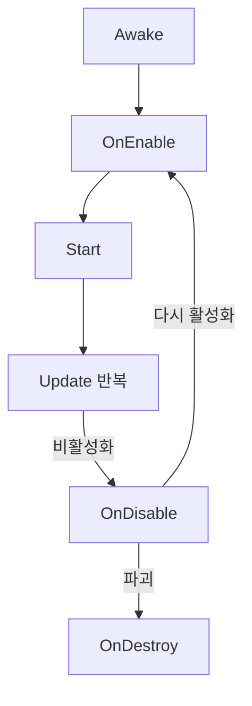

# OnDisable (OnDisable)

## 핵심 개념

- **OnDisable**: 컴포넌트가 **비활성화되는 순간** 유니티가 자동으로 호출하는 생명주기 메서드
- 짝은 **OnEnable**임. 켜질 때 OnEnable, 꺼질 때 OnDisable
- 한 번만 불리는 Awake·Start와 달리, **켜졌다 꺼질 때마다 반복해서** 호출됨
- 꺼지기 전에 정리해야 할 일(구독 해제, 상태 초기화)을 넣는 자리임

## 호출되는 시점

| 상황 | 호출 여부 |
| --- | --- |
| 컴포넌트의 `enabled`를 false로 바꿈 | 호출됨 |
| 게임 오브젝트를 `SetActive(false)` | 호출됨 |
| 부모 오브젝트가 비활성화됨 | 자식의 활성 컴포넌트 전부 호출됨 |
| 오브젝트가 파괴됨 | **OnDestroy 직전**에 호출됨 |
| 씬이 언로드됨, 게임 종료 | 호출됨 |
| 에디터에서 스크립트 재컴파일 | 호출됨 (이후 OnEnable 다시 호출) |

- **이미 꺼져 있던 컴포넌트**는 다시 꺼질 일이 없으므로 호출되지 않음. 파괴될 때도 마찬가지임
- 즉 OnDisable은 "켜져 있던 것이 꺼질 때"만 불림

- Start는 처음 한 번만 실행되므로, 다시 켜질 때는 OnEnable → Update로 바로 감. [[Unity Lifecycle]] 참고

## 비활성화되면 멈추는 것

| 대상 | `enabled = false` | `SetActive(false)` |
| --- | --- | --- |
| Update 계열 | 멈춤 | 멈춤 |
| 코루틴 | **계속 돎** | **전부 중단됨** |
| 충돌·트리거 이벤트 | 콜라이더는 그대로라 오브젝트 기준으로 동작할 수 있음 | 멈춤 |

- 코루틴은 컴포넌트가 아니라 **게임 오브젝트의 활성 상태**에 묶여 있음. 컴포넌트만 끄면 코루틴은 멈추지 않음 주의
- 오브젝트를 끄면 코루틴은 중단되고, 다시 켜도 **자동으로 재시작되지 않음**. 필요하면 OnEnable에서 다시 시작해야 함. [[Coroutine]] 참고

## 주로 하는 일

**이벤트 구독 해제**

- OnEnable에서 구독하고 OnDisable에서 해제하는 것이 기본 짝임
- 꺼진 오브젝트가 계속 이벤트를 받는 문제, 파괴된 오브젝트를 이벤트가 붙잡고 있는 누수를 막음. [[Event & Pub-Sub Pattern]], [[Memory leak]] 참고
- Awake·Start에서 구독하고 OnDestroy에서 해제하면, **꺼져 있는 동안에도 이벤트를 받음** 주의

**상태 정리·초기화**

- 진행 중이던 연출, 타이머, 입력 상태를 정리함
- 다시 켜졌을 때 이전 상태가 남아 있지 않게 함

**입력 액션 끄기**

- Input System의 액션을 OnEnable에서 켜고 OnDisable에서 끄는 방식이 일반적임. [[Input System]] 참고

## 주의할 점

**오브젝트 간 호출 순서는 보장되지 않음**

- 여러 오브젝트가 동시에 꺼질 때 누구의 OnDisable이 먼저 불릴지 알 수 없음
- 다른 오브젝트가 아직 살아 있다고 가정하고 접근하면, 이미 꺼졌거나 파괴 중일 수 있음

**OnDisable 안에서 계층 구조를 바꾸면 에러**

- 비활성화 처리 도중 부모를 바꾸거나 다른 오브젝트를 켜고 끄면 "활성화·비활성화 중에는 계층을 바꿀 수 없다"는 에러가 날 수 있음

**종료 시 오브젝트 생성 금지**

- 게임 종료나 씬 언로드 때도 OnDisable이 불리므로, 여기서 새 오브젝트를 생성하면 정리되지 않은 오브젝트가 남았다는 경고가 뜸
- 생성이 필요한 로직은 "정말 게임 중에 꺼진 것인가"를 구분해야 함

**OnDestroy와 역할 구분**

| 구분 | OnDisable | OnDestroy |
| --- | --- | --- |
| 호출 횟수 | 꺼질 때마다 여러 번 | 파괴될 때 한 번 |
| 짝 | OnEnable | Awake |
| 적합한 일 | 켜져 있는 동안만 필요한 것의 정리 | 생애 전체에 걸친 자원의 해제 |

## 게임 개발 관점에서

**오브젝트 풀링과 가장 밀접함**

- 풀링된 오브젝트는 파괴되지 않고 꺼졌다 켜지기를 반복하므로, **OnEnable·OnDisable이 사실상 생성·파괴 역할**을 함
- Awake·Start에만 초기화를 넣으면, 재사용될 때 이전 상태(체력, 속도, 타이머)가 그대로 남는 버그가 생김
- 초기화는 OnEnable, 정리는 OnDisable에 두는 습관이 중요함. [[ObjectPooling]] 참고

**UI 창 열고 닫기**

- 인벤토리 창처럼 켜고 끄는 UI는 OnEnable에서 데이터를 갱신하고 구독하며, OnDisable에서 구독을 해제하는 구조가 흔함

## 의문점 / 더 알아볼 것

- OnEnable·OnDisable과 Awake·Start의 실행 순서가 섞이는 경우 (같은 프레임에 생성 후 바로 비활성화)
- 스크립트 실행 순서(Script Execution Order) 설정이 OnDisable에도 적용되는가
- 게임 종료 시 OnDisable과 OnApplicationQuit의 순서
- 관련 노트 — [[Instantiate & Destroy]], [[Unity Event]]